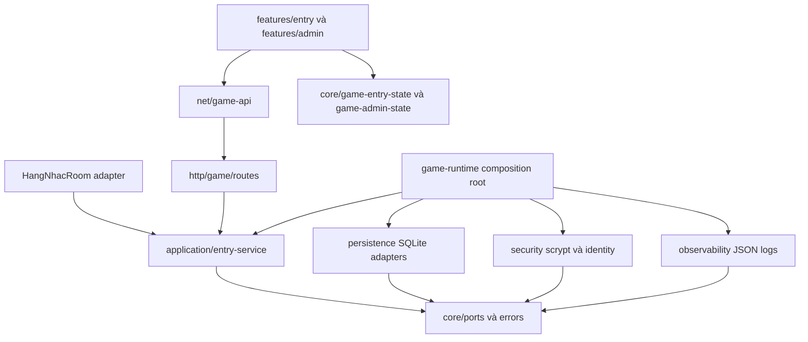

# Tài khoản, server, nhân vật và quản trị backend

**Cập nhật màn đầu 10/10:** [Tiên môn trên biển mây](GAME-TITLE-SCREEN.md) đã đặt trước entry; login/server/nhân vật dùng nền UI độc lập. API/DB/lease vẫn theo hợp đồng dưới đây. Mô tả “không tạo ART mới” trong mốc backend ban đầu không áp dụng cho ART title bổ sung này.

**Triển khai 10/10/2026 · modular monolith theo [Core](ARCHITECTURE.md).** Owner chọn tên tài khoản + mật khẩu và một trong ba mẫu nhân vật. `/hang-nhac.html` mặc định dùng luồng thật: **Đăng ký/đăng nhập → chọn server → tạo/chọn nhân vật → vào game**. Tài khoản mới không tự sinh nhân vật. Các màn dùng khung, nền và token Vân Ngọc hiện có; không tạo ART mới hoặc thay map/navigation.

## 1. Chạy và sử dụng

```powershell
npm.cmd run dev
```

- Game: `http://127.0.0.1:5173/hang-nhac.html`.
- Quản trị: `http://127.0.0.1:5173/admin.html`.
- Backend mặc định: `http://127.0.0.1:2567`; client có thể cấu hình `VITE_SERVER_URL`.

- Đăng ký tên tài khoản 3–32 ký tự ASCII chữ/số/`_ . -`; mật khẩu 12–128 ký tự. Sau đó chọn `S1 · Hằng Nhạc`, nhấn Tạo mới, chọn mẫu và đặt tên.
- Tên hồ sơ 2–24 code point chữ Unicode/số/dấu cách/`_ -`, chuẩn hóa NFC và khoảng trắng. So trùng bằng NFKC/lowercase, trong phạm vi một server.
- Mặc định 3 slot/server/tài khoản; cho tạo nhiều hồ sơ cùng mẫu. `accountId`, `realmId`, `characterId` và `avatarId` là các định danh khác nhau. Không dùng avatar làm khóa nhân vật.
- Rời game quay về danh sách nhân vật; Đổi server và Đăng xuất là thao tác riêng. Reload trong game đọc lại phiên/quyền sở hữu rồi phục hồi đúng nhân vật.
- C/I mở nhân vật/hành trang sau khi vào game. Tái sử dụng R01, NPC/HN01–HN04, thổ nạp, đồ nhập môn và vật tư thật hiện có; không thêm số liệu bonus HP/MP mẫu.

**Phiên duyệt đang chạy trong lần triển khai này:** game `http://127.0.0.1:5174/hang-nhac.html`, admin `http://127.0.0.1:5174/admin.html`, backend 2568. Tiến trình 5173/2567 cũ còn hoạt động; cơ chế duyệt tự động chặn lệnh dừng/khởi động lại, nên mở phiên mới riêng. DB được sao lưu tại `server/data/backups/pre-game-entry-1791619041298.sqlite` trước khi thêm schema. Không tạo tài khoản/nhân vật thử trong DB thật. `npm run dev` với cấu hình mặc định vẫn dùng 5173/2567 khi người vận hành khởi động lại phiên của họ.

### Tài khoản quản trị

Backend không có mật khẩu mặc định. Cấu hình đồng thời `GAME_BOOTSTRAP_ADMIN_LOGIN` và `GAME_BOOTSTRAP_ADMIN_PASSWORD` qua môi trường chạy backend, rồi khởi động backend. Mật khẩu tuân theo giới hạn ở trên; dùng giá trị riêng do người vận hành chọn, không ghi vào repo/log. Sau khi tạo, có thể bỏ hai biến khỏi môi trường và đăng nhập bằng tài khoản đó.

**Ngoại lệ quản trị local 11/10:** `GAME_LOCAL_ADMIN_SHORT_PASSWORD=1` cho phép bootstrap/đăng nhập admin bằng mật khẩu 8–128 ký tự khi backend không ở production và chỉ bind loopback (`127.0.0.1`, `localhost`, `::1`). Không áp dụng cho đăng ký/đăng nhập tài khoản người chơi; mặc định vẫn 12–128. Backend từ chối khởi động nếu bật cờ này trên production hoặc host ngoài loopback. Cần giữ cờ khi chạy local để đăng nhập admin đã tạo với mật khẩu dưới 12 ký tự; hai biến bootstrap có thể bỏ sau khi tạo. Form đăng nhập gửi mật khẩu cho backend kiểm, form đăng ký giữ tối thiểu 12. Mật khẩu và hash không đưa vào tài liệu/mã nguồn.

Bootstrap chỉ tạo **tài khoản admin mới**. Nếu tên đã là người chơi, backend từ chối nâng quyền. Nếu đã là admin, bootstrap không đổi mật khẩu. UI không có nút tự cấp quyền; admin hiện có được bảo vệ khỏi thao tác khóa tài khoản.

Quản trị có danh sách tài khoản/nhân vật, server, audit và trạng thái node. Có thể khóa/mở tài khoản người chơi, sửa tên/trạng thái/slot/quyền tạo của server và thêm server. Khóa tài khoản thu hồi các phiên đăng nhập; bảo trì kết thúc phiên chơi sau bước lưu. Không có chức năng xóa hồ sơ hoặc sửa thưởng/chỉ số gameplay.

## 2. Ranh giới Core



`shared/game/entry.ts` chứa hợp đồng và kiểm tên/luồng thuần. `EntryService` sở hữu chính sách tài khoản, quyền truy cập, tạo hồ sơ, vé chơi, lease và quản trị; không import SQLite, Express hoặc Colyseus. Repository/hasher/identity/logger là port trong `server/src/core/ports.ts`. HTTP chỉ đọc cookie/header/body và ánh xạ lỗi; room chỉ xác nhận grant và nối gameplay hiện có với `ProfilePersistence`.

Client giữ state tập trung trong Core, DOM ID trong Core, view/controls/coordinator trong feature. `GameApi` sở hữu transport và CSRF trong bộ nhớ. Entry và admin không import nhau. `scripts/check-boundaries.mjs` đăng ký các module mới và kiểm vòng phụ thuộc cùng `typecheck`.

Điểm ghép backend là `game-runtime.ts` và `index.ts`; điểm ghép game là `hang-nhac.ts`. Không đặt luật tạo nhân vật trong UI, hotbar hoặc renderer. Hotbar vẫn chỉ trình bày snapshot/callback.

## 3. Lưu dữ liệu và tương thích

`GAME_DB_PATH` mặc định `server/data/profiles.sqlite`. Kết nối dùng WAL, foreign keys và busy timeout. Nhóm bảng mới:

| Bảng | Trách nhiệm |
| --- | --- |
| `game_migrations` | Phiên bản schema tài khoản, hiện 1; từ chối phiên bản tương lai |
| `game_accounts`, `game_sessions` | Tài khoản, mật khẩu băm, quyền/trạng thái, phiên thu hồi/hết hạn |
| `game_realms`, `game_characters` | Cấu hình server, quyền sở hữu hồ sơ, tên duy nhất trên server |
| `game_create_receipts` | Tạo nhân vật có idempotency, không nhân đôi khi thử lại cùng yêu cầu |
| `game_profile_receipts` | Ledger `cast`, `sect`, `inventory`; commit receipt và profile trong một transaction |
| `game_play_tickets`, `game_play_leases` | Vé một lần và quyền điều khiển một tài khoản |
| `game_rate_windows`, `game_audit` | Giới hạn thao tác bền qua worker/restart, audit quản lý |

Profile vẫn schema 2. `persistence/profile-codec.ts` dùng chung kiểm/chuẩn hóa save cũ. Save nhân vật đăng ký dùng revision compare-and-swap; nếu revision đã đổi thì từ chối ghi đè. Lỗi transaction rollback receipt/profile; UI giữ snapshot server cuối cùng.

Các bảng khách `accounts/profiles/*_receipts`, `PRAGMA user_version=2`, token khách và khóa trình duyệt cũ **được giữ**. Nhân vật đăng ký dùng bảng mới, không tự nhận hồ sơ khách theo tên hoặc avatar. Chưa triển khai claim/import guest vào tài khoản. Không xóa DB, reset save hoặc sửa authored map để kiểm login.

Chế độ khách phục vụ hồi quy DEV qua `/hang-nhac.html?devGuest=1`. API khách và room fixture token-free chỉ mở ngoài production khi `GAME_ALLOW_GUEST` khác `0`. Người chơi mở URL thường luôn đi qua tài khoản thật. Production tắt đường khách.

## 4. Phiên, vé vào game và vòng đời

Mật khẩu dùng async scrypt `N=32768,r=8,p=3`, salt ngẫu nhiên 16 byte, kết quả 32 byte, maxmem 64 MiB; giới hạn 2 phép băm đồng thời. Lựa chọn theo một cấu hình thay thế của [OWASP Password Storage](https://cheatsheetseries.owasp.org/cheatsheets/Password_Storage_Cheat_Sheet.html), thực hiện bằng [Node crypto.scrypt](https://nodejs.org/api/crypto.html#cryptoscryptpassword-salt-keylen-options-callback). Không ghi mật khẩu hoặc hash vào phản hồi quản trị/log.

Cookie phiên có 32 byte ngẫu nhiên dạng base64url, `HttpOnly`, `SameSite=Strict`, path `/`; DB lưu SHA-256 của secret. Hết hạn 7 ngày, idle 1 ngày; hoạt động được touch tối đa một lần/phút. Production dùng `Secure` và tên `__Host-game_session`. DEV dùng `game_session_<port>`. CSRF riêng của phiên ở bộ nhớ client, bắt buộc header cho thao tác đã đăng nhập. Chính sách theo [OWASP Session Management](https://cheatsheetseries.owasp.org/cheatsheets/Session_Management_Cheat_Sheet.html).

Vé chơi có hạn 60 giây, gắn phiên/tài khoản/server/nhân vật, lưu hash và consume trong transaction cùng lease. Client gửi tên/avatar giả cũng không thay dữ liệu đã được backend cấp quyền. Vé không lưu trong browser storage.

Lease trong SQLite cho phép một tài khoản điều khiển một nhân vật tại một thời điểm: connected 30 giây, drop 20 giây, renew và kiểm phiên/server mỗi giây trước simulation. Reconnect SDK kiểm lại grant; backend restart nạp cùng profile, không replay lệnh thưởng hoặc dùng đồ. `sessionStorage` chỉ giữ con trỏ account/realm/character và SDK reconnect token cho tab hiện hành. Không lưu mật khẩu/cookie phiên vào JavaScript storage.

**`GAME_NODE_ID` phải khác nhau giữa mọi tiến trình đang chạy.** Mặc định `<HOST>:<PORT>` phù hợp một tiến trình/cổng. Boot chỉ dọn lease của chính node đó để phục hồi nhanh sau restart. Không dùng cùng node ID cho hai worker hoặc rolling deployment chồng nhau.

## 5. API và truy vết

Tất cả route mới dưới `/api/game`; lỗi JSON `{code,message,requestId}` và header `X-Request-Id`. Mutation dùng JSON, header `X-Game-Client: h5`, và `X-Game-CSRF` sau đăng nhập. Không ghi body/cookie/authorization/ticket/password vào log.

| Method / route | Kết quả |
| --- | --- |
| POST `/register`, `/login` | Cookie HttpOnly và public session view/CSRF |
| GET `/session` | Xác nhận phiên và public account |
| POST `/logout` | Thu hồi phiên, xóa cookie |
| GET `/realms` | Server thật và số nhân vật của tài khoản |
| GET `/characters?realmId=…` | Hồ sơ thuộc tài khoản trên server |
| POST `/characters` | `{requestId,realmId,avatarId,name}`; tạo chủ động/idempotent |
| POST `/play-ticket` | `{realmId,characterId}`; vé vào room một lần |
| GET `/admin`, `/admin/status` | Danh sách 20 dòng/bảng và tình trạng vận hành; admin-only |
| PATCH `/admin/accounts/:id` | `{status:active hoặc blocked}` |
| POST `/admin/realms`, PATCH `/admin/realms/:id` | Tạo/sửa cấu hình server; có audit |
| GET `/health`, `/ready` | Liveness và DB readiness; không trả credential |

Log JSON có `module`, `event`, `requestId`, các ID liên quan, HTTP status/duration. Lỗi save/commit profile đăng ký có event riêng với accountId/characterId/requestId. Trường được allowlist; log lỗi chỉ giữ stack frames, bỏ exception message có thể chứa dữ liệu nhạy cảm. UI hiển thị mã hỗ trợ khi có request ID. Admin liên kết nhân vật với ID chủ sở hữu. Audit bền ghi đăng ký/đăng nhập/đăng xuất/tạo nhân vật và quản lý account/realm trong DB; không thay log gameplay.

| Triệu chứng | Nơi debug |
| --- | --- |
| Login không tới backend / preflight | `config.ts`, hook CORS Colyseus trong `index.ts`, `http/game/routes.ts`; OPTIONS do Colyseus xử lý trước Express |
| 401 / 403 / 429 | Session, CSRF, role và rate policy trong `EntryService`; tìm `requestId` |
| Không tạo được / hồ sơ trùng | Validation shared, quota/name/receipt transaction trong application và `game-characters.ts` |
| 409 phiên đang chơi | `game_play_leases`, node ID, room drop/leave/reconnect; không xóa DB để vượt lease |
| Save không đổi | Profile revision và atomic ledger ở `game-profiles.ts`; room chỉ cập nhật snapshot sau commit |
| HUD đúng nhưng màn chọn sai | State Core, `features/entry/coordinator.ts` và selected character ID |
| Backend lag | Admin status uptime/heap/event loop p99/utilization/event counters; đo tải trước tăng room cap |

## 6. Cấu hình triển khai và giới hạn scale

| Biến | Ý nghĩa |
| --- | --- |
| `HOST`, `PORT` | Bind/cổng backend |
| `GAME_DB_PATH` | DB thật hoặc fixture riêng |
| `GAME_NODE_ID` | Định danh độc nhất của một tiến trình live |
| `VITE_SERVER_URL` | Endpoint HTTP/WebSocket client build |
| `GAME_ALLOWED_ORIGINS` | Danh sách origin chính xác phân cách dấu phẩy; production bắt buộc HTTPS |
| `GAME_COOKIE_SECURE` | `1` bật Secure ngoài production; production luôn Secure |
| `GAME_ALLOW_GUEST` | `0` tắt fixture khách trong DEV; production luôn tắt |
| `GAME_BOOTSTRAP_ADMIN_LOGIN/PASSWORD` | Khởi tạo admin mới, không có giá trị mặc định |
| `GAME_LOCAL_ADMIN_SHORT_PASSWORD` | `1` mở ngoại lệ mật khẩu 8–128 cho admin local; từ chối production/host ngoài loopback |

Production cần HTTPS/WSS và frontend/backend cùng site để cookie Strict hoạt động, thường đặt reverse proxy cùng origin. Cấu hình HTTPS origin phải đúng URL build. Hiện IP rate lấy socket trực tiếp; chưa tự tin header `X-Forwarded-For`. Khi dùng proxy cần thiết kế trusted proxy/IP policy trước khi chạy tải thật.

Nền này đã có đường biên để thay persistence và auth provider, cùng kiểm lease qua hai tiến trình **trên một host dùng chung SQLite**. Chưa có distributed Colyseus presence/driver/routing hoặc DB nhiều máy; thêm server trong admin là namespace hồ sơ cùng map hiện có, không tự cấp máy chủ mới. Không tuyên bố đã scale MMO sản xuất. Bước scale tiếp theo: đo tải/DB contention, adapter PostgreSQL với transaction/CAS/lease tương đương, Redis presence/driver và routing node, migration/backup/restore, telemetry/load tests và vận hành secret.

Chưa có đổi/quên mật khẩu, Google/OTP, claim guest, chống bot hoặc công cụ CSKH đầy đủ. Inventory hiện là đồ nhập môn và vật tư; kho/loot/shop/công pháp/pháp bảo là mốc tiếp nối [E3–E5](GAME-ENTRY-SYSTEM-DESIGN.md).

## 7. Kiểm tra

`npm.cmd run test:game-entry` chạy API/room và browser bằng DB/cache/context fixture. Unit account/service/persistence/hash nằm trong `tests/unit/game-entry.test.ts`. Kết quả tổng hợp: [verification](data/game-entry-verification.json); screenshots ở `artifacts/game-entry-browser/`. Typecheck kiểm ranh giới và chu kỳ. Gameplay/lifecycle còn chạy hồi quy R01/sect/lessons/reload/aim/HUD/game shell/character.

Kiểm kỹ thuật và xem screenshot không tự cấp ownerApproved cho mỹ thuật mới. Không dùng DB/map/draft trình duyệt của owner làm fixture.
