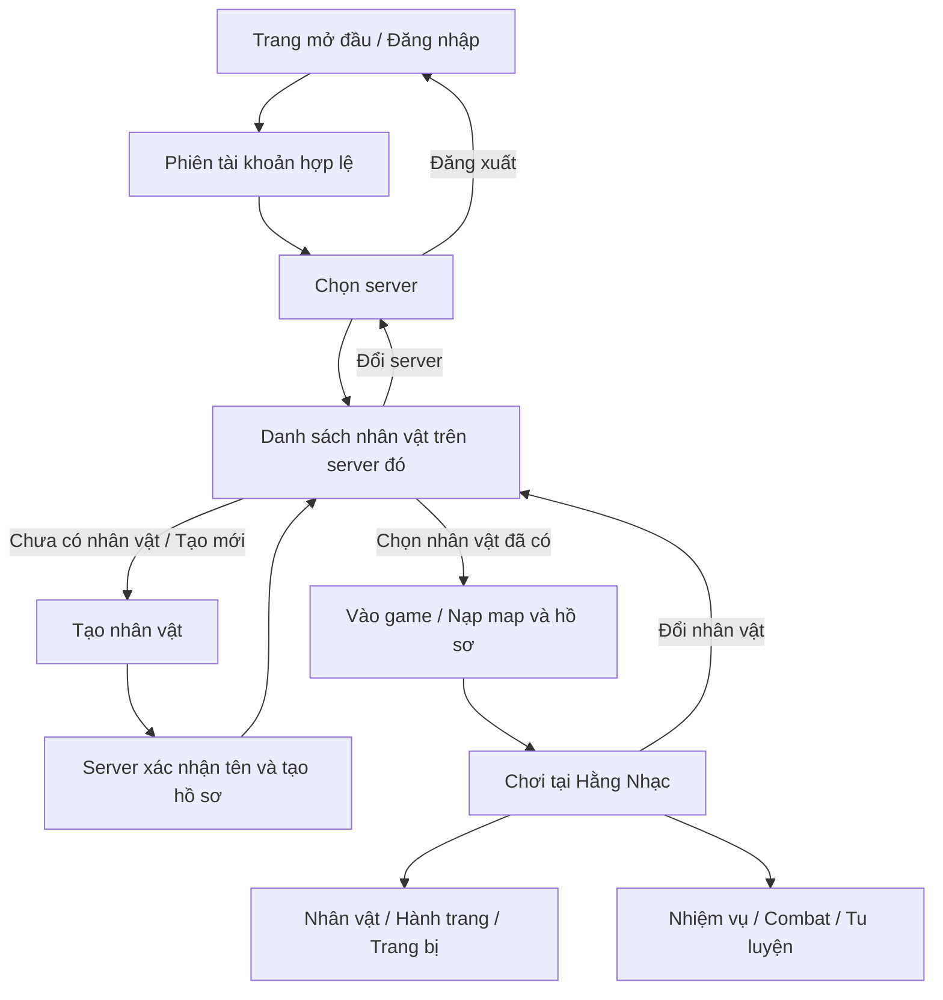
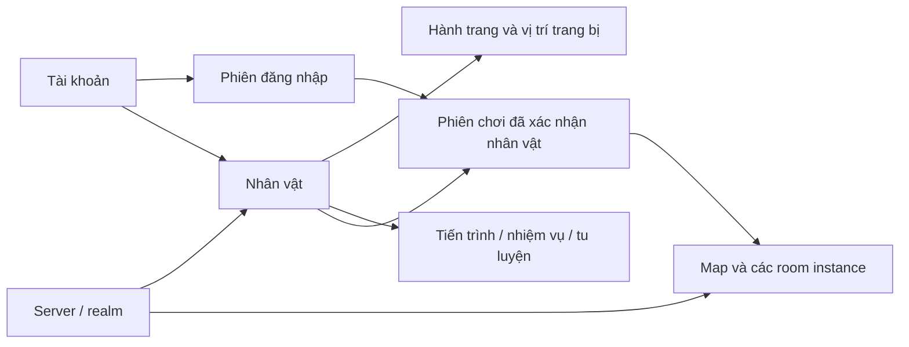

# Hệ thống vào game và nền MMORPG — reference và thiết kế

**Màn mở đầu đã bổ sung 10/10:** [Tiên môn trên biển mây](GAME-TITLE-SCREEN.md) đặt trước luồng E0–E2 bên dưới. Nền title và entry riêng; Hằng Nhạc xuất hiện khi vào thế giới. Mở trực tiếp bằng `?screen=title`; reload đang chơi vẫn phục hồi hồ sơ.

**Ngày 10/10/2026 · Đã triển khai nền E0–E2 local theo lựa chọn của owner:** tên tài khoản + mật khẩu, chọn một trong ba mẫu rồi đặt tên nhân vật. Luồng thường đã là **đăng nhập → chọn server → tạo/chọn nhân vật → vào game → ba lô/hành trang và các hệ thống trong game**. Chi tiết code, quản trị, debug và giới hạn scale ở [Game entry backend](GAME-ENTRY-BACKEND.md); phần reference/roadmap dưới đây giữ nguồn thiết kế.

Diện mạo HUD Vân Ngọc và Linh Đài 02 tiếp tục là nguồn UI. Đã có account/session/realm/character, tạo hồ sơ chủ động, vé vào room, lease SQLite và quản trị có audit. Hành trang nhập môn được dùng sau entry; ba lô tổng quát, kho/loot/kinh tế và hạ tầng MMO nhiều máy còn là mốc tiếp nối.

## 1. Reference chọn dùng

Các nguồn dưới đây là tài liệu của nhà phát hành/nhà phát triển, tra ngày 10/10/2026. “Áp dụng” là đề xuất cho game-solo, không phải luật được sao chép từ game tham khảo.

| Reference | Điều quan sát được từ nguồn | Đề xuất học và áp dụng |
| --- | --- | --- |
| [FFXIV — Getting Started](https://na.finalfantasyxiv.com/game_manual/start/) | Hướng dẫn có đăng nhập, chọn data center/World, tạo và chọn nhân vật; nhân vật gắn với Home World. | Tách tài khoản/server/nhân vật; màn chọn luôn nhắc server hiện tại, cho biết nhân vật nằm ở đâu. |
| [Black Desert — Beginner's Basic Guide](https://blackdesert.pearlabyss.com/Asia/en-US/Game/Wiki?_masterWikiNo=169) | Người chơi thấy màn chọn server sau đăng nhập, tiếp đến tạo nhân vật; hướng dẫn nói có thể đổi server linh hoạt trong game này. | Học cách trình bày các bước. Game-solo cần định nghĩa riêng server lưu hồ sơ và kênh chơi; không áp khả năng chuyển server của BDO vào dữ liệu của mình. |
| [VLTK Công Thành Chiến — hướng dẫn đăng nhập/tạo nhân vật](https://ctc.vnggames.com/su-kien/may-chu-moi-s4-phat-son/dang-ky-cai-dat-635.html) | Hướng dẫn nhà phát hành phân biệt cụm/máy chủ, tạo nhân vật và đặt tên. Đây là tài liệu client cũ. | Tham khảo cách gọi tiếng Việt quen thuộc; dùng kiểm tên Unicode hiện đại của dự án, không kế thừa hướng dẫn mã hóa/cài đặt cũ. |
| [Black Desert — Inventory](https://blackdesert.pearlabyss.com/Asia/en-US/Game/Wiki?_masterWikiNo=11), [Equipment](https://blackdesert.pearlabyss.com/Asia/en-US/Game/Wiki?_masterWikiNo=9), [Warehouse](https://blackdesert.pearlabyss.com/Asia/en-US/Game/Wiki?_masterWikiNo=36) | Có hướng dẫn riêng cho đồ mang theo, trang bị và kho; inventory có sắp xếp/phân nhóm đồ. | Phân biệt nơi chứa với vị trí đang trang bị. Dùng tìm/lọc/sắp xếp và thao tác theo loại đồ; sức chứa/trọng lượng của mình cần luật riêng. |
| [Black Desert — Family Inventory](https://blackdesert.pearlabyss.com/Asia/en-US/Game/Wiki?_masterWikiNo=107) | Kho chung cho các nhân vật trong cùng Family là một tính năng riêng, có giới hạn loại đồ. | Nếu về sau có kho tài khoản thì phải ghi rõ phạm vi dùng chung và điều kiện đồ; chưa tự dùng chung hành trang giữa các nhân vật. |
| [Mịch Trường Sinh / 觅长生 — trang nhà phát triển trên Steam](https://store.steampowered.com/app/1189490/_?l=english) | Nhà phát triển giới thiệu RPG tu tiên với tích lũy tu vi, vượt cảnh giới và câu chuyện tu tiên. Trang có gallery hình game. | Tham khảo cách đặt cảnh giới/công pháp/pháp bảo trong trải nghiệm tu tiên. Đây là nguồn chất liệu/ý niệm, không chứng minh luồng đăng nhập MMO. |

Nguồn ảnh UI chính thức để đối chiếu trực tiếp: [FFXIV chọn data center/World](https://lds-img.finalfantasyxiv.com/game_manual/na/40/2257be24e95c3276241b3b0b71d90518ff2d0a.jpg) và [FFXIV chọn/tạo nhân vật](https://lds-img.finalfantasyxiv.com/game_manual/na/d5/2ad94565836d397b1f7d15e3d059655ceb8016.jpg). Ảnh thuộc Square Enix; dùng xem reference qua nguồn gốc, chưa copy vào ART runtime.

**Hướng tổng hợp:** cấu trúc vào game học từ MMO; cách diễn đạt phát triển nhân vật học từ game tu tiên; bộ mỹ thuật của game-solo giữ [Vân Ngọc](HANG-NHAC-VAN-NGOC-UI.md) và [Linh Đài](CHARACTER-UI-PREVIEW.md). Không lấy một giao diện inventory làm đại diện cho toàn bộ game.

## 2. Luồng người chơi

Người quay lại vẫn đọc đúng tài khoản, server và danh sách nhân vật đã tạo; server chơi gần nhất là gợi ý. Tài khoản mới có danh sách nhân vật rỗng. Chọn hình/avatar chỉ là chọn mẫu trước khi nhấn **Tạo nhân vật**, chưa phải hồ sơ đã tồn tại.

Nếu có nút “Tiếp tục”, nó phải đọc lại quyền truy cập và trạng thái server/nhân vật trước khi vào. Hết phiên đăng nhập trở về Đăng nhập; đang bảo trì trở về Chọn server; hồ sơ không thuộc tài khoản không được vào room. Reconnect phục hồi nhân vật đang chơi, không tự tạo một hồ sơ mới.

## 3. Các màn cần thiết kế trước

| Màn | Nội dung và thao tác chính | Trạng thái phải có |
| --- | --- | --- |
| G01 — Đăng nhập | Tên game, phương thức đăng nhập đã chọn, Đăng ký/khôi phục tài khoản theo phương thức đó, thông báo dịch vụ và thiết lập âm thanh/chuyển động | Đang xác thực, lỗi đăng nhập, mất mạng, hết phiên. Không có nút dùng đồ hoặc điều khiển map. |
| G02 — Chọn server | Server vừa chơi; danh sách server thật; tên/mã, trạng thái, số nhân vật của tài khoản, nút Chọn server | Đang tải, chưa có danh sách, online, bảo trì, đầy hoặc chưa cho tạo nhân vật khi backend thực sự có các trạng thái đó. |
| G03 — Chọn nhân vật | Danh sách của tài khoản trên server đã chọn; tên hồ sơ, mẫu nhân vật, cảnh giới/trạng thái, map lưu; Tạo mới / Vào game / Đổi server | Rỗng, đang tải, không còn quyền truy cập, hồ sơ đang được điều khiển ở phiên khác. Slot chỉ hiển thị theo cấu hình server đã chốt. |
| G04 — Tạo nhân vật | Chọn mẫu/ngoại hình theo hướng sản phẩm, giới thiệu trạng thái và lối chơi, tên hồ sơ, nhắc server đích, nút Tạo nhân vật | Tên trống/không hợp lệ/đã dùng; đang tạo; hết slot; server đóng tạo mới; tạo xong nhưng mất phản hồi. Giữ nội dung người chơi nhập khi thử lại. |
| G05 — Vào thế giới | Tên nhân vật/server, tiến độ nạp asset và kết nối, mô tả mục tiêu mở đầu | Nạp asset lỗi, server không nhận phiên, mất mạng; thử lại hoặc quay về danh sách. Không cho cast khi chưa có snapshot hợp lệ. |
| G06 — Trong game | Map/HUD hiện hành; lối mở Nhân vật, Hành trang, Trang bị, Nhiệm vụ và menu | Snapshot đúng nhân vật; reconnect tạm dừng thao tác; đổi nhân vật/đăng xuất kết thúc quyền điều khiển. |

**Tạo nhân vật đã chốt đợt đầu:** owner chọn Vương Lâm/Tư Đồ Nam/Lý Mộ Uyển rồi đặt tên hồ sơ. Mặc định 3 slot/server, admin cấu hình 1–12; cho nhiều hồ sơ cùng mẫu, tên Unicode duy nhất theo server. Luồng đang chạy chưa tùy biến ngoại hình. **Cập nhật 12/10:** owner yêu cầu giữ các concept cho màn tạo nhân vật; [thư viện thiết kế](design/characters/character-customization-library-v1/README.md) giữ năm áo/ba khí, tách nguồn áo nhập môn cho tạo nhân vật và diện mạo Hóa Thần theo tiến trình. Cần đủ animation và hợp đồng appearance trước tích hợp; [hợp đồng triển khai](GAME-ENTRY-BACKEND.md) ghi quy tắc và giới hạn.

## 4. Đồng bộ mỹ thuật với HUD

G01–G04 là các màn trước khi vào thế giới: nền phong cảnh tu tiên, một điểm nhìn chính và các vùng thao tác có thứ bậc rõ. Dùng màu đồng/ngọc/mây, chữ tiêu đề và vật liệu Vân Ngọc; không đặt HUD chiến đấu giả phía dưới màn đăng nhập.

G02 dùng danh sách dễ đọc thay cho nhiều cầu/nút trang trí. G03/G04 đặt nhân vật làm điểm nhìn chính, bên cạnh là danh sách hoặc thông tin tạo hồ sơ; một nút chính rõ ràng. Ngôn ngữ thao tác giữ “Đăng nhập”, “Chọn server”, “Tạo nhân vật”, “Vào game”; chất tu tiên nằm ở hình ảnh và lời giới thiệu, không làm mơ hồ chức năng.

G06 tái sử dụng đúng HUD đã có. Linh Đài phù hợp màn Nhân vật sau khi vào game; hệ thống hành trang dùng vùng đọc/tìm kiếm/chi tiết đã làm, nhưng phải nhận container và luật vật phẩm đầy đủ. Trên mobile, mỗi bước có một nội dung chính, chi tiết chuyển thành màn riêng; nút thao tác dễ chạm, chữ xuống dòng, khung và nền dùng chung box. ART mới chỉ sản xuất khi đã có cấu trúc màn cần dùng.

## 5. Bản đồ hệ thống game

| Nhóm | Dữ liệu/luật cần có | Tình trạng checkout |
| --- | --- | --- |
| Tài khoản và đăng nhập | Danh tính ổn định, phiên đăng nhập, đăng xuất/khôi phục, quyền sở hữu | Đã có username/password scrypt, cookie phiên/CSRF và đăng xuất; chưa đổi/quên mật khẩu/Google/OTP. |
| Server | Danh mục, trạng thái, nơi lưu nhân vật, cấu hình slot và điều kiện vào | Realm thật trong SQLite, UI chọn, admin quản trạng thái/slot/tạo mới; mặc định S1 Hằng Nhạc. |
| Tạo/chọn nhân vật | Tạo chủ động, đặt tên, danh sách theo tài khoản + server, ID hồ sơ ổn định | Tài khoản mới rỗng, tạo chủ động với receipt, tên duy nhất theo realm; ID riêng cho từng hồ sơ, kể cả cùng mẫu. |
| Phiên chơi và map | Nhận đúng nhân vật, một phiên điều khiển, nạp map, reconnect, lưu vị trí | Có nền Colyseus/lease/lưu/reload ở Hằng Nhạc, có thể tái sử dụng. |
| Nhân vật/tu tiên | Tài nguyên, cảnh giới/hồi phục, công pháp, thuật pháp, pháp bảo, lĩnh ngộ | HP/MP/R01 và mốc nhập môn có bản thử; toàn bộ sáu nhánh chưa triển khai đầy đủ. |
| Hành trang/ba lô | Container, danh mục đồ, instance/stack, sức chứa nếu có, nhận đồ, chuyển vị trí, dùng đồ và lưu | Bản thử chỉ có hai gear cố định và stack phản chiếu `sect.supplies`; chưa là ba lô tổng quát. |
| Trang bị | Vị trí trang bị, điều kiện, bonus nếu được chốt, so sánh, chuyển đồ atomic | Mang/tháo hai món nhập môn có thử; max HP/MP giữ nguyên. |
| Nhiệm vụ/combat/loot | Điều kiện nhận/hoàn thành, credit, thưởng, kẻ địch, drop và quyền nhặt | HN01–HN04/R01/mục tiêu luyện có thử; map farm, loot và kinh tế chưa có. |
| Kho/cửa hàng/luyện chế | Phạm vi dùng chung, chuyển đồ, giá, công thức, chi phí, kết quả | Chưa có. Phụ thuộc inventory và nguồn nhận tài nguyên. |
| Cộng đồng | Chat, bạn bè, tổ đội, môn phái/bang, thư và phần thưởng nhận thư | Chưa có hệ thống hoàn chỉnh. Thiết kế sau identity/server và luật thưởng. |

“Ba lô” và “Hành trang” nên gọi thống nhất cùng một nơi chứa đồ mang theo. **Trang bị** là vị trí đang mặc/cầm. **Kho** là nơi gửi đồ, nếu được triển khai. Nếu muốn ba lô là một món đồ mở rộng sức chứa thì cần quy tắc riêng; không mặc định tạo thêm một kho/số đếm chỉ vì có hai cách gọi.

## 6. Ranh giới dữ liệu đề xuất

**Server/realm không phải một Colyseus room.** Realm là phạm vi lưu nhân vật/tiến trình và luật dùng chung. Room là một phiên chạy của map hoặc hoạt động trong realm đó. Đợt đầu có thể triển khai một realm thật, nhưng danh tính realm vẫn phải được lưu; UI không cần tạo nhiều server giả để giống MMO.

Đề xuất định danh: `accountId` cho tài khoản, `realmId` cho server, `characterId` cho hồ sơ, `avatarId`/appearance cho mẫu ngoại hình. Chọn Vương Lâm không thể thay cho chọn một hồ sơ cụ thể. Điều khiển room cần kiểm phiên đăng nhập, quyền sở hữu characterId, realm đích, release map và quyền giữ phiên. Có thể dùng vé vào game ngắn hạn gắn với danh tính đã xác thực; chi tiết auth được thiết kế cùng phương thức đăng nhập đã chọn.

Tài khoản mới không tự sinh đủ ba hồ sơ. Khi tạo nhân vật, backend kiểm tên/slot/realm, cấp đồ khởi đầu đúng một lần và ghi hồ sơ cùng receipt tạo. Yêu cầu trùng không tạo hai nhân vật. Sau khi tạo, backend trả hồ sơ đã ghi; UI trở về danh sách để chọn vào game.

### Hành trang tổng quát

Tách **định nghĩa đồ** (loại, stack, slot, điều kiện, hiệu lực, ART) khỏi **đồ đang sở hữu** (instance/stack, chủ sở hữu, số lượng, nơi chứa, vị trí trang bị, bảo vệ/ràng buộc nếu có). Một instance chỉ ở một vị trí hợp lệ. Nhận thưởng, dùng, mang/tháo và chuyển kho đều do server kiểm và ghi atomic; có receipt theo nguồn để không cấp thưởng hai lần.

Sức chứa/stack max, các vị trí trang bị, điều kiện nhận khi đầy, quyền chia sẻ kho và bonus cần được chọn trước khi triển khai từng phần. Không mặc định các số slot/HP/MP/phẩm chất trong prototype là luật game. Vật tư HN01 phải có một nguồn số lượng; khi chuyển sang item model thật cần migration rõ từ `sect.supplies`, không cộng hai nguồn cùng lúc.

### Bản lưu khách đã có

Giữ ID hồ sơ, quest/cast/item receipts, tọa độ và tài nguyên hiện có. Thiết kế cơ chế nhận/chuyển hồ sơ khách sang tài khoản chính thức cùng kiểm sở hữu trước khi chạy migration. Không gắn hồ sơ theo tên/nhân vật giống nhau; không seed/reset DB owner để thử luồng mới. Bản thử khách có thể giữ ở lối DEV riêng trong lúc xây và kiểm entry mới.

## 7. Thứ tự triển khai

**Đối chiếu snapshot 10/10:** [RM0–RM6](DEVELOPMENT-ROADMAP.md) từng bổ sung thiết kế nhân vật/nhiệm vụ trước mở rộng. Mã E bên dưới giữ phạm vi entry: E0–E2 là nền đã có; E3 tối thiểu nối RM1; E4/HN05 nối RM2; E5 được tách vào RM3–RM6. Không phải hai roadmap cạnh tranh; điều kiện hiện hành của VG01–VG11 xem [hợp đồng GDD 0.35](GDD-035-UNIFIED-CONTRACT.md).

| Mốc | Sản phẩm cụ thể | Tiêu chí xong |
| --- | --- | --- |
| E0 — Đặc tả entry | Luồng G01–G06, wireframe, phương thức đăng nhập, hướng tạo nhân vật, danh tính realm/character | Tài khoản mới và cũ có đường đi rõ; trạng thái thiếu/lỗi không bị che bằng dữ liệu giả. |
| E1 — Tài khoản/server/nhân vật | Đăng nhập thực, một realm thật, danh sách rỗng, tạo/đặt tên/chọn nhân vật và lưu | Đăng nhập lại hoặc đổi máy đọc đúng danh sách; tên/slot/ownership/server do backend kiểm; retry tạo không nhân đôi. |
| E2 — Vào Hằng Nhạc bằng nhân vật đã tạo | Gate phiên chơi, loading, nạp đúng map/profile, đổi nhân vật/server/đăng xuất và reconnect | Không có hồ sơ hợp lệ thì không vào game; không chéo save/server; hồi quy R01/NPC/HN03–HN04/HUD/lifecycle qua trên fixture. |
| E3 — Vật phẩm/hành trang/trang bị | Catalog và container thật, cấp đồ nhập môn một lần, vật tư HN01, dùng/mang/tháo/bảo vệ, lưu | Đổi hồ sơ/reconnect/restart không mất/nhân đồ; quy tắc đầy túi có xử lý nếu áp sức chứa; UI đọc snapshot thật. |
| E4 — Vòng chơi có tài nguyên | Nhiệm vụ/encounter/map ngoại vi, nhận thưởng và loot theo GDD, quay về môn phái | Nguồn đồ/tiến trình có luật, thưởng một lần và quyền nhặt rõ; map/portal chỉ mở khi có đích thật. |
| E5 — Mở rộng tu tiên và tiện ích | Công pháp/pháp bảo/lĩnh ngộ/đột phá, kho/shop/luyện chế và xã hội theo ưu tiên | Mỗi màn có dữ liệu/luật phục vụ vòng chơi; không bày nút tương lai như chức năng đã hoạt động. |

E0–E2 đã có bản triển khai local, kiểm tài khoản/server/nhân vật và vòng đời thật; chưa hoàn tất đăng nhập sản xuất/khôi phục mật khẩu hoặc scale nhiều máy. **Bước chuẩn bị kế tiếp là RM0:** chốt khung nhân vật/nhiệm vụ và phạm vi item thật HN05 cần. Sau đó E3/RM1 chỉ mở rộng phần hành trang/nguồn thưởng tối thiểu, trên nền identity đã có; giữ gear/vật tư pilot và số liệu HP/MP. E4/RM2 kiểm bằng vòng HN05; phần kho/shop/kinh tế còn lại không là điều kiện bắt buộc trước trận đầu.

## 8. Phạm vi nghiên cứu ban đầu và cập nhật triển khai

Đợt đầu chỉ đọc runtime/GDD, tra reference và ghi roadmap. Sau yêu cầu triển khai, đã bổ sung bảng `game_*` riêng, API/room/client entry và admin theo Core. Giữ bảng/save/receipt khách; chưa tự nhập save khách vào tài khoản. Không tạo ART mới, không đổi authored map/navigation. Phản hồi hình ảnh và kiểm kỹ thuật vẫn là việc riêng.
