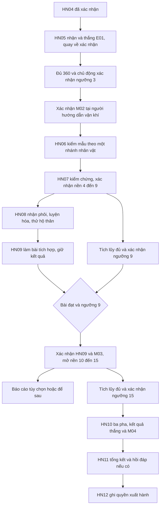

# Chương Hằng Nhạc — đồ thị nhiệm vụ và luồng phát triển

> **Thiết kế tiếp nối 13/10/2026:** [GDD 0.33](GDD.md), [hệ tu tiên mới](CULTIVATION-REDESIGN-2026-10-13.md) và [Hằng Nhạc v2](HANG-NHAC-ONBOARDING-V2.md) thay đề xuất về nhịp nhập môn, HN04, xác nhận tầng/nhiệm vụ và thời điểm EX trong tài liệu này. Nội dung bên dưới giữ làm cơ sở/lịch sử; trạng thái đang chạy xem [runtime chương](HANG-NHAC-CHAPTER-RUNTIME.md). Bản thiết kế mới chưa thay code/save hoặc duyệt balance/ART.

**Cập nhật 12/10:** owner đã chọn phạm vi Hằng Nhạc và EX01–EX04 để trải nghiệm; [bản runtime](HANG-NHAC-CHAPTER-RUNTIME.md) thực hiện tuyến dưới đây trên cảnh hoạt động thử và save thật. Tài liệu này giữ đề xuất/nguồn và lịch sử các gate thiết kế; trạng thái runtime, lựa chọn timing, giới hạn ART/stat xem tại bàn giao mới.

**Bản thiết kế làm việc 0.1 · 10/10/2026 · ND1–ND2.** Owner yêu cầu bắt đầu bước tiếp theo sau nghiên cứu. Bản này cụ thể hóa phương án **Đạo đồ + “Dấu sai trên vân lộ”** để đánh giá; không coi lời cho phép bắt đầu thiết kế là duyệt toàn bộ thoại, luật mới, cân bằng hoặc sản xuất ART. Chưa sửa runtime, schema, map, UI hay save.

[GDD](GDD.md) · [roadmap](DEVELOPMENT-ROADMAP.md) · [nguồn nghiên cứu](XIANXIA-GAME-RESEARCH.md) · [catalog đi cùng](HANG-NHAC-CONTENT-CATALOG.md). Đây là đặc tả nội dung chi tiết của phương án A, không phải roadmap thứ hai. ID HN01–HN04 và thành quả cũ giữ nguyên; toàn bộ tên tình tiết/vật liệu mới là sáng tạo game, không là canon.

## 1. Lựa chọn làm cơ sở cho bản này

| Điểm | Phương án dùng để thiết kế | Trạng thái / giới hạn |
| --- | --- | --- |
| Nguồn truyện D09 | Giữ bộ ba/Hằng Nhạc, viết tuyến phụ chuyển thể có nhãn; không dùng châu chung để giải thích hệ thống | Theo hướng hiện hành, không quyết quyền khai thác hoặc IP dài hạn thay owner |
| Nét riêng D10 | Đạo đồ ghi điều đã kiểm chứng trong J/C; một lựa chọn báo cáo và một hồi đáp | Phương án A để đánh giá; chưa xây hệ NPC tự trị |
| HN05 D05/D12 | Một encounter cá nhân ở ngoại vi, quay lại môn phái; không cần M02 để vào | Phương án mặc định của slice, map đích/navigation còn cần owner chốt |
| Năng lực nhập môn | R01 từ đầu, HN08 thêm một công cụ phòng thủ; không có skill damage mới | Giữ quyền cũ, chi tiết pháp khí ở catalog là đề xuất |
| Nhịp chương D11 | Dùng bảng ngưỡng/thưởng cũ làm kịch bản kiểm, không thay số trong code | Rà điểm chờ ở mục 8 trước khóa balance |
| Bản sắc bộ ba | Chung kết quả tiến trình, khác cách kiểm chứng nhẹ ở HN06/07 | Không cần party đúng avatar, không đổi class hoặc reset kiến thức Tư Đồ Nam |

Ưu tiên thay đổi **nội dung có thể chơi** chứ không thêm giải thích dài. Đạo đồ không phát thưởng/tiền/điểm riêng và không yêu cầu thêm màn ngoài J/C.

## 2. Tóm tắt chương cho người biên tập

**Câu hỏi trung tâm:** vật liệu không giữ khí vì có người tráo hàng, vì tuyến vận chuyển hỏng, hay vì người sử dụng chưa hiểu cách vận hành?

**Mở:** sau bài luyện an toàn, người chơi đủ thao tác nhưng chưa biết tự vận dụng ngoài sân. Người coi luyện thuật cho làm một lượt đối luyện tại tuyến ngoại vi rồi mang kết quả về. Sổ giao nhận kèm dấu niêm của một lô vật liệu có chỗ không khớp.

**Giữa:** kiểm một mẫu bằng góc nhìn của nhân vật cho thấy dấu niêm bất thường chưa đủ kết luận có trộm cắp. Thiếu điều kiện bảo quản và việc báo cáo chậm là hai chuyện riêng. Đồng thời người chơi nhận ra có đủ nguồn lực khác với vận dụng được. Bài bình cảnh nối sang nhận biết/luyện hóa một công cụ thật.

**Kết:** mẫu đối chứng và bài vận dụng xác nhận phương án chuẩn bị có tác dụng. Người chơi chọn cách báo cáo sự cố, thấy một hồi đáp, rồi qua khảo nghiệm để được tự xuất hành. Bí ẩn nhỏ của chương được giải; đầu mối dài hạn chưa được giải không dùng để che thiếu kết thúc.

**Sự thật tác giả của phương án A:** một đợt dẫn khí không ổn định khiến vật liệu bảo quản sai bị hao tổn; người giữ tuyến gửi báo cáo muộn rồi né nói rõ việc này. Chưa có bằng chứng tráo hàng. Người coi chuẩn bị quá tin sổ nhưng không ác; người giữ tuyến có trách nhiệm về báo chậm nhưng không bị kết tội trộm. Không tạo một boss phản diện để giết và “giải quyết” toàn câu chuyện.

**Phân biệt quan trọng:** mẫu nghi lỗi là vật mẫu thử trong hoạt động/nhật ký, không phải stack nguyên liệu thưởng. Người chơi luôn nhận nguyên liệu đạt chuẩn cho HN08; chọn nhánh nào cũng không bị cấp đồ hỏng hoặc phải bỏ tiền sửa.

### Góc nhìn và cách gọi

- **Vương Lâm:** tìm đường tiếp cận phương pháp cao hơn; quan sát/kiểm chứng trước kết luận. Không cấp Cực Cảnh, thần thức hoặc cấm chế cao trong chương này.
- **Tư Đồ Nam:** nhận ra nguyên lý nhưng phải ổn định biểu hiện hiện tại để chứng minh; gọi tiến triển là hồi phục. Không bảo ông chưa từng học tu luyện hoặc mới nhập môn trong nguyên tác.
- **Lý Mộ Uyển:** đánh giá vật liệu và chuẩn bị rồi tự vận dụng. Không bắt chữa cho Vương Lâm hoặc người chơi khác.

Giới thiệu một câu ở đầu chương rằng đây là hành trình nhập môn chuyển thể. Không giải thích lại canon trong mỗi NPC. Nguồn luận cứ ở bảng N01–N05 của nghiên cứu; tình tiết dấu niêm và NPC chức năng ở đây là sáng tạo.

## 3. Nhân vật chức năng và nơi diễn ra

| Vai / mã hiện có nếu có | Nhiệm vụ trong chương | Lời dẫn mẫu, chưa là thoại được duyệt |
| --- | --- | --- |
| Người coi luyện thuật / `training` | Giao HN05, đối chiếu kết quả chiến đấu, luyện tích hợp | “Ngoài sân không có vòng nhắc từng bước. Hãy chứng minh ngươi biết lúc tiến, lúc lui.” |
| Người coi chuẩn bị / `preparation` | Mẫu đối chứng HN06, phôi/luyện hóa HN08, tiếp nhận báo cáo | “Sổ ghi cùng một lô. Nhưng thứ giữ được khí và thứ làm hao khí không thể dùng lẫn.” |
| Người hướng dẫn vận khí / `cultivation` | Xác nhận ngưỡng/M02, HN07 và giải thích nền | Với Tư Đồ Nam: “Nguyên lý không lạ. Điều cần kiểm là phần hiện diện chịu được nhịp nào.” |
| Người tiếp dẫn / `guide` | Tổng kết HN11, quyền xuất hành HN12 | “Đã biết làm một việc, cũng phải biết điều mình chưa làm được.” |
| Người giữ tuyến / vai truyện mới | Tác giả một tờ báo cáo, hồi đáp sau lựa chọn | Bản đầu hiện qua văn bản/nhắn gửi tại NPC, chưa đòi sprite/NPC mới |

Bản đầu không thêm NPC hiện thân riêng cho người ghi sổ; vai đó gộp vào người coi chuẩn bị. E01 là đối luyện áp sát **do người chơi chủ động bắt đầu, có sát thương và thất bại thật trong luật thử**, khác HN04 không mất HP. Danh tính/diện mạo E01 chờ D06, không là trưởng lão canon.

Không chốt tọa độ/map bằng tài liệu này. Dùng ba không gian chức năng: môn phái chung đã có, tuyến ngoại vi nhỏ mới, phiên khảo nghiệm cá nhân. Mọi point thử mới cần vùng đi hợp lệ trong release do owner chốt; không sửa 9 blocker hoặc dùng cảnh trí làm collider ngầm.

## 4. Đồ thị tiến trình phương án A

**Đề xuất mới cần duyệt:** HN06 trong phương án A bắt đầu sau M02 đã xác nhận, thay vì chỉ HN05 trong bảng cơ sở. Lý do: dùng một bước rõ để giải thích “nhiệm vụ xong” khác “mốc đã ghi”. Không có chờ thêm theo ngân sách thử: HN02–HN05 cho đủ 360. Người cũ đã có tầng 3 vẫn phải làm HN05; sau đó xác nhận M02, không làm lại bài cũ. Có thể giữ điều kiện cũ nếu chơi thử cho thấy bước này chỉ tăng số lần đi NPC; quyết định này thuộc D03/D07, chưa đổi runtime.

M02 là thao tác riêng trong cùng màn vận khí với xác nhận ngưỡng, không phải nhiệm vụ mới có thưởng. M03 được ghi atomic khi xác nhận HN09; M04 được ghi atomic với kết quả thắng cuối HN10, màn tổng kết không nhận thêm thưởng lần nữa. Những mốc đã ghi không giảm khi đổi đồ/mất mạng.

### Bảng điều kiện kiểm được

Các số là **đối chiếu baseline đề xuất**, không lệnh cập nhật save. “Bài đạt” là proof bền thuộc đúng chủ, không ảnh chụp client.

| ID | Được nhận / bắt đầu khi | Điều kiện chốt kết quả | Quyền mở sau chốt |
| --- | --- | --- | --- |
| HN05 | HN04 hoàn tất; profile hợp lệ | Thắng E01 riêng, proof đã lưu, tới NPC `training` xác nhận | Nhận gói HN05; M02 sẵn sàng khi ngưỡng 3 đủ |
| M02 | HN05 hoàn tất + ngưỡng 3 đã xác nhận | Chủ động xác nhận tại `cultivation` | HN06; không tự mở R02/nền 4–9 |
| HN06 | M02 đã xác nhận | Đạt đúng nhánh avatar, tới `preparation` xác nhận | HN07, nguyên liệu bổ sung |
| HN07 | HN06 hoàn tất + ngưỡng 3 đã xác nhận | Bài kiểm chứng hợp lệ và xác nhận tại `cultivation` | Nền 4–9; không tự xác nhận tầng 4 |
| HN08 | HN07 hoàn tất | Nhận biết, luyện hóa đã commit, trang bị và thử hộ thân có kết quả; xác nhận tại `preparation` | HN09, cùng một pháp khí dùng được |
| HN09 | HN08 hoàn tất; cho làm bài trước ngưỡng 9 | Proof bài tích hợp + ngưỡng 9 đã xác nhận; xác nhận tại `training` | M03, nền 10–15, đủ điều kiện tích lũy tiếp |
| HN10 | HN09/M03 + ngưỡng 15 đã xác nhận, pháp khí dùng được | Ba pha thắng, kết quả cuối server commit | HN10/M04, HN11; không kill reward |
| HN11 | HN10/M04 | Đọc được thành quả và chọn xác nhận tổng kết tại `guide` | HN12; không yêu cầu làm nhánh báo cáo |
| HN12 | HN11 và toàn tuyến bắt buộc đã chốt | Chủ động xác nhận xuất hành | Quyền xuất hành; chuyển map chỉ nếu đích thật sẵn sàng |

Không thêm điều kiện bí mật về vật tư, cấp gear, tỷ lệ né, điểm đánh giá hoặc lựa chọn truyện. HN08 phải dạy công cụ, HN10 không bắt dùng đúng một combo/công cụ nếu đã thắng hợp lệ.

## 5. Thẻ nhiệm vụ chi tiết

### HN05 — Ra khỏi sân luyện

- **Động lực:** trước khi nhận việc ngoại vi và dùng vật liệu ngoài môn phái, tự chứng minh biết giữ mình khi đối thủ không đứng yên.
- **Luồng:** nhận ở `training` → tới lối ra được phép → nạp đích/điểm chuẩn bị hợp lệ → tự bắt đầu E01 → thắng → xem bản ghi dấu niêm → quay về xác nhận.
- **Mục tiêu UI:** “Tới điểm đối luyện ngoại vi”; “Vượt lần đối luyện”; “Trở lại người coi luyện thuật”. Bản ghi dấu niêm tự kèm proof sau thắng, không buộc săn một vật rơi để kết thúc.
- **Thành công:** đối thủ bị hạ và người chơi còn HP > 0 ở thời điểm server chốt; đòn thường/Kiếm/Lôi đều hợp lệ. Không bắt dùng đủ ba thuật lần nữa.
- **Dữ kiện ghi:** `hn05_attempt_won`, `route_seal_observed` là tên biên tập cho proof/manh mối; chưa là field giao thức.
- **Thưởng:** chỉ tại xác nhận NPC: +100 tích lũy, 3 nguyên liệu nhiệm vụ, 2 vật tư theo bảng thử. Thắng E01 không cấp thêm một gói loot/tu vi; mẫu nghi lỗi không thay nguyên liệu đạt chuẩn.
- **Chưa đạt:** kết thúc attempt, giữ HN04 và mọi credit đã ghi; không mất cảnh giới/đồ. HP/MP/cooldown, grace và điểm quay lại còn phải chốt D04, nhưng bắt buộc có đường chuẩn bị/thử lại miễn phí, không cần vật tư còn trong túi.
- **Mất mạng:** proof thắng đã ghi thì quay lại chờ xác nhận, không phải đánh lại. Attempt chưa chốt không được client tự xác nhận thắng. Không mặc định policy pause HN10 cho HN05.
- **Giới hạn sản xuất:** một AI/một vùng đối luyện, không escort NPC, không mob trộm, không drop ngẫu nhiên, không điều tra nhánh trong RM2.

### HN06 — Dấu riêng

**Câu hỏi:** dấu niêm bất thường có chứng minh vật liệu bị đánh tráo không? Bài chỉ xác nhận tính chất mẫu và giới hạn người dùng, chưa kết luận trách nhiệm.

| Nhánh | Thao tác mới nhưng nhỏ | Server kiểm | Kết luận đúng phạm vi |
| --- | --- | --- | --- |
| WL — Quan sát trước kết luận | Xem hai vị trí kiểm đã đánh dấu; chủ động bắt đầu một lượt ở mỗi vị trí, so nhịp dấu | Hai tương tác đúng điểm trong activity; hoàn tất lượt so được xác nhận | Cùng một vật nhưng điều kiện dẫn khác làm phản hồi khác; chưa đủ buộc tội |
| TDN — Biết và hiện làm được | Chọn lượt đối chứng nền ổn định, giữ chân tại điểm thử tới tín hiệu ổn rồi chủ động thử lại mẫu | Đúng activity/điểm, trạng thái ổn định riêng bài và thao tác thử; đi ra thì lượt chưa đạt | Tri thức không bị mất; cần loại sai lệch của biểu hiện hiện tại trước khi đánh giá mẫu |
| LMW — Đúng vật, đúng cách giữ | Chọn vỏ bảo quản mẫu được cấp trong bài, đặt vào điểm thử rồi so phản hồi với mẫu trần | Cách đặt/điểm và một phép thử đã resolve; đổi lựa chọn được trước chốt | Chuẩn bị phù hợp thay kết quả; khác biệt không chứng minh trộm vật liệu |

Dấu/điểm là tín hiệu dễ thấy, có chữ/hình; không dò pixel. Các thiết bị/vật mẫu là tài nguyên activity không vào túi; thử sai được làm lại không mất nguyên liệu HN08. Không thêm thanh “ổn định” vĩnh viễn cho Tư Đồ Nam hoặc nghề luyện đan riêng ngay.

Đủ lượt rồi xác nhận tại `preparation`: +120 tích lũy, +3 nguyên liệu, một kết luận theo nhánh. Gợi ý sau lượt chưa đạt nêu hành động cụ thể. Các nhánh chỉ khác thao tác/diễn giải, cùng quyền/ngân sách, không cần chơi đủ ba avatar để biết sự thật chính.

### HN07 — Vì sao chưa tiến?

**Vấn đề:** có đủ tích lũy/mẫu đạt chuẩn nhưng cách dẫn chưa ổn định. Người hướng dẫn mở bài kiểm chứng an toàn, không trò hỏi đáp đổi EXP lĩnh ngộ.

| Nhánh | Cách giải được đưa ra trước bài | Minh chứng yêu cầu |
| --- | --- | --- |
| WL | Chờ đối thủ kết thúc đòn rồi chọn góc/nhịp ra tay | Một hit đòn thường/Kiếm/Lôi hợp lệ trong cửa sổ hồi phục đã báo; không yêu cầu kill hoặc né hoàn hảo |
| TDN | Giữ điểm ổn định trong khoảng an toàn rồi chủ động thi triển, không vận dụng dồn | Một lượt ổn định được server xác nhận rồi một hit hợp lệ trong cùng attempt; ra khỏi điểm trước tín hiệu thì thử lại phần đó |
| LMW | Đặt phương án bảo quản/chuẩn bị ở điểm thử ngoài vùng báo trước rồi tự vận dụng | Một thao tác chuẩn bị hợp lệ trước lượt và một hit trong cửa sổ an toàn; không cần dùng vật tư hồi phục khi HP đang đầy |

Chỉ có một mẫu hành vi báo đòn/hồi phục để dùng lại; mode bài an toàn không gây mất HP, vẫn dùng quyền/chi phí/cooldown R01 thật. Điểm chuẩn bị phục hồi bài có hợp đồng riêng, không tự trừ/nhân đồ trong túi. Bài LMW không cho buff độc quyền đem ra farm; TDN không bị tước R01 ngoài activity.

Xác nhận: +240 tích lũy, mở nền 4–9, ghi một entry Đạo đồ gồm vấn đề–bằng chứng–cách kiểm–giới hạn–bước tiếp. Nút “Xem Đạo đồ” chỉ xem, không phát thưởng. Nền mở không tự biến 720 tu vi thành tầng 6; người chơi xác nhận các ngưỡng thực sự đủ.

### HN08 — Vật trong tay

- Tới `preparation`, xem tác dụng/phần thiếu trước khi nhận phôi; phôi cấp một lần và có cùng instance ID suốt vòng luyện hóa.
- Nhận biết từ các kết quả HN06/07, xem công thức 4 nguyên liệu, chủ động xác nhận luyện hóa. Không cần tick minigame/RNG hỏng đồ.
- Commit chuyển `raw` → `refined` trên cùng món và tiêu 4 nguyên liệu; thất bại ghi thì không đổi gì, mất phản hồi đọc lại trạng thái chứ không cấp phôi mới.
- Trang bị vào chỗ ngọc sức/pháp bảo hiện đang trống; thử ở bài riêng có một hit yếu được báo rõ. Server xác nhận hộ thân giảm một hit, không chỉ nhấn nút là đạt. Nếu kích hoạt quá sớm, hết hiệu lực và thử lại từ điểm chuẩn bị; không mất lại 4 nguyên liệu.
- Xác nhận HN08: +300 tích lũy, +2 vật tư. “Nhận một pháp khí” trong bảng thưởng là thành quả của việc luyện hóa món đã có, **không spawn thêm item thứ hai**.
- Mô tả dùng/slot/input theo [catalog](HANG-NHAC-CONTENT-CATALOG.md). Gắn hotbar/phím mới là công việc UI/runtime riêng sau khi được duyệt.

### HN09 — Vận dụng ổn định

Làm bài với E02 trong phiên luyện, nhận kết quả thắng hợp lệ bằng các công cụ đã có; không kiểm một combo tối ưu. HN08 đã kiểm cách dùng hộ thân, không buộc lặp đúng thao tác để qua mọi trận. Bài đạt được lưu kể cả chưa đủ tầng 9.

UI phải tách hai mục: **bài đạt** và **ngưỡng 9 đã xác nhận**. Nếu thiếu ngưỡng, hướng tới thổ nạp/hoạt động đã thực sự mở, không bắt đánh lại để farm tu vi. Đủ hai điều kiện, xác nhận tại `training` ghi +360 tích lũy, +2 vật tư, HN09/M03 và nền 10–15 cùng transaction. Không dùng +360 trước khi đủ điều kiện nhận.

Sau xác nhận mới mở báo cáo truyện tùy chọn ở mục 6. Bỏ qua/để sau không ngăn HN10, không mất vật tư hoặc nguồn lĩnh ngộ bắt buộc.

### HN10 — Khảo nghiệm nhập môn

HN09/M03, ngưỡng 15 và pháp khí hợp lệ là điều kiện vào; không kiểm còn vật tư hồi phục, tổ đội hoặc chọn đúng nhánh báo cáo. Trước bắt đầu trình bày ba pha E01/E02/E03 và cách thử lại.

Giữ đặc tả checkpoint theo pha thắng ở [encounter](HANG-NHAC-ENCOUNTERS-TRIAL.md), nhưng timing/hình học phải tính lại cho runtime. Pha thắng phải còn HP > 0; nếu cùng bị hạ thì chưa đạt. Không thêm boss truyện/pha thứ tư hoặc bắt boss biểu diễn hết chu kỳ.

Kết quả cuối HN10/M04 được ghi một lần; +0 tu vi/loot. Nếu giữ bảng stat thử, M04 chỉ có sau commit, không dùng để thắng chính trận này. Màn tổng kết là xem kết quả, không một đường nhận thưởng mới. Grace/pause/checkpoint/restart vẫn cần đặc tả kỹ thuật; không coi mô tả trên giấy là đã có phiên hoạt động.

### HN11 — Nhìn lại con đường

Tại `guide`, tổng kết điều đang dùng được: nền đã mở, một dòng Đạo đồ, R01 và pháp khí thật, giới hạn/mục tiêu tiếp theo. Xác nhận tổng kết giữ chủ động nhưng không đòi đọc hết từng tab hoặc cast thêm ngoài map.

Nếu đã báo cáo, hiện hồi đáp của người giữ tuyến theo mục 6; nếu chưa, đưa tổng kết trung tính, không ghi người chơi đã chọn hộ. Không thêm stat/tài nguyên từ hồi đáp. Kết quả mở HN12.

### HN12 — Xuất hành

Người chơi xác nhận đi tiếp, server kiểm tuyến bắt buộc và ghi quyền xuất hành một lần. Chuyển map là thao tác khác chỉ chạy khi đích/release/spawn và quyền thật có sẵn. Nếu chưa có đích, thông báo hoàn tất chương hiện tại, giữ quyền đã ghi và cho ở lại/luyện phần đã mở. Không báo “đã tới” một map rỗng, không tự Trúc Cơ/R02.

Lời hứa tiếp theo theo người: Vương Lâm tìm nguồn phương pháp/tri thức; Tư Đồ Nam tìm điều kiện biểu hiện sâu hơn; Lý Mộ Uyển theo nguồn đan–trận để chủ động chuẩn bị. Chưa đặt tên map/công pháp canon chưa đối chiếu.

## 6. Lựa chọn có hệ quả — thu gọn còn hai nhánh và “để sau”

**Thu hẹp so với brainstorm:** chưa làm nhánh buộc tội sai/đính chính riêng. Sau HN09 đủ chứng cứ, người chơi chọn thứ tự xử lý, không đoán một đáp án đúng ẩn. Các clue gồm dấu niêm HN05, thử mẫu HN06 và ghi nhận vận dụng HN09; không cần quest tùy chọn khác.

| Chọn | Việc xảy ra ngay trong phạm vi chương | Hồi đáp thấy được | Giới hạn |
| --- | --- | --- | --- |
| `report-first` — Đối chứng trước | Đọc hai phần báo cáo, gửi bảng dữ kiện qua NPC chuẩn bị | Người giữ tuyến gửi bản giải trình kèm ghi nhận việc báo chậm; người coi chuẩn bị công nhận vật liệu không bị tráo | Một tương tác gửi/commit, một bản hồi đáp; không cuộc xử án dài |
| `repair-first` — Giúp khắc phục trước, vẫn ghi đủ sự thật | Giúp sắp một mẫu bảo quản dùng trong bài tại NPC rồi gửi cả dữ kiện và việc đã làm | Người giữ tuyến gửi ghi chép bảo quản và lời cảm ơn; sai sót báo chậm vẫn được ghi, không bị che | Vật mẫu trong activity, không tiêu 2 nguyên liệu dư hoặc đồ của người chơi |
| Để sau | Chưa commit nhánh, tiếp tục main quest | HN11 tổng kết trung tính; có thể quay lại báo cáo sau | Không coi trì hoãn là phản bội hoặc mất cơ hội vĩnh viễn |

Hai nhánh có **thao tác khác nhỏ và vật chứng hồi đáp khác**, không chỉ đổi một câu khen; thông tin cốt lõi/tiến trình ngang nhau, không nhánh tối ưu damage. Người chơi thấy trước: “Cách xử lý này được ghi trong nhật ký; không đổi phần thưởng hay điều kiện khảo nghiệm.” Tên nhánh chỉ là ID thiết kế, không danh tiếng/điểm đạo đức.

Hồi đáp có sẵn ở NPC sau commit, HN11 tóm tắt lại nếu đã chọn. Người báo cáo sau HN11 vẫn xem được tại NPC/J mà không chạy lại HN11 hoặc nhận thêm reward. Xem lại không đổi lựa chọn. Content version đổi không reset nhánh; nếu cần sửa quyết định về sau phải có policy riêng, chưa hứa nút đổi vô hạn.

## 7. Sổ thành quả và proof

| Mốc | Fact bền / nguồn | Dùng ở đâu | Không được suy thêm |
| --- | --- | --- | --- |
| E01 thắng | Proof HN05 đúng hồ sơ/attempt, commit kết quả | Xác nhận quest, tự kèm bản ghi dấu niêm | Không tự có vật phẩm thưởng/M02 |
| HN06 chốt | Nhánh theo avatar + kết luận thử mẫu | HN07 và báo cáo sau HN09 | Không skill class/tri thức toàn realm |
| HN07 chốt | Nền 4–9 + kết quả bài | Gate tu luyện và Đạo đồ | Không thêm EXP lĩnh ngộ |
| Luyện hóa chốt | Recipe receipt + instance refined + nguyên liệu giảm | Tiếp tục bước thử HN08 | Không cần luyện hóa lại nếu thử hộ thân thất bại |
| Bài HN09 đạt | Proof độc lập với reward/level | Đợi đủ ngưỡng để xác nhận | Không cộng +360 sớm |
| Báo cáo chốt | Branch + bằng chứng liên quan | Hồi đáp cá nhân | Không trạng thái NPC chung hoặc reward power |
| HN10 thắng cuối | Checkpoint/kết quả + HN10/M04 | Tổng kết/xuất hành | Không +tu vi từ boss |

Các fact là yêu cầu nghiệp vụ, không schema đã triển khai. Lưu candidate/receipt/CAS atomic, cùng request trùng và request ID mới vẫn không nhận lại gói đã ghi. UI animation/đọc văn bản không là nguồn kết quả. Ngoại vi/room có một quyền ghi hồ sơ tại một thời điểm, không chồng authority khi transfer lỗi.

## 8. Kiểm toán ngân sách và điểm chờ

Nguồn số duy nhất: [tiến trình/phần thưởng v0.2](HANG-NHAC-PROGRESSION-REWARDS.md). Bảng sau chép lại để đối chiếu đồ thị, không tạo bảng balance thay thế. Vật tư là lượng **cấp**, không phải tồn kho sau sử dụng.

| ID | Tu vi lần đầu | Vật tư hồi phục cấp | Nguyên liệu cấp | Nguyên liệu tiêu | Pháp khí |
| --- | --- | --- | --- | --- | --- |
| HN01 | 0 | 2 | 0 | 0 | 0 |
| HN02 | 100 | 0 | 0 | 0 | 0 |
| HN03 | 80 | 0 | 0 | 0 | 0 |
| HN04 | 80 | 0 | 0 | 0 | 0 |
| HN05 | 100 | 2 | 3 | 0 | 0 |
| HN06 | 120 | 0 | 3 | 0 | 0 |
| HN07 | 240 | 0 | 0 | 0 | 0 |
| HN08 | 300 | 2 | 0 | 4 | 1 món chuyển từ phôi |
| HN09 | 360 | 2 | 0 | 0 | 0 |
| HN10 | 0 | 0 | 0 | 0 | 0 |
| HN11 | 0 | 0 | 0 | 0 | 0 |
| HN12 | 0 | 0 | 0 | 0 | 0 |

Tổng: **1.380 tích lũy, 8 vật tư cấp, 6 nguyên liệu cấp/4 tiêu/2 còn, một instance pháp khí**. Không thêm thưởng cho clue/Đạo đồ/nhánh báo cáo. Hai nguyên liệu còn lại được giữ với nhãn chưa có công thức tiếp, không tự đổi tiền hoặc thêm recipe vô nghĩa; catalog ghi đây là điểm cần chọn trước phát hành toàn chương.

**Đường chỉ tuyến chính, không tích lũy nền trước các điểm kiểm:**

- Sau HN05: 360, đủ xác nhận ngưỡng 3/M02; không cần đánh lại.
- Sau HN06: 480, dư gate 360 vẫn được giữ; HN07 cần ngưỡng 3 chứ không ngưỡng 4.
- Sau HN07: 720, nền 4–9 mở; sau HN08: 1.020.
- Trước nhận thưởng HN09: cần 1.620, thiếu 600; ở 120/phút là **5 phút hoạt động nền hợp lệ**. Bài đạt có thể làm trước và được giữ. Không lấy 360 thưởng HN09 để tính đủ đầu vào HN09.
- Sau xác nhận HN09: tối thiểu 1.980 vì đã tích lũy đủ 1.620 rồi nhận 360; tới 3.600 còn 1.620, tương đương **13 phút 30 giây nền hợp lệ**.
- Tổng phần nền phải có: 2.220/120 = **18 phút 30 giây lý thuyết**, có thể trùng thời gian đi/đọc an toàn, không phải thời lượng chơi thực. Không tính offline chưa triển khai hoặc bù pause/combat.

**Rủi ro trải nghiệm chưa giải bằng phép tính:** đoạn sau HN09 có thể chỉ còn chờ. Không lấp bằng replay có thưởng hoặc daily. Trước RM3/RM4, chọn sau chơi thử: điều chỉnh đường ngưỡng/sản lượng, phân bố lại thưởng, hoặc bổ sung hoạt động O01–O04 đã có ngân sách riêng. Không đưa nhánh báo cáo 0 thưởng thành điều kiện bí mật để rút ngắn chờ. RM2 không cần giải toàn đoạn 9–15 mới thử HN05.

## 9. Storyboard HN05 cho lần tích hợp đầu

| Bước | Người chơi nhìn thấy / làm | Trạng thái cần kiểm |
| --- | --- | --- |
| 1 | NPC nêu mục tiêu tự vượt đối luyện, đường đi và luật thử lại | Chưa HN04: thiếu điều kiện; HN05 đã nhận: Tiếp tục; đã thắng: Quay về xác nhận |
| 2 | Tới lối ngoại vi, chủ động qua; màn nạp ghi nơi đến | Không có release/spawn: không cho mở cửa giả; transfer lỗi trở lại trạng thái hợp lệ |
| 3 | Ở điểm chuẩn bị, xem đối thủ/luật rồi bắt đầu | Không yêu cầu vật tư túi/M02; không bị đánh khi đang đọc |
| 4 | E01 tiếp cận, báo đòn, khóa hướng, đánh và recovery | Đi bộ có đường né tại tốc độ 80/radius 8; không theo cú né ở lúc resolve |
| 5a | Chưa đạt: lý do và nút chuẩn bị/thử lại | Không mất credit bền/đồ; reset attempt theo D04 trước khi nhận đòn mới |
| 5b | Thắng: kết quả đã lưu, một dấu gợi mở hiện trong J | Không loot/thưởng tức thì; tải lại không làm mất proof |
| 6 | Quay về NPC, xác nhận gói thưởng hiển thị trước | Đủ quyền, gần NPC, atomic commit; lỗi giữ ready, không cấp nửa gói |
| 7 | J/C chỉ đường tới vận khí để xác nhận ngưỡng/M02 | Nếu đã tầng 3 không yêu cầu làm lại; M02 chốt không nhận lại +100 |

Không cần một UI mới: tracker/J/NPC/C/I/menu đã có. View mới chỉ bổ sung dữ liệu thật và callbacks hợp lệ, hotbar không sở hữu quest. Chơi thử storyboarding trên giấy không chứng minh browser hoặc server đã chạy.

## 10. Phần đủ bàn giao và phần còn chặn

- **Đã có bản chi tiết:** động lực/kết chương, vai NPC, đồ thị có cổng rõ, thẻ HN05–HN12, ba nhánh HN06/07, một lựa chọn 2 nhánh, ngân sách và storyboard HN05.
- **Chờ owner đánh giá nội dung:** phương án truyện A/Đạo đồ, HN06 sau M02, lựa chọn báo cáo thu gọn, nguyên liệu dư; thoại vẫn là mẫu.
- **Chặn code encounter/transfer:** D04 failure/reconnect/refill/cooldown; D05 map/release/spawn; D06 AI timing/geometry và ART theo runtime. Không dùng thông số 160 px/s/collider 18 cũ.
- **Chặn phần hệ thống tương ứng:** D01 migration/adapter; D02 nguồn item; D03 mốc/stat; slot/input/activation pháp khí cần hợp đồng trước HN08.
- **Không cần cho RM2:** build hậu nhập môn, tổ đội/chợ, pháp khí khám phá, tuổi thọ/thiên kiếp/khí linh.

Bước tiếp của RM0 là lấy thẻ HN05 và catalog để chốt hợp đồng kỹ thuật tối thiểu/fixture acceptance, không nhảy thẳng vào code cả HN01–HN12. Nghiệm thu độc lập: kiểm logic bảng/đồ thị, chơi thử cảm giác, duyệt ART; không suy một loại thay loại khác.
