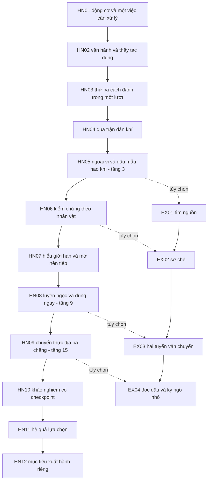

# Hằng Nhạc v2 — từ bài thao tác sang chuyến tu tiên đầu

**13/10/2026 · Thiết kế thay thế cho prototype, chưa chạy trong server.** Theo [GDD 0.33](GDD.md). Giữ ID HN/EX để truy vết ý nghĩa, nhưng thay hành vi phải dùng phiên bản nội dung và mapping save; không đổi definition cũ rồi mặc định mọi attempt đang dở còn hợp lệ.

**Asset đợt 1:** [Mẫu vật, phiến dẫn khí, đế đối chứng và dấu báo](design/gameplay/hang-nhac-onboarding-assets-v1/README.md) đã có bản xem thử cùng Vương Lâm Pixel02; owner chấp nhận hình ba đạo cụ raster 13/10, chưa ghép gameplay. Năm SVG riêng còn candidate. Nguồn cũ 11 icon nguyên liệu/công cụ được tái dùng. [NPC và sinh hoạt](HANG-NHAC-NPC-LIFE-PLAN.md) bổ sung vai trò, khu hoạt động và nơi dùng bệ; chưa đặt lên map.

## 1. Phạm vi và nhịp chương

**HN01–HN05 là hướng dẫn, mục tiêu 15–20 phút tới tầng 3. HN06–HN12 là phần còn lại của chương, mục tiêu tổng 60–90 phút tới tầng 15.** Người đã biết chơi có thể nhanh hơn, đọc truyện/làm EX lâu hơn. Đây là mục tiêu thiết kế chưa đo; không thêm chờ/kill để ép đúng thời lượng.

Ba không gian: hub Hằng Nhạc hiện hành; ngoại vi khám phá/chiến đấu; sân bài/khảo nghiệm riêng. Không thay nền owner, blocker, bậc thang, camera hoặc thả hazard vào hub. Prototype dùng sân riêng đã có sau khi kiểm đường đi và kích thước; ART mới là công việc sau.

Đường EX còn cần EX trước đó; đường HN không cần EX, đồ EX hoặc lựa chọn báo cáo. Mỗi tuyến đã nhận tự chọn bước tiếp sau kết quả server; bấm mục tiêu để tìm đường. HN04 không tự kéo người chơi sang một activity khác khi vừa hoàn tất.

## 2. Quy tắc giảm thao tác

- Một lần nhận một việc/cụm bài. Trong bài, phát hiện/proof chuyển bước và cấp phần thưởng chắc chắn tự động khi server đã lưu.
- Đối thoại trọng tâm, chọn nhánh truyện, bắt đầu nội dung nguy hiểm, chế tác tiêu nguyên liệu, đổi build và đại đột phá giữ nút chủ động.
- Cắt “chọn quest → nhận → đóng → mở lại → chọn quest → bắt đầu → quay NPC → xác nhận” nếu những bước ấy không mang lựa chọn mới.
- Không auto-combat/craft/tiêu vật tư. Chọn mục tiêu tự động không có nghĩa auto-path hoặc tự nhận mọi nhiệm vụ gần đó.
- NPC trả lời sau kết quả bằng một câu ngắn trên HUD; quay gặp chỉ khi có cảnh mới/việc đáng làm. Journal vẫn xem lại được đầy đủ.
- Giới hạn thao tác quản lý tách khỏi input chơi: một lần bắt đầu HN04, không nút nối đoạn, một lần chọn rời/tiếp sau kết quả. Không bắt đầu lại bằng nói chuyện NPC.

## 3. Thẻ HN01–HN12

Thời lượng là ngân sách cho nội dung có ý nghĩa, không timer phải đợi. Các tên/biến cố bổ sung đều là sáng tạo game.

| ID / thời lượng thử | Mong muốn, việc thực sự chơi | Kết quả dùng tiếp | Chốt và thất bại |
| --- | --- | --- | --- |
| HN01 — Đường vào, 1–2 phút | Lời dẫn riêng 2–3 câu: vì sao nhân vật cần nguồn/phương pháp ở đây. Đi tới người tiếp dẫn, nhận một việc đang trục trặc | Mục tiêu mẫu vật; biết điều khiển và danh tính | Một lần đồng ý. Đọc thêm tùy chọn, không khóa đi vì phải đóng nhiều cửa sổ |
| HN02 — Khí vào tay, 2–3 phút | Bắt đầu một lượt vận hành, thấy MP tiêu khi thử thuật rồi hồi trong bài an toàn; vận khí tự chạy qua ba nhịp, không bấm theo nhịp | Tu vi +100, tầng 1; lời giải thích ngắn MP khác tu vi; M01 | Thử một thuật hợp lệ là đủ proof. Không quiz. Hủy/mất mạng giữ bước bền, không hoàn tất từ thời gian client |
| HN03 — Thuật để làm gì, 3–4 phút | Một sân mục tiêu thay tình huống: gần để dùng F, đường rõ cho Kiếm, mục tiêu dịch vị trí để thấy cách khóa Lôi; không ra vào NPC giữa đòn | Tu vi +80; biết chọn công cụ và hướng | Credit mỗi tình huống giữ; không đòi spam đủ N cast. Bỏ qua hướng dẫn dài nếu đã làm đúng |
| HN04 — Qua trận dẫn khí, 2–3 phút kể cả lời dẫn | Mang mẫu qua ba đoạn cùng một lượt; đường an toàn đi bộ, đường ngắn dùng Phong; quan sát nơi mẫu hao khí | Tu vi +80; một phát hiện nối HN05, có kinh nghiệm tự né | Xem đặc tả dưới; hoàn tất tự ghi, không quay NPC |
| HN05 — Lần ra ngoại vi, 4–6 phút | Đối thủ thật và một dấu vật tư; giữ khoảng cách hoặc áp sát theo nhịp đọc được, thắng rồi quan sát mẫu | Tu vi +100; tầng 3/M02 tự ghi; 3 nguyên liệu HN/2 vật tư theo nguồn cũ; EX01 mở | Thắng proof bền, tự chốt phần thưởng; thua thử tại điểm gần, không cần mua vật tư |
| HN06 — Cách ta nhìn, 5–7 phút | Một câu hỏi mẫu bị tráo hay hỏng. WL đổi điều kiện quan sát; TDN ổn định biểu hiện rồi đối chứng; LMW chọn bảo quản rồi thử mẫu trần | Tu vi +240 thử; 3 nguyên liệu HN; một kết luận có giới hạn; EX02 nếu xong EX01 | Hai điều kiện tạo phản ứng dễ thấy; cho thử sai miễn phí, không dò pixel |
| HN07 — Vượt giới hạn, 5–8 phút | Thấy lần dẫn sai không đạt, tự thay cách vận hành rồi kiểm trong nguy hiểm đã báo. Khác theo nhân vật | Tu vi +420 thử; nền tiếp được mở; Đạo đồ một câu; P2 mới thêm thử build | Đạt từ hành động, không chọn câu “đã hiểu”. Dừng an toàn và thử lại phần thiếu |
| HN08 — Vật trong tay, 6–9 phút | Biết ngọc sẽ bảo vệ thế nào, xem chi phí, luyện hóa và trang bị trong một màn; dùng ngọc để bảo vệ mẫu khỏi một xung kích | Tu vi +600 thử; ngọc giữ instance; +2 vật tư; tầng 9; EX03 nếu xong EX02 | Xác nhận tiêu 4 nguyên liệu một lần; thử công cụ không tiêu lại nguyên liệu; hoàn tất tự ghi |
| HN09 — Tự đi một chuyến, 12–18 phút | Ba chặng: lấy mẫu khi có nguy hiểm; đưa qua hai cách tiếp cận; giữ điểm kiểm chứng trước đối thủ. Không ba trận giống nhau | Ba phần tu vi 660; tới tầng 15; bằng chứng vụ việc; M03; +2 vật tư một lần cuối; EX04 nếu xong EX03 | Proof từng chặng, thất bại chỉ chơi lại chặng đang dở. Lựa chọn báo cáo tùy chọn không khóa HN10 |
| HN10 — Tự giữ con đường, 6–10 phút | Ba pha: đọc đối thủ; giữ vị trí/mục tiêu; kết hợp dưới áp lực. Giữ cấu trúc E01/E02/E03 và checkpoint, biên tập mục tiêu trước khi đổi AI | M04, chứng nhận đã tự ứng phó; không thưởng kill thêm | Không bắt đúng combo hay né hoàn hảo; chuẩn bị miễn phí giữa pha; thắng cuối tự ghi |
| HN11 — Lời đã hứa, 2–4 phút | Quay lại thấy tuyến được sửa và phản hồi khác theo ưu tiên của người chơi. Một cảnh có hành động/nhờ giúp tiếp | Quan hệ cụ thể, một biến thể hoạt động sau; giá trị tiến triển tương đương | Nếu chưa chọn báo cáo, diễn tiến trung lập vẫn hoàn thành. Không thêm xác nhận nhận lại thưởng |
| HN12 — Tự chọn bước đi, 1–2 phút | Chọn mục tiêu kế theo nhân vật, xem cần chuẩn bị gì và nơi đã sẵn sàng đi | Quyền xuất hành/lịch sử chương, mục tiêu Trúc Cơ | Nếu đích chưa có, báo “Hoàn tất chương; vùng tiếp chưa mở”, cho quay vòng hoạt động có thật |

HN09 cần sản xuất đủ ba tình huống trước khi đổi thưởng; không chia một trận cũ thành ba thông báo để hợp thức hóa tu vi. Ngân sách phía trên không bảo đảm chương vui; có thể cắt nội dung trùng và rút thời lượng sau chơi thử.

## 4. HN04 thay thế chi tiết: Qua trận dẫn khí

### Mục đích và diễn tiến

Người coi luyện thuật cần đưa một mẫu đã niêm qua trận dẫn thử để kiểm cách giữ khí. Người chơi là người mang mẫu, tự chịu trách nhiệm đọc nguy hiểm. Kết thúc thấy dấu hao khí không khớp lời giải thích; đây là lý do đi kiểm chứng HN05, không coi quái ngoại vi là kẻ đã đánh tráo.

**Một lượt 60–90 giây là mục tiêu cho người mới**, không phải bắt chờ đồng hồ. Dùng ba đoạn ngắn; dấu tiếp xuất hiện khi người chơi đi tới vùng kích hoạt an toàn, không ngồi chờ vòng lặp.

| Đoạn | Tín hiệu và quyết định | Điều kiện đạt |
| --- | --- | --- |
| A — Đọc nhịp | Vòng báo có mép, hướng và dấu đếm; lối đi bộ rộng thấy rõ | Ra ngoài vùng resolve bằng đường đi hợp lệ, tới điểm nghỉ mang mẫu |
| B — Chọn cách qua | Luồng chặn đường ngắn; đường vòng đi bộ an toàn, Phong giúp qua trong thời cơ đã chỉ | Đến đích cùng mẫu; đi bộ hay Phong đều đạt, không bắt đúng nút |
| C — Giữ bình tĩnh | Hai dấu báo nối nhau, đủ điểm nghỉ và thời gian đọc; có thể tách từng nhịp | Qua cả hai vùng tới bàn nhận; không cần né trong vài frame hoặc gây damage |

Mẫu là trạng thái bài thử, không item chiếm túi, không bị tiêu hay tạo bản sao. Không thêm escort AI hoặc NPC phải sống để làm tutorial di chuyển.

### Input và giao diện

Một nút “Bắt đầu chuyến thử” kèm mục tiêu. Sau đó HUD chỉ hiện việc hiện tại, ba đoạn đã qua và lối an toàn. Tự nối đoạn, tự commit hoàn tất/+80 sau đích; nút cuối là “Tiếp tục ra ngoại vi” (ý định đi tiếp) hoặc xem lại. Không cần nút nhận thưởng/confirm lesson.

Lời dẫn “Phong giúp qua nhanh hơn; có thể đi bộ theo lối vòng”. Phong không được bài tự cast; hết MP/cooldown vẫn có lối đi. Trước khởi hành/đoạn retry, chuẩn bị miễn phí theo luật activity; không bật hồi phục vô hạn có thể mang ra ngoài hoặc tạo nguồn vật tư mới.

### Chưa đạt và tiếp cận

Trúng dấu: dừng đoạn hiện tại, đưa mẫu về điểm nghỉ của đoạn, giữ các đoạn đã qua. Hiện một lý do cụ thể (“ra khỏi cả mép vòng trước nhịp cuối”), một nút “Thử lại tại đây”. Không mất tu vi/vật liệu, không chạy về NPC, không tự reset liên tục gây khó chịu.

Sau hai lần chưa qua cùng đoạn, đề nghị báo sớm hơn và vẽ lối đi rõ hơn; người chơi tự bật. Hỗ trợ giữ nguyên thưởng và ghi cấu hình để đọc kết quả playtest. Không tự hoàn thành thay người chơi. Có mode tập không deadline để học trước, nhưng proof hoàn tất vẫn cần tự vượt bản có nhịp đủ rộng.

Tín hiệu dùng hình/mép/hướng/chữ, không chỉ đỏ–xanh; đủ tương phản trên nền sáng/tối. Giảm chuyển động bỏ rung/flash nhưng giữ dấu báo. Mobile không cần đồng thời bấm nhiều nút hoặc rê chính xác; nút tương tác >=44px. Thiết kế có lối đi bộ toàn bài cho người không thuận thao tác Phong.

### Hình học và timing cần kiểm khi prototype

Giữ tốc độ/collider hiện hành, không tăng speed hoặc sửa blocker để né dễ hơn. Mỗi đòn kiểm `thời gian báo >= (quãng đường thoát + biên collider + lề an toàn) / tốc độ đi thường + ngân sách trễ input`. Dùng đường đi thật có góc/rào, không khoảng cách thẳng xuyên vật cản. Có thể thu vùng nguy hiểm hoặc kéo dài báo; chốt số sau khi đo desktop/mobile trên fixture.

### Kết quả, hủy và mất mạng

Đoạn đã đạt lưu theo phiên bản bài/đúng hồ sơ. Hủy chủ động về chuẩn bị, giữ đoạn đã ghi; không tạo proof hoàn tất. Drop/restart đọc checkpoint bền, về chuẩn bị đoạn chưa xong, không suy đã né từ tọa độ client. Khi resume bắt đầu đếm báo mới sau một lần chọn tiếp; không gây hit trước khi điều khiển được. Đây là policy đề xuất cho HN04 mới, không tự áp cửa sổ HN10 cho mọi bài cũ.

Nếu người chơi đã hoàn tất HN04 cũ: được giữ thành quả, mở tùy chọn “Thử bài mới” không thưởng lần đầu lại. Người đang dở được chuyển credit như mục migration.

## 5. EX mở sớm và việc khám phá có mục đích

| Nhánh | Mở khi | Quyết định/hành động mới | Ràng buộc nguồn |
| --- | --- | --- | --- |
| EX01 — Tìm đúng nguồn | HN05 | Theo dấu môi trường tìm dược/thủy/cát, tự chọn thứ tự; nhận một bộ nguyên liệu biết nơi dùng | Giữ gói hữu hạn 2 dược/2 linh tuyền/1 cát một lần |
| EX02 — Giữ thứ đã tìm | HN06 + EX01 | Thử mẫu chưa xử lý so với mẫu sơ chế rồi chọn chuẩn bị | Giữ 3 sợi/3 ngọc/1 cát một lần; thiết bị bài không thành đồ túi |
| EX03 — Hai cách đi | HN08 + EX02 | Tuyến vòng ổn định thủ công hoặc tuyến ngắn dùng hộp niêm | Cùng tiến trình; giữ luật mực/niêm, không bắt dùng công cụ |
| EX04 — Đọc dấu | HN09 + EX03 | Quan sát A+B hoặc dùng bàn để giảm bước, vẫn tự đi kiểm chứng | Định Lưu Bàn có đích dùng rõ; không thêm cơ duyên châu hoặc đồ độc hữu canon |

Sáu công thức đang chạy giữ lượng tiêu/giữ và maxOwned trong lần thử quest đầu. Đưa quyền EX sớm hơn kéo theo quyền recipe theo nhiệm vụ đã đạt, không mở công thức từ trang preview. Không hồi node thành farm vô hạn. Khi đã dùng nguồn hữu hạn vào recovery/mực, tuyến chính và cách làm thủ công vẫn không kẹt; không cho HN09 tiêu vật tư EX bắt buộc.

## 6. Ngân sách tiến trình thử A — không có chờ bắt buộc

Giữ `T(L)=10L(L+9)` để chỉ thay nguồn/nhịp trước. Các số đề xuất khác runtime được ghi rõ; toàn bộ tuyến tính với **0 tu vi idle, 0 EX, 0 phần thưởng tùy chọn**.

| Mốc chốt | Tu vi hiện hành | Tu vi đề xuất | Tổng tối thiểu mới | Tác dụng ngay |
| --- | --- | --- | --- | --- |
| HN02 | 100 | 100 | 100 | Tầng 1/M01 |
| HN03 | 80 | 80 | 180 | Tiến gần tầng 2 |
| HN04 | 80 | 80 | 260 | Tầng 2 |
| HN05 | 100 | 100 | 360 | Tầng 3/M02, tự mở HN06 |
| HN06 | 120 | 240 | 600 | Mở bài nền; phần vượt 360 giữ tới khi nền hợp lệ |
| HN07 | 240 | 420 | 1.020 | Nền 4–9 mở, đủ ổn định tới tầng 6 |
| HN08 | 300 | 600 | 1.620 | Tầng 9, ngọc dùng được; mở trần tích lũy tới 15 cho HN09 |
| HN09 đoạn 1 | Không thưởng riêng | 660 | 2.280 | Tầng 11; năng lực mới áp tại điểm nghỉ |
| HN09 đoạn 2 | Không thưởng riêng | 660 | 2.940 | Tầng 13; đoạn 1 không phải chơi lại |
| HN09 đoạn 3/hoàn tất | 360 cuối nhiệm vụ | 660 | 3.600 | Tầng 15/M03, đủ nhận HN10 |
| HN10–HN12 | 0 | 0 | 3.600 | Khảo nghiệm/M04 và kết thúc chương |

**Thay luật cổng:** trần 3 tới khi HN07 giải nền; trần 9 tới khi HN08 hoàn tất; từ đó có thể tích lũy/ổn định tới 15 trong HN09. Điều kiện HN10 vẫn gồm HN09/M03, tầng 15, ngọc hợp lệ. Không dùng reward sau HN10 để đáp ứng gate trước HN10. Phần vượt trần không mất.

HN06 có thể hiện “600 tổng; nền tầng 4 cần kiểm chứng HN07”, kèm đúng mục tiêu một lần; không mời tới NPC xác nhận tầng không thể lên. HN07/HN08 mở nền và ổn định đủ tầng trong cùng kết quả, không tách confirm_level/confirm_m02.

Tổng cũ trước HN09 là 1.020 nên thiếu 600; phải tích lũy tới 1.620 mới xác nhận HN09, nhận +360 xong thành 1.980 nên thiếu 1.620 tới tầng 15. Vì online nền 120/phút và dừng trong activity, hai đoạn thiếu tương đương 5 + 13,5 phút idle nếu không tích lũy khác. Bảng mới loại phần thiếu bằng nội dung chính; không lấy cả thưởng EX hoặc idle để chứng minh đủ.

Tu vi mới tăng nhanh về cuối vì ngưỡng tầng tăng. Ba đoạn HN09 phải là nội dung được chơi, reward ghi riêng một lần, không chia theo mỗi hit. Nếu thời lượng hoặc tốc độ lên tầng không phù hợp, điều chỉnh một phương án số khác sau đo; không khóa bảng này là balance phát hành.

## 7. Chuyển save và bảo toàn thành quả

Thiết kế tương thích bắt buộc trước code. Giữ một writer `HangNhacRoom`, save schema 2 tới khi có migration rõ; thêm version tiến trình và validator tương ứng trong đặc tả thực thi, không hạ cap hồ sơ cũ về tầng 3 hoặc dùng validator gate cũ để đọc trạng thái gate mới; không sửa receipt `cast/sect/inventory/chapter-v1` cũ hoặc tạo kho supplies khác. Version nội dung mới cần phân biệt definition/attempt, nhưng đổi version không tự tạo quyền nhận thưởng lần đầu lần nữa.

| Hồ sơ cũ | Cách chuyển đề xuất |
| --- | --- |
| HN01–HN04 đã xong | Giữ hoàn tất/thưởng/tu vi, miễn phần bắt buộc tương ứng mới; bài mới replay không thưởng |
| HN04 có credit đi bộ, chưa Phong | Quy đổi đạt đoạn A; vào chuẩn bị đoạn B. Credit Phong nếu có giữ thành tích, không bắt lặp cả bài |
| HN04 attempt đang chạy | Để kết thúc trên ruleset cũ hoặc hủy về checkpoint an toàn khi đổi version; không đổi geometry/timing giữa tick |
| HN05–HN08 đã hoàn tất | Giữ đồ/proof/nhánh; áp khoản bù **một lần** cho phần chênh ngân sách quest đã nhận: HN06 +120, HN07 +180, HN08 +300 |
| HN09 đã hoàn tất | Coi cả ba đoạn mới đã đạt, không yêu cầu đánh lại; bù 1.620 là chênh của 1.980 mới so với 360 cũ |
| HN09 đã thắng, chưa xác nhận | Giữ proof; migration ánh xạ thành ba đoạn đã đạt, chốt gói mới một lần thay cho gói cũ chưa nhận; kiểm identity nguồn để không cộng cả hai |
| HN10/M04 hoặc HN12/EX đã xong | Không hạ tầng/mốc, không đóng EX đã mở. Khoản bù chỉ tính theo các quest thưởng đã chốt, không grant lại đồ/recipe |
| Người có tu vi idle vượt nhu cầu | Giữ tổng, không trừ vì bảng mới; gate quyền dựa fact, không suy đã xong quest từ số tu vi |
| Vật liệu/phôi/ngọc/công cụ đang có | Giữ instance, số lượng, trạng thái niêm/cooldown. Không phát lại nguồn vì EX được mở sớm |

Khoản bù và mapping là chính sách đề xuất cho migration, không command quản trị để chạy vào owner DB. Cần ledger migration có ID duy nhất theo hồ sơ/phiên bản và transaction atomic; giữ receipt business cũ làm chứng cứ. Không dùng namespace mới để né dedup. Tổng tu vi có thể tăng do bù nhưng không đổi danh tính/cảnh giới canon hoặc tự cấp quyền chương chưa làm.

Schema thực thi phải chứng minh các invariant: hoàn tất/thưởng đơn điệu; bù chạy hai lần bằng chạy một lần; restart/drop không nhân proof/đồ; hồ sơ cùng avatar vẫn riêng; không mất checkpoint; vật tư dùng cùng nguồn `sect.supplies`. HN10 giữ pause/reconnect 30 giây hiện hành, hệ cũ giữ cửa sổ cũ trừ phần được đặc tả riêng.

## 8. Nghiệm thu theo trải nghiệm và kỹ thuật

| Nhóm | Điều kiện đạt khi prototype |
| --- | --- |
| Rõ tiến trình | 4/5 người mới giải thích được tu vi khác MP, biết lên tầng được gì và mục tiêu tiếp theo mà không hỏi người hướng dẫn |
| HN04 | Lượt thành công chỉ 1 thao tác bắt đầu + tối đa 1 thao tác chọn bước tiếp; không mở NPC giữa đoạn; đi bộ và Phong đều có đường hoàn tất |
| Nhịp tuyến | Chạy từ save mới với idle tắt, không EX, không seed tu vi vẫn đủ gate; không đứng chờ XP |
| Quyền tự chủ | Không auto-path/cast/craft/chọn thoại khi mục tiêu chuyển; hủy đường bằng input tay/Esc vẫn hoạt động |
| Sức mạnh | Khi gói P2 bật, người chơi thấy số nguồn và tác dụng trước/sau trong cùng điều kiện; chưa bật thì UI không hứa bonus |
| Nhân duyên | Người chơi nhận ra hậu quả lựa chọn HN09 tại HN11 qua một cảnh/việc khác, không chỉ text log |
| Truy cập | Desktop/mobile, tín hiệu không chỉ màu, giảm chuyển động, chế độ hỗ trợ, mất mạng giữa mỗi đoạn đều có đường tiếp |
| Bảo toàn | Bộ fixture save mới/cũ/dở/đã xong, transaction lỗi, restart và migration hai lần không mất/nhân thành quả |

Khi sửa runtime: chạy `test:hang-nhac-chapter`, lessons/sect/character/R01/reload/HUD phù hợp; thêm kiểm navigation/selection nếu đổi quest target và skill-aim nếu đổi input. Sửa HN04 cần parity server/client proof và timing, không chỉ smoke nhìn thấy nút. Không ghi fixture vào owner map/DB/draft. Đợt tài liệu này không cần chạy lại toàn bộ regression runtime đã qua trước đó.
