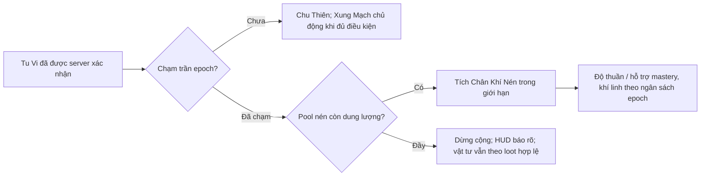
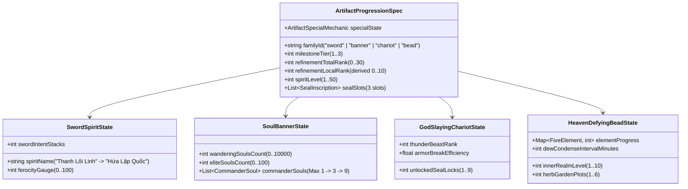
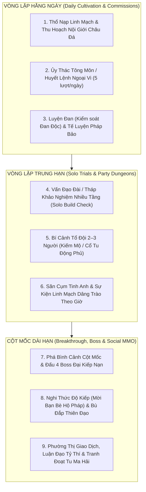
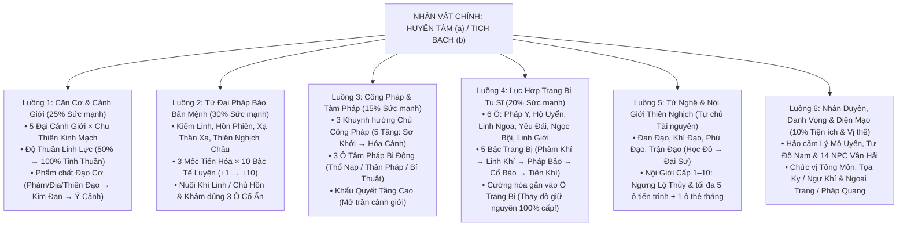

# Đặc Tả Chiều Sâu Tu Luyện, Nhịp Độ Thời Gian & Hệ Sinh Thái RPG MMO (GDD 0.35 · 15/10/2026)

> **Thống nhất 15/10:** [Hợp đồng GDD 0.35](GDD-035-UNIFIED-CONTRACT.md) quy định điều kiện mở khóa, hai nhánh Trúc Cơ, kế thừa và trạng thái ART. Các con số balance/thời lượng là mục tiêu fixture, chưa phải kết quả playtest. Logic bản chạy chưa phát hành có thể refactor theo yêu cầu owner; tái dùng ART hiện có, chỉ bổ sung phần thiếu.

> **Mục đích tài liệu:** Giải quyết triệt để vấn đề **“Game Feel còn ngắn, thời gian tu luyện và đột phá quá nhanh”** sau đợt rà soát GDD 0.34 (14/10/2026). Tài liệu này mở rộng khung tiến trình 5 Đại Cảnh Giới (`Ngưng Khí → Trúc Cơ → Kết Đan → Nguyên Anh → Hóa Thần`) và 11 Hồi `VG01–VG11` thành **một hệ sinh thái Tu Tiên RPG MMO có chiều sâu hàng trăm giờ chơi**, kết hợp **Khổ Tu Đa Trục (Tu Vi – Độ Thuần Khí – Kinh Mạch – Khẩu Quyết)**, **Ôn Dưỡng Pháp Bảo 10 Bậc/Mốc**, **Trang Bị Tu Sĩ 6 Ô & Tứ Nghệ (Đan – Khí – Phù – Trận)** cùng **Nhịp Mở Khóa Kỷ Nguyên Máy Chủ (`Thiên Đạo Phong Ấn`)**.  
> **Ranh giới bảo toàn:** Giữ identity, bốn họ pháp bảo và mã VG01–VG11. Owner cho phép refactor logic bản chạy chưa phát hành; không sửa nguồn ART/approval/basis lịch sử hoặc ghi owner map/DB. 955 kiểm G2 v1 là baseline nhanh 0.34, không chứng minh cơ chế 0.35 đã hoàn tất.

---

## 1. Chẩn Đoán Nguyên Nhân Khiến "Game Feel Ngắn & Tu Luyện Quá Nhanh" Ở Bản 0.34

Qua nghiên cứu đối chiếu bản GDD 0.34 (14/10/2026) với cảm giác chơi thực tế của thể loại **Tu Tiên RPG MMO** (*Mịch Trường Sinh, Quỷ Cốc Bát Hoang, Nhất Niệm Tiêu Dao, Tru Tiên Thế Giới, Dật Kiếm Phong Vân Quyết*) và nguyên tác *Tiên Nghịch*, có **4 nguyên nhân trực tiếp** làm nhịp tu luyện bị trôi quá nhanh:

| Điểm hạn chế trong bản 0.34 (14/10) | Hệ quả đối với "Game Feel" | Giải pháp Cốt lõi trong GDD 0.35 (15/10) |
| --- | --- | --- |
| **1. Đồng nhất "Xong 1 Hồi Truyện = Nhảy 3 Tầng Cảnh Giới":** Hồi I dự kiến chỉ `~15 phút` đã lên thẳng Ngưng Khí tầng 3; các Hồi II–V mỗi hồi chỉ cần làm 2 bước + đánh 1 Boss là nhảy vọt 3 tầng Ngưng Khí; sang Chặng 2 (`VG07–VG10`) mỗi hồi chỉ có **1 bước duy nhất** đã nhảy trọn 1 Tiểu Cảnh Giới Trúc Cơ. | Người chơi cảm giác cảnh giới tu tiên quá rẻ, lên cấp vèo vèo như game hành động tuyến tính 2–3 giờ là tới Kết Đan, mất đi sự khắc nghiệt và cảm giác thành tựu khi vượt qua một bậc tu hành. | **Tách "Mở Cốt Truyện" khỏi "Độ Dày Tu Luyện Giữa Các Hồi":** Mỗi tầng Ngưng Khí được chia thành **Chu Thiên Kinh Mạch**; mỗi Tiểu Cảnh Giới Trúc Cơ/Kết Đan gồm **9 Trọng Thiên (tổng 36 nấc/đại cảnh giới)**. Cốt truyện (`VG01–VG11`) đóng vai trò **Mở Cổng & Biến Cố Đỉnh Cao**, còn ở giữa là **75–80% thời lượng cày cuốc, khổ tu, luyện đan, tế luyện pháp bảo và săn bí cảnh**. |
| **2. Tự động nhảy tầng chỉ bằng 1 chỉ số EXP đơn thuần:** Chỉ cần đủ `totalCultivationExp` là tự động nhảy qua các tầng `2, 4, 5, 7, 8, 10, 11, 13, 14` mà không có ma sát tu luyện hay rủi ro căn cơ. | Tu luyện bị biến thành thanh Level RPG phương Tây thông thường; không có khái niệm **Linh Lực Hư Phù, Đan Độc, Thiếu Khẩu Quyết Tầng Cao** hay **Bế Quan Xung Mạch**. | **Thiết lập "Tam Trụ Tu Luyện Nội Tại":** Muốn đột phá mỗi tầng phải thỏa mãn đủ 3 trục: **(1) Tu Vi Khí Hải (Lượng)** + **(2) Độ Thuần Linh Lực / Kháng Đan Độc (Chất)** + **(3) Đả Thông Kinh Mạch & Khẩu Quyết Tầng Tương Ứng (`[Nguyên tác Ch.33]`)**. |
| **3. Pháp Bảo và Công Pháp tiến hóa quá phẳng:** 4 Pháp Bảo chỉ nhảy 3 mốc lớn (Mốc I → II → III) theo nhiệm vụ; 3 Khuynh hướng Công pháp mở ra là dùng tối đa hiệu lực ngay. | Thiếu mục tiêu farm hằng ngày (Daily/Weekly Grind) cho một game MMO. Khi chưa đến nhiệm vụ mở Mốc II, người chơi không biết cày nguyên liệu để nâng cấp cái gì. | **Mở rộng Trục Nuôi Dưỡng Chiều Ngang & Chiều Sâu:** • Mỗi Mốc Pháp Bảo có **10 Bậc Tế Luyện (`+1 → +10`)**, **Hệ thống Nuôi Khí Linh / Nạp Hồn** và **Khảm Cổ Ấn**. • Mỗi Công Pháp & Kỹ năng có **5 Tầng Lĩnh Ngộ (`Sơ Khởi → Tiểu Thành → Đại Thành → Viên Mãn → Hóa Cảnh`)** cần *Tàn Quyển Bí Tịch* và độ thuần thục thực chiến. |
| **4. Thiếu Hệ Trang Bị Tu Sĩ, Nghề Chế Tác & Nhịp Máy Chủ MMO:** Nhân vật chỉ có Pháp Bảo mà chưa có đồ phòng cụ/phụ kiện tu sĩ, chưa có chu kỳ Đan–Khí–Phù–Trận sâu và chưa có nhịp giữ chân cộng đồng MMO. | Thế giới thiếu nền kinh tế trao đổi giữa người chơi; người cày nhiều hoàn thành sớm rồi hết việc làm, người vào sau bị bỏ rơi. | **Bổ sung Hệ Sinh Thái RPG MMO Hoàn Chỉnh:** • **6 Ô Trang Bị Tu Sĩ** (*Pháp Y, Hộ Uyển, Linh Ngoa, Yêu Đái, Ngọc Bội, Linh Giới*) + **Tứ Nghệ (Đan – Khí – Phù – Trận)**. • Cơ chế **"Thiên Đạo Phong Ấn" (`Server Epoch Gate`)** kiểm soát nhịp độ mở cảnh giới theo ngày/tuần của máy chủ. |

---

## 2. Ngân Sách Thời Lượng Tu Luyện Mục Tiêu & Cơ Chế "Thiên Đạo Phong Ấn"

### 2.1. Bảng Ngân Sách Thời Gian Mục Tiêu Cho Từng Cảnh Giới (Pacing Budget)

Ngân sách dưới đây là **mục tiêu chơi chủ động của tuyến Cổ Cảnh/Thiên Đạo**, chưa kiểm bằng playtest. Ghi riêng giờ chủ động, online thụ động, offline và ngày lịch; không cộng chờ epoch/offline vào ngân sách hoặc tính trùng chu kỳ Nội Giới với hoạt động đồng thời. Nhánh Trúc Cơ tầng 12 cần đo riêng. Lịch ngày/tuần là kịch bản mô phỏng, không phải lịch phát hành đã chốt.

| Chặng & Cảnh Giới | Cấu Trúc Tầng / Chu Thiên Chi Tiết | Giờ Chơi Chủ Động Mục Tiêu (Chưa Đo) | Nhịp Mở "Thiên Đạo Phong Ấn" (Server Epoch) | Trải Nghiệm Cốt Lõi & Điểm Nghẽn Cần Vượt Qua ("Game Feel") |
| --- | --- | --- | --- | --- |
| **1A. Ngưng Khí Sơ Kỳ** *(Tầng 1 → Tầng 3)* | **3 Tầng × 3 Chu Thiên Kinh Mạch = 9 Nấc** + Khai mở Khí Hải | **2.5 – 4 giờ** *(Thay cho 15 phút cũ)* | **Ngày 1 Máy Chủ** *(Trần Ngày 1: Ngưng Khí Tầng 6)* | • **Tầng 1 → 2:** Lạc xuống Hẻm Vân Liệt nhặt Châu Đá, nhưng 1 giọt lộ thủy đầu tiên chỉ giúp mở **Kinh Mạch Tầng 1 Viên Mãn**. Ba Chu Thiên tầng 1 đã được giọt đầu hoàn tất một lần; học Diệp Tĩnh và chủ động Xung Mạch lên tầng 2, không cộng lại ba Chu Thiên này. • **Tầng 2 → 3:** Rèn Kiếm I +2 cùng Tống Thiết, luyện Chu Thiên tầng 2, thực chiến Khôi Lỗi/Trận Dẫn Khí và Xung Mạch lên tầng 3; luyện nốt Chu Thiên tầng 3 để kết hồi với tổng chín. |
| **1B. Ngưng Khí Trung – Hậu Kỳ** *(Tầng 4 → Tầng 9)* | **6 Tầng × 6 Chu Thiên Kinh Mạch = 36 Nấc** + 2 Bình Cảnh Lớn (Tầng 6 & Tầng 9) | **12 – 20 giờ** | **Ngày 1 – Ngày 4** *(Trần Ngày 3: Ngưng Khí Tầng 9)* | • **Bình cảnh Khẩu Quyết Tầng 4 (`[Nguyên tác Ch.33]`):** Ngoại môn chỉ phát công pháp đến tầng 3. Muốn tu tiếp tầng 4–6 và 7–9, người chơi phải làm Ủy thác Tông môn, săn yêu thú ngoại vi và thu thập *Tàn Quyển* đổi khẩu quyết tại Tàng Kinh Các (Lục Văn). • **Nuôi Hồn Phiên Mốc I:** Không phải giao 3 nguyên liệu là xong ngay — cần thu nạp **100 Du Hồn** quái thường + **5 Yêu Hồn Tinh Anh (Lang Tuần Sơn)** để luyện thành *Tiểu Hồn Phiên (+4)* theo mục tiêu fixture trước khi đấu **Vân Nha Lang Vương** ở Tầng 6. |
| **1C. Ngưng Khí Đỉnh Phong & Cổ Cảnh** *(Tầng 10 → 15 → Trúc Cơ)* | 6 tầng × 9 Chu Thiên = 54 nấc trên tuyến Cổ Cảnh. | **26 – 41 giờ** *(Tổng tuyến Cổ Cảnh: **40.5 – 65 giờ**, gọi rút gọn khoảng 40–65 giờ)* | Ngày 6–10 (mô phỏng; trần Trúc Cơ áp dụng cho cả hai nhánh). | **Hai đường nhập cùng VG07:** Tầng 12 có thể hoàn tất cốt truyện Rừng Cổ Mộc/Lý Mộ Uyển và đột phá Phàm/Địa Đạo sau Hắc Ấn. Tùy chọn hoàn tất Cổ Cảnh 13–15, độ thuần >=95%, đan thượng phẩm và chứng đạo nâng cao để đạt Thiên Đạo. Không dùng trần tầng 13 để khóa nguồn đan cơ bản của nhánh sớm. Cổ Cảnh là chuyển thể riêng, không phải kết luận từ Ch.33. |
| **2. Đại Cảnh Giới Trúc Cơ** *(Sơ → Trung → Hậu → Viên Mãn)* | **4 Tiểu Cảnh Giới × 9 Trọng Chu Thiên = 36 Nấc Chân Nguyên** + 3 Bình Cảnh Huyết Mạch | **80 – 120 giờ** | **Tuần 2 – Tuần 5** *(Mở từng Tiểu Cảnh Giới mỗi 5–7 ngày)* | • Chấm dứt việc mỗi Hồi (`VG07–VG10`) nhảy 1 Tiểu Cảnh Giới chỉ bằng 1 nhiệm vụ! • Mỗi Tiểu Cảnh Giới (Sơ / Trung / Hậu / Viên Mãn) đòi hỏi đả thông **9 Trọng Chân Nguyên**, cày **Bí Cảnh Tổ Đội 2–3 người (Hàn Thiết Kiếm Mộ, Di Tích Cổ Tu)**, nâng cấp bộ 6 Trang Bị Linh Khí, và **tế luyện cả 4 Pháp Bảo từ Mốc I (+10) lên Mốc II (+10)**. |
| **3. Đại Cảnh Giới Kết Đan** *(Sơ → Trung → Hậu → Viên Mãn)* | **4 Tiểu Cảnh Giới × 9 Trọng Đan Văn = 36 Nấc** + Ngưng tụ Bản Mệnh Kim Đan | **150 – 250 giờ** | **Tháng 2 – Tháng 3** | • Tiến vào **Tu Ma Hải**: Mở **Động Phủ Cá Nhân**, trồng linh thảo bậc cao, tham gia **Chiến Trường Phe Phái (Chính – Ma – Tán Tu)**, săn Boss Hải Đảo 5 người đoạt Chủ Hồn Kết Đan và chuẩn bị chống **Tam Trọng Kiếp Lôi**. |
| **4. Nguyên Anh & 5. Hóa Thần** | **Phá Đan Thành Anh (36 Nấc)** & **Lĩnh Ngộ Ý Cảnh (Đạo Vực)** | **300+ giờ (Endgame dài hạn)** | **Tháng 4 – Tháng 6+** | • Cổ Thần Chi Địa, Vực Sâu Tinh Không, đại kiếp thọ nguyên Lý Mộ Uyển, tái tạo nhục thân Tư Đồ Nam, tiến hóa Pháp Bảo lên **Mốc III (Thập Ức Tôn Hồn Phiên / Đạo Vực)** và tranh bá liên tông môn. |

---

### 2.2. Cơ Chế "Thiên Đạo Phong Ấn" (`Server World Epoch & Qi Compression`)

Thiên Đạo Phong Ấn giới hạn realm/tầng/Chu Thiên theo cấu hình epoch có phiên bản. Hai nhánh tầng 12 và tầng 15 dùng cùng trần Trúc Cơ. Lịch minh họa: ngày 1 tới Ngưng Khí 6, ngày 3 tới 9, ngày 6 tới 12, ngày 8 mở 15 và Trúc Cơ Sơ Kỳ; cần mô phỏng trước khi chốt vận hành.

Pool không đổi lại EXP để nhảy nhiều tầng khi mở trần; không thay sách, chủ hồn, vật tư mở mốc hoặc thử thách. Dung lượng/tỷ lệ đổi/ngân sách chi phải hữu hạn và được cấu hình trước khi mở tính năng. Không hứa tích EXP vô hạn. Catch-up 50–150% là dải fixture cần đo, chỉ áp dụng dưới trần và không bỏ qua các cổng; xem [hợp đồng mục 7](GDD-035-UNIFIED-CONTRACT.md#7-epoch-và-chân-khí-nén).

---

## 3. Tam Trụ Tu Luyện Nội Tại: Tu Vi – Độ Thuần Linh Lực (Đan Độc) – Chu Thiên Kinh Mạch

Để mỗi lần tăng tầng mang lại cảm giác **"tu tiên thực thụ"** thay vì chỉ là một con số nhảy tự động, hệ thống tu luyện được cấu thành từ **3 trụ cột tương tác trực tiếp với nhau**:

### 3.1. Trụ 1: Chu Thiên Kinh Mạch & Nghi Thức Xung Mạch (`Meridian Sub-cycles`)
- Thay vì nhảy thẳng từ Tầng $N$ lên Tầng $N+1$, mỗi tầng cảnh giới yêu cầu người chơi đả thông các **Huyệt Đạo / Chu Thiên Kinh Mạch**:
  - **Ngưng Khí Tầng 1–3:** 3 Chu Thiên / tầng (*Đan Điền → Khí Hải → Bách Hội*).
  - **Ngưng Khí Tầng 4–9:** 6 Chu Thiên / tầng (*Khai thông Nhâm – Đốc Nhị Mạch*).
  - **Ngưng Khí Tầng 10–15 (Đỉnh Phong & Cổ Cảnh):** 9 Chu Thiên / tầng (*Thập Nhị Chính Kinh & Cực Cảnh Thức Hải*).
  - **Trúc Cơ / Kết Đan / Nguyên Anh:** Mỗi Tiểu Cảnh Giới (*Sơ – Trung – Hậu – Viên Mãn*) gồm **9 Trọng Thiên (`Nhất Trọng → Cửu Trọng Viên Mãn`)**.
- **Quy tắc UX cân bằng (Không phiền nhiễu nhưng có trọng lượng):**
  - Các **Nấc Chu Thiên nhỏ** bên trong 1 tầng tự động đả thông và cộng chỉ số mượt mà khi đủ Tu Vi ngoài thực địa.
  - Khi đạt **Đỉnh của một Tầng (ví dụ: hoàn tất Chu Thiên thứ 6/6 của Tầng 4 để lên Tầng 5)**, nút **"Xung Mạch Đột Phá"** trên HUD Đạo Ấn sẽ sáng lên. Người chơi cần ngồi **Vận Khí Xung Mạch (`5s – 15s` ở nơi an toàn hoặc trong Nội Giới)** để chính thức bước sang tầng mới!

### 3.2. Trụ 2: Độ Thuần Linh Lực & Cơ Chế Đan Độc (`Qi Purity & Pill Toxicity`)
Trong truyện tiên hiệp, kẻ chỉ dựa vào việc nuốt đan dược vô độ sẽ bị **Đan Độc ứ đọng, căn cơ hư phù**, không thể vượt qua đại cảnh giới. GDD 0.35 đưa quy luật này vào gameplay:

| Chỉ Số Nội Tại | Phạm Vi & Trạng Thái | Tác Động Trực Tiếp Tới Gameplay & Đột Phá | Cách Cải Thiện / Hóa Giải (Vòng Lặp Chơi) |
| --- | --- | --- | --- |
| **Độ Thuần Linh Lực** (`qiPurity`) | **50–100%**, clamp server 0.50–1.00. | >=95% mở Cổ Cảnh/điều kiện Thiên Đạo; 75–94% là dải thường; <75% khóa bắt đầu mọi Xung Mạch. Bonus chỉ số +10%, giảm sát thương/MP khi hư phù là số fixture, chưa balance. Không cộng xác suất đột phá sau khi đã thắng thử thách. | Gain +0.5–2% chỉ từ encounter đúng bậc/độ khó được server xác nhận, một lần mỗi encounterLifeId và có trần theo kỳ; quái quá thấp không cho gain. Lộ Thủy +5%/giọt và giải độc -5/giờ là số fixture. |
| **Đan Độc Tích Tụ** (`pillToxicity`) | 0–100; <=60 được kiểm trước Xung Mạch. | Fixture: Hạ phẩm +18 độc/-4% thuần; Trung +10/-1.5%; Thượng/Đan Văn +4 độc/không giảm thuần. >60 giảm hấp thu và khóa bắt đầu Xung Mạch; đan cao phẩm vẫn gây độc. | Điều tức, thực chiến hợp lệ, Thanh Tâm/Tẩy Tủy, Linh Tuyền; thời gian đào thải dùng clock server, không nhân đôi khi reconnect. |

### 3.3. Trụ 3: Bình Cảnh Khẩu Quyết & Tâm Ma Khảo Nghiệm (`Manual Gates & Inner Demon Trials`)
- **Bình Cảnh Khẩu Quyết (`[Nguyên tác Ch.33]`):**
  - Ở Hằng Nhạc Phái, đệ tử mới chỉ có khẩu quyết Ngưng Khí tầng 1–3. Khi đạt đỉnh tầng 3, tầng 6, tầng 9, tầng 12, người chơi **bắt buộc phải thu thập đủ bộ Khẩu Quyết tầng kế tiếp**:
    - *Tầng 4–6 (`Ngưng Khí Trung Thiên Quyết`):* Đổi bằng Công Huân Ngoại Môn (làm nhiệm vụ Đinh Sóc / Hứa Hành) hoặc ghép 5 *Tàn Trang Nội Môn*.
    - *Tầng 7–9 (`Ngưng Khí Hậu Thiên Quyết`):* Cùng **Lục Văn** giải mã cổ tịch và vượt khảo nghiệm Tàng Kinh Các.
    - *Tầng 10–12 (`Hằng Nhạc Tinh Nguyên Quyết`):* Đoạt từ tay phản đồ Hắc Phù hoặc vượt Sân Khảo Nghiệm Nội Môn.
    - *Tầng 13–15 (`Viễn Cổ Cực Cảnh Quyết`):* Truyền thừa bí mật do **Tư Đồ Nam** mở khóa trong Thiên Nghịch Châu khi Độ Thuần Linh Lực đạt $\ge 95\%$.
- **Thất bại và hồi phục:** Thiếu điều kiện thì từ chối trước khi tiêu vật tư, không phạt. Bị ngắt nghi thức/thua Tâm Ma hoặc Boss có thể gây Kinh Mạch Chấn Động; 5 phút/10% Tu vi tầng hiện tại là số fixture cần đo. Không tụt cảnh giới/đồ/tế luyện. Đủ điều kiện và vượt thử thách thì thành công, không tung thêm xúc xắc; xem [hợp đồng mục 6](GDD-035-UNIFIED-CONTRACT.md#6-độ-thuần-đan-độc-và-thất-bại).

---

## 4. Chiều Sâu Bốn Họ Pháp Bảo: Tế Luyện 10 Bậc, Nuôi Khí Linh & Khảm Cổ Ấn

Để 4 Pháp Bảo biểu tượng (**Kiếm linh, Hồn phiên, Xạ Thần Xa, Thiên Nghịch Châu**) thực sự là linh hồn của vòng lặp cày cuốc RPG MMO, mỗi Pháp Bảo được mở rộng thành **3 Lớp Tiến Hóa Chuyên Sâu**:

### 4.1. Bảng Ma Trận Nuôi Dưỡng 4 Họ Pháp Bảo Trong Suốt Vòng Đời MMO

| Họ Pháp Bảo | Lớp 1: Tế Luyện 10 Bậc / Mốc (`+1 → +10`) | Lớp 2: Cơ Chế Nuôi Dưỡng Độc Quyền (Cày Cuốc Thực Địa) | Lớp 3: Ô Khảm Cổ Ấn (`Seal Slots`) & Điều Kiện Lên Mốc Kế |
| --- | --- | --- | --- |
| **1. Kiếm linh** *(Hứa Lập Quốc)* | Tổng bậc 0–30, trần 10/20/30 theo mốc. Mốc I: Huyền Thiết/Đá Mài Kiếm sơ cấp; Mốc II: Hàn Thiết Tinh Kim. | Tôi Kiếm Ý; từ Mốc II nuôi Hung Tính Hứa Lập Quốc bằng huyết tinh. Hệ số crit/truy kích là fixture. | Đúng 3 ô Kiếm Ấn. I +10 + thắng/trấn áp Hứa Lập Quốc VG08 → II +0, giữ tổng bậc 10 và bonus đã kiếm. |
| **2. Hồn phiên** | Mốc I: Mảnh Hắc Phù/Mộc Linh Dịch; Mốc II: Huyết Văn Lụa/Âm Mộc. Tế luyện tổng bậc kế thừa, không reset bonus. | Du Hồn/Tinh Hồn tăng nuôi dưỡng; chủ hồn có danh tính mang kỹ năng riêng. I ở VG02 cần 100 Du Hồn + 5 Yêu Hồn Lang Tuần Sơn. | Đúng 3 ô Hồn Ấn. I +10 + **1.000 Tinh Hồn Trúc Cơ + 2 Chủ Hồn (Lang Tuần Sơn/Phù Sư Hắc Lụa khảo nghiệm Trúc Cơ)** mở II tại VG07; hồn Chấp Sự bổ sung thứ ba sau trận VG10. |
| **3. Xạ Thần Xa** | Mốc I: Mảnh Khôi Lỗi/Giáp Ngọc Trùng; Mốc II: Thiên Lôi Thiết. Tổng bậc kế thừa như Kiếm/Phiên. | Tổng chín khóa, ba khóa/mốc. Có Xa I sau Tam Ấn VG04. | Đúng 3 ô Xa Ấn. I +10 và giải khóa 4–6 **trước Hộ Đạo Đan Thất VG09** để có Xa II dùng trong trận. Chiến thắng giữ lò trao đan/tín vật. |
| **4. Thiên Nghịch Châu** | Châu có tổng bậc tế luyện 0–30 riêng; Nội Giới cấp 1–10 là trục độc lập. Mốc I dùng Mộc Linh Dịch/Lộ Thủy. | Nội Giới sơ khai VG03/cấp 3 VG05; quản lý đầy đủ VG07. Linh điền tối đa 5 ô tiến trình + 1 ô thẻ tháng (trần 6). | Đúng 3 ô Đạo Ấn. Châu I +10 + Nội Giới cấp 5 + đủ Ngũ Hành từ VG04–VG09 mở Châu II **trước trận VG10**. VG07 không tự cấp Châu II. |

---

## 5. Hệ Thống Công Pháp 5 Tầng, Trang Bị Tu Sĩ 6 Ô & Tứ Nghệ Tu Tiên

### 5.1. Công Pháp Chủ Đạo & Tâm Pháp Phụ Trợ (`5-Tier Manuals & Sub-Manuals`)
1. **Năm Tầng Lĩnh Ngộ Cho Mỗi Công Pháp:**
   - Ba Khuynh hướng Công pháp chính (*Kiếm Sát Quyết, Ngự Hồn Quyết, Trấn Nhạc Quyết*) và bộ kỹ năng Pháp Bảo không còn đạt 100% sức mạnh ngay khi vừa mở khóa, mà chia thành **5 Tầng Lĩnh Ngộ**:
     - **Tầng 1 — Sơ Khởi (Mới học):** Đạt `60%` hiệu số tối đa của công pháp.
     - **Tầng 2 — Tiểu Thành:** Đạt `75%` hiệu số (Cần `500` độ thuần thục thực chiến + `3 Tàn Quyển Quyển Thượng`).
     - **Tầng 3 — Đại Thành:** Đạt `90%` hiệu số + Mở hiệu ứng nội tại cấp 1 (Cần `2.000` độ thuần thục + `5 Tàn Quyển Quyển Trung` có nguồn solo VG04).
     - **Tầng 4 — Viên Mãn:** Đạt `100%` hiệu số chuẩn (Cần `5.000` độ thuần thục + `8 Tàn Quyển Quyển Hạ` có nguồn solo VG07 + Tư Đồ Nam chỉ điểm).
     - **Tầng 5 — Hóa Cảnh (Đạo Ý):** Đạt `120%` hiệu số + Thay đổi hiệu ứng phụ kỹ năng (Cần ngộ đạo qua Độ Kiếp / Tháp Vấn Đạo).
2. **Hệ Thống Tâm Pháp Phụ Trợ (`Passive Sub-Manuals — 3 Ô Trang Bị Tâm Pháp`):**
   - Người chơi có thể sưu tầm các bộ **Tâm Pháp Phụ** từ Tàng Kinh Các, Kỳ ngộ, Bí cảnh và Boss để lắp vào **3 Ô Tâm Pháp Bị Động**:
     - *Ô 1 — Thổ Nạp Tâm Pháp:* Ví dụ `Hằng Nhạc Triều Dương Quyết` (Tăng tốc độ hồi MP), `Thiên Nghịch Thôn Linh Quyết` (Tăng hấp thu Tu vi từ đan dược).
     - *Ô 2 — Thân Pháp / Bộ Pháp:* Ví dụ `Vân Ảnh Bộ` (Giảm hồi chiêu Lướt né), `Bàn Thạch Thân` (Miễn nhiễm đẩy lùi khi đang vận chiêu AOE).
     - *Ô 3 — Bí Thuật Công Kích:* Ví dụ `Toái Linh Chỉ` (Đòn đánh thường thứ 4 gây sát thương chuẩn), `Huyết Diễm Bí Thuật` (Đốt 5% HP bản thân để tăng 20% sát thương trong 6s).

### 5.2. Sáu Ô Trang Bị Tu Sĩ (`6-Slot Cultivator Equipment`) & Hiệu Ứng Bộ
Để tạo mục tiêu săn đồ, chế tạo và giao dịch phong phú chuẩn RPG MMO mà **không làm phát sinh gánh nặng vẽ lại hàng nghìn frame quần áo nhân vật** (giữ nguyên diện mạo `Huyễn Tâm a` / `Tịch Bạch b` đã chốt), nhân vật có **6 Ô Trang Bị Phòng Cụ & Phụ Kiện Tu Sĩ**:

| Ô Trang Bị | Chỉ Số Chính (Main Stats) | Dòng Phụ Ngẫu Nhiên / Luyện Hóa (1–4 Affixes) | Các Bộ Trang Bị Tiêu Biểu (Set Bonus 2 / 4 / 6 Món) |
| --- | --- | --- | --- |
| **1. Pháp Y (Áo)** | Sinh Lực (HP), Phòng Thủ Nội/Ngoại | Giảm sát thương nhận từ Tinh Anh/Boss, Kháng Độc/Lôi | • **Bộ Thanh Vân Ngoại Môn (Ngưng Khí 1–6):**   - *(2 món)*: `+10%` Max HP.   - *(4 món)*: Khi bật `Dẫn Giới Hộ Thân`, hồi nhẹ `5%` HP. • **Bộ Vân Nha Sát Lục (Ngưng Khí 6–12 — Săn Lang Vương & Tinh Anh):**   - *(2 món)*: `+8%` Tỷ lệ Bạo kích.   - *(4 món)*: Đòn ST Pháp Bảo gây thêm vết thương rỉ máu.   - *(6 món)*: Hạ gục mục tiêu giảm `1.5s` hồi chiêu mọi kỹ năng. • **Bộ Huyền Thiết Trấn Ấn (Ngưng Khí 12–Trúc Cơ — Săn Tam Ấn & Cổ Mộc):**   - *(2 món)*: `+15%` Phòng thủ & Kháng choáng.   - *(4 món)*: Tăng `25%` sát thương phá Giáp/Ấn Boss. • **Bộ Quyết Minh Đan Tâm / Hàn Thiết Kiếm Ma (Chặng 2 — Trúc Cơ):**   - Rơi từ Bí cảnh tổ đội Kiếm Mộ & Hộ Đạo Đan Thất, cường hóa trực tiếp Pháp Bảo Mốc II. |
| **2. Hộ Uyển (Tay)** | Lực Công Kích, Xuyên Giáp | Tăng sát thương ST, Tốc độ xuất chiêu | *(Nt)* |
| **3. Linh Ngoa (Giày)** | Tốc Độ Di Chuyển, Né Tránh | Giảm tiêu hao MP khi Lướt, Kháng làm chậm | *(Nt)* |
| **4. Yêu Đái (Đai)** | Sinh Lực (HP), Giới Hạn Linh Lực (MP) | Tăng số lượng mang Đan dược, Giảm tích tụ Đan Độc | *(Nt)* |
| **5. Ngọc Bội** | Hồi Linh Lực (MP/s), Độ Thuần Khí | Tăng hiệu quả Khiên Hộ Thể, Tăng tốc độ Thổ nạp | *(Nt)* |
| **6. Linh Giới (Nhẫn)** | Tỷ Lệ Bạo Kích, Sát Thương Bạo Kích | Tăng sát thương AOE Pháp Bảo, Hút Sinh Lực | *(Nt)* |

### 5.3. Tứ Nghệ Tu Tiên (`Đan – Khí – Phù – Trận`) & Nền Kinh Tế MMO
Mỗi nghề gắn trực tiếp với các NPC trong roster 14 NPC Vân Hải và đóng vai trò **nguồn cung – điểm tiêu (Source & Sink)** không thể thiếu trong quá trình tu luyện:
1. **Đan Đạo (`Bạch Chỉ` & `Lý Mộ Uyển`):**
   - Người chơi thu thập linh thảo ngoài tự nhiên hoặc trồng trong **Linh Điền Thiên Nghịch Châu**.
   - Khi luyện đan có mini-game / cơ chế **Khống Hỏa & Ngưng Đan**: căn đúng nhịp linh hỏa sẽ cho ra **Thượng Phẩm / Cực Phẩm Đan** (tăng Tu vi theo recipe; fixture cao phẩm vẫn +4 Đan Độc và không giảm độ thuần, có thể đem bán giá cao trên Phường Thị cho người chơi khác!).
2. **Khí Đạo (`Tống Thiết`):**
   - Rèn đúc 6 món trang bị tu sĩ, phân giải đồ dư lấy *Linh Thiết Tinh Hoa*, và **Tẩy Luyện / Khắc Minh Văn** lại dòng thuộc tính phụ của trang bị.
3. **Phù Đạo (`Lục Văn`):**
   - Chế tạo các loại **Linh Phù Tiêu Hao** gắn vào ô vật tư chiến thuật: *Phá Cấm Phù* (phá ấn Boss), *Thần Hành Phù* (tăng tốc chạy), *Kim Quang Hộ Thân Phù* (đỡ đòn), *Tụ Linh Phù* (tăng 30% tốc độ thổ nạp trong 30 phút).
4. **Trận Đạo (`Lý Mộ Uyển` & `Tư Đồ Nam`):**
   - Chế tạo **Trận Bàn Di Động** đặt xuống mặt đất trước các trận đánh lớn: *Tụ Linh Trận* (hồi MP cho cả tổ đội 3 người trong Bí cảnh), *Khốn Sát Trận* (giữ chân đàn quái tinh anh), *Tị Lôi Hộ Đạo Trận* (bắt buộc phải có để giảm sát thương thiên lôi khi Độ Kiếp Kết Đan!).

---

## 6. Sáu Vòng Lặp Hoạt Động MMORPG Lấp Đầy "80% Sandbox Tu Luyện"

Để người chơi đăng nhập mỗi ngày đều có mục tiêu rõ ràng (Ngắn hạn 30 phút – Trung hạn 2 giờ – Dài hạn cả tuần), phần **80% Sandbox** được cấu trúc thành **6 Hệ Thống Hoạt Động Lặp Lại Có Chiều Sâu**:

1. **Vấn Đạo Đài / Sân Khảo Nghiệm Nhiều Tầng (`Endless/Tiered Trial Tower`):**
   - Ngay tại Sân Khảo Nghiệm Hằng Nhạc (và sau này là Tháp Cổ Tu ở Quyết Minh Cốc), người chơi có thể khiêu chiến từng tầng khảo nghiệm từ **Tầng 1 → Tầng 50**.
   - Mỗi tầng có tổ hợp quái/khôi lỗi và điều kiện khắc nghiệt riêng (ví dụ: phá hết ấn trong 45s, sống sót qua trận mưa phù ấn, hạ gục 2 tinh anh cùng lúc). Vượt tầng lần đầu và càn quét hàng ngày mang lại **Tàn Quyển Công Pháp, Đá Tế Luyện Pháp Bảo và Tu Vi Tinh Thuần (không gây Đan Độc)**.
2. **Ủy Thác Tông Môn & Bảng Huyết Lệnh (`Sect Commissions & Bounty Board`):**
   - Thay vì chạy việc vặt nói chuyện vô nghĩa, mỗi ngày bảng **Huyết Lệnh Ngoại Vi** cung cấp 5 nhiệm vụ thực chiến ngẫu nhiên có độ khó chọn lọc (1 Sao → 5 Sao): *Truy sát Tán Tu Hắc Phù lẩn trốn*, *Thu thập Linh Thảo dưới sự canh gác của Thiết Giáp Linh Trùng*, *Giải cứu đệ tử bị vây*, *Trấn áp Yêu Thú Bạo Động*.
   - Hoàn thành nhận **Điểm Cống Hiến Tông Môn** dùng để đổi **Khẩu Quyết Cảnh Giới Tầng Cao (`Tầng 4–12`)**, công thức đan dược và nguyên liệu chế đồ.
3. **Bí Cảnh Tổ Đội 1–3 Người Với 3 Độ Khó (`Normal / Hard / Hell Dungeons`):**
   - Mỗi vùng lớn đều có **Bí Cảnh Lặp Lại** (như *Hang Gió Hút Sâu, Sào Huyệt Lang Vương, Mật Thất Tam Ấn, Rừng Độc Cổ Mộc, Hàn Thiết Kiếm Mộ*):
     - **Độ khó Thường (Solo):** Phục vụ làm nhiệm vụ cốt truyện `VG01–VG11` và kiếm nguyên liệu cơ bản.
     - **Độ khó Khó & Địa Ngục (Tổ đội 2–3 người hoặc Solo khi đã cực mạnh):** Boss có thêm cơ chế phối hợp, rơi **Trang Bị Bộ Phẩm Chất Tím/Vàng, Chủ Hồn Biến Dị cho Hồn Phiên, và Mảnh Cổ Ấn Pháp Bảo**.
4. **Sự Kiện Thế Giới Mở & Boss Ngoại Vực Theo Khung Giờ (`Timed Field Events`):**
   - Định kỳ trên bản đồ chung xuất hiện **Linh Tuyền Dâng Trào** hoặc **Thủ Lĩnh Yêu Thú Xuất Thế**. Nhiều người chơi cùng khu vực có thể hợp sức tiêu diệt hoặc tỷ thí tranh quyền khai thác mỏ linh thạch thượng phẩm.
5. **Nghi Thức Hộ Pháp Độ Kiếp (`Cooperative Tribulation Protection`):**
   - Khi người chơi chuẩn bị đột phá các mốc lớn (**Ngưng Khí Tầng 15 Cổ Cảnh, Trúc Cơ, Kết Đan**), có thể chọn đột phá tại **Độ Kiếp Đài ngoài thực địa** và mời **1–2 đạo hữu đứng Hộ Pháp xung quanh**.
   - Trong lúc người đột phá đang ngồi vận khí chống Kiếp Lôi, các đợt *U Niệm / Tâm Ma Ảnh / Quái cướp đan* sẽ lao vào tấn công; đồng đội Hộ Pháp tiêu diệt chúng sẽ giúp người đột phá giữ vững `100%` tỷ lệ thành công và cả nhóm cùng nhận thưởng **Hộ Đạo Công Đức**!

---

## 7. Cấu Trúc Mới Của 11 Hồi `VG01–VG11`: Đầy Đủ Điều Kiện Tu Luyện Giữa Mỗi Hồi

Điều kiện đầy đủ theo [hợp đồng thống nhất mục 2–5](GDD-035-UNIFIED-CONTRACT.md#2-điều-kiện-chung-và-thứ-tự-sự-kiện). Bảng sau đồng bộ từ hợp đồng; thời lượng là mục tiêu tuyến Cổ Cảnh, chưa đo bằng playtest.

| Hồi | Vùng cảnh giới | Điều kiện và thứ tự thống nhất | Kết quả chính | Giờ tối thiểu | Giờ tối đa |
| --- | --- | --- | --- | --- | --- |
| VG01 | Ngưng Khí 1–3 | Nhặt Châu, hoàn tất ba Chu Thiên tầng 1 → học Xung Mạch lên 2 → nhận Kiếm/tế luyện I +2 → luyện tầng 2, vượt sân tập/Trận Dẫn Khí, Xung Mạch lên 3 → hoàn tất ba Chu Thiên tầng 3 (tổng 9). | Kiếm ST, Châu ST, mở Ngoại Vi. | 2.5 | 4 |
| VG02 | Ngưng Khí 4–6 | Có khẩu quyết 4–6; chế Phiên I bằng 100 Du Hồn + 5 Yêu Hồn Lang Tuần Sơn; tế luyện Phiên I +4; hạ Lang Vương; đủ 18 Chu Thiên và Xung Mạch tầng 6. | Phiên ST, Kiếm/Phiên AOE, lệnh bài đen. | 6 | 10 |
| VG03 | Ngưng Khí 7–9 | Thức Hải Tư Đồ Nam, khẩu quyết 7–9, đủ 18 Chu Thiên; Công pháp Tiểu Thành, độ thuần >=85%; giải lệnh bài, Xung Mạch tầng 9. | Ba khuynh hướng, Nội Giới sơ khai. | 6 | 10 |
| VG04 | Ngưng Khí 10–12 | Khẩu quyết 10–12, đủ 27 Chu Thiên; Kiếm/Phiên I +7; chuẩn bị Phá Cấm Phù, hạ Tam Ấn rồi nhận/giải lõi Xa I; Xung Mạch tầng 12. Lần hạ đầu không đòi Xa chưa sở hữu. | Xa I, mở Rừng Cổ Mộc. | 10 | 15 |
| VG05 | Ngưng Khí 12–15 | Chung: cứu đoàn dược sư, gặp Lý Mộ Uyển, hạ Cổ Mộc và lấy Thanh Mộc Linh Tâm, luyện Trúc Cơ Đan. Tùy chọn Cổ Cảnh: khẩu quyết 13–15, độ thuần >=95%, thêm 27 Chu Thiên và Xung Mạch từng tầng đến 15. | Lò đan, Châu AOE; nhánh sớm được hoàn tất hồi tại tầng 12. | 10 | 16 |
| VG06 | Ngưng Khí 12 hoặc 15 → Trúc Cơ | Chung: ít nhất hai pháp bảo I +10, Công pháp Đại Thành, thắng Hắc Ấn, có Trúc Cơ Đan và epoch cho phép. Chọn phẩm chất theo mục 3; ba ấn ký Tinh Anh không phải điều kiện chung. | Trúc Cơ Sơ Kỳ, Quyết Minh Cốc; cả hai nhánh nhập lại VG07. | 6 | 10 |
| VG07 | Trúc Cơ Sơ Kỳ | Mở Nội Giới đầy đủ chức năng quản lý; đủ 9 Trọng; Phiên I +10 + 1.000 Tinh Hồn Trúc Cơ + hai chủ hồn quy định ở mục 4 → Phiên II. | Phiên II với hai chủ hồn; chưa cần hồn Chấp Sự. | 15 | 25 |
| VG08 | Trúc Cơ Trung Kỳ | Đủ 9 Trọng, Công pháp Viên Mãn, Kiếm I +10; vào Kiếm Mộ bằng pháp bảo đang có, thắng/trấn áp Hứa Lập Quốc rồi mới mở Kiếm II. | Kiếm II/Hứa Lập Quốc. | 20 | 30 |
| VG09 | Trúc Cơ Hậu Kỳ | Đủ 9 Trọng; Xa I +10 và khóa 1–3 đã mở; giải khóa 4–6 trước trận, mở Xa II rồi Hộ Đạo Đan Thất. | Thiên Ly Đan và Ngọc Giản Hộ Mệnh sau khi giữ lò thành công. | 20 | 30 |
| VG10 | Trúc Cơ Viên Mãn | Đủ 9 Trọng; gom Ngũ Hành từ các nguồn VG04–VG09, Nội Giới cấp 5 và Châu I +10 để mở Châu II trước trận; tế luyện bốn họ II +10, đánh chân thân Hắc Ấn. | Chủ hồn Chấp Sự Giả Đan bổ sung vị trí thứ ba cho Phiên II. | 15 | 20 |
| VG11 | Trúc Cơ → Kết Đan | Độ thuần 100%, Thiên Ly Đan, Tị Lôi Hộ Đạo Trận; hoàn thành ba pha Kiếp Lôi. Có phương án NPC/khí linh hộ pháp mặc định khi solo. | Kết Đan, mở Tu Ma Hải. | 10 | 15 |

---

## 8. Kiến Trúc 6 Luồng Phát Triển Nhân Vật Xuyên Suốt (`6 Interlocking Character Progression Streams`)

Để người chơi (cả Dân Cày lẫn Dân Nạp) luôn cảm nhận được sự trưởng thành rõ rệt mỗi ngày mà không bị phụ thuộc duy nhất vào cấp độ cảnh giới, nhân vật **Huyễn Tâm (`a`) / Tịch Bạch (`b`)** được xây dựng trên **6 Luồng Phát Triển Xuyên Suốt từ Ngưng Khí đến Hóa Thần**, có cơ chế **Kế Thừa 100% Giá Trị Đầu Tư**:

### 8.1. Bảng Ma Trận Tiến Hóa 6 Luồng Nhân Vật Qua 5 Đại Cảnh Giới

| Luồng Phát Triển | Chặng 1: Ngưng Khí (Tầng 1–15) | Chặng 2: Trúc Cơ (Sơ → Viên Mãn) | Chặng 3: Kết Đan (Sơ → Kim Đan) | Chặng 4 & 5: Nguyên Anh → Hóa Thần | Cơ Chế Bảo Toàn Giá Trị (Chống Phế Đồ Khi Lên Cấp) |
| --- | --- | --- | --- | --- | --- |
| **1. Cảnh Giới, Kinh Mạch & Đạo Cơ** *(25% Power)* | • Đả thông Nhâm–Đốc Mạch (72 Chu Thiên nhánh tầng 12; 99 trên tuyến Cổ Cảnh). • Giữ Độ Thuần Khí $\ge 95\%$ mở **Cổ Cảnh 13–15**. | • Đả thông 36 Trọng Chân Nguyên. • Đúc **Phàm / Địa / Thiên Đạo Trúc Cơ** (Có thể Bù Đắp Đạo Cơ). | • Đả thông 36 Trọng Đan Văn. • Ngưng tụ **Bổn Mệnh Kim Đan** (*Kiếm / Hồn / Lôi Xa / Nghịch Pháp*). | • **Phá Đan Thành Anh** (Nguyên Anh xuất khiếu thuấn di). • Lĩnh ngộ **Đạo Vực Ý Cảnh** (*Sinh Tử / Sát Lục / Chân Giả*). | Chỉ số Chu Thiên và Phẩm chất Đạo Cơ (*Thiên Đạo Trúc Cơ*, *Thượng Phẩm Kim Đan*) cộng dồn vĩnh viễn theo tỷ lệ `%` xuyên suốt về sau. |
| **2. Tứ Đại Pháp Bảo Bản Mệnh** *(30% Power)* | • Mở **Mốc I** cho Châu, Kiếm, Phiên, Xa. • Tế luyện từ `+1 → +10`. • Nạp 100 Du Hồn + 1 Chủ Hồn Sơ cấp. | • Đột phá lên **Mốc II**. • Thu phục **Hứa Lập Quốc**, nạp **2 Chủ Hồn tại VG07; thêm hồn Chấp Sự tại VG10**, giải **6 Khóa Chiến Xa**, mở **Nội Giới**. | • Hoàn thiện **Mốc II Đỉnh Phong (`+10`)**. • Mở khóa chuỗi **Combo `F1–F2–F3`**. • Nạp Chủ Hồn bậc Kết Đan. | • Tiến hóa **Mốc III (`Thập Ức Tôn Hồn Phiên`, `Tử Kim Ma Kiếm`, `Xạ Thần Xa Toàn Ấn`, `Thiên Nghịch Đạo Vực`)**. | **4 Pháp Bảo đi theo nhân vật suốt đời!** Tổng bậc tế luyện 0–30 được giữ: I +10 → II +0 (tổng 10) → II +10 (tổng 20); bonus/cổ ấn/khí linh không mất, không cộng lại hai lần. |
| **3. Công Pháp & Tâm Pháp** *(15% Power)* | • Khẩu quyết Tầng 1–15. • Mở 3 Công pháp chính ở **Tầng 1 (Sơ Khởi) → Tầng 3 (Đại Thành)**. • Mở 1 Ô Tâm Pháp Phụ. | • Nâng Công pháp chính lên **Tầng 4 (Viên Mãn)**. • Mở Ô Tâm Pháp Phụ thứ 2 (*Thân Pháp / Bộ Pháp*). | • Nâng Công pháp lên **Tầng 5 (Hóa Cảnh)**. • Mở Ô Tâm Pháp Phụ thứ 3 (*Bí Thuật Công Kích*). | • Dung hợp Công pháp thành **Bản Mệnh Thần Thông** & **Cổ Thần Chiến Kỹ**. | Độ thuần thục công pháp giữ nguyên; có thể chuyển đổi qua lại giữa 3 Khuynh hướng (*Kiếm Sát / Ngự Hồn / Trấn Nhạc*) ngoài giao chiến. |
| **4. Lục Hợp Trang Bị Tu Sĩ (6 Ô)** *(20% Power)* | • **Bậc 1 (Phàm Khí):** Bộ *Thanh Vân* (Tầng 1–6). • **Bậc 2 Sơ (Hạ Phẩm Linh Khí):** Bộ *Vân Nha* & *Huyền Thiết* (Tầng 7–15). | • **Bậc 2 Cao (Thượng Phẩm Linh Khí):** Bộ *Quyết Minh Đan Tâm* & *Hàn Thiết Kiếm Ma* (Set 2/4/6 món). | • **Bậc 3 (Pháp Bảo Phòng Cụ):** Bộ *Tu Ma Huyết Hải* & *Thiên Lôi Trấn Pháp*. | • **Bậc 4 (Cổ Bảo Tu Chân)** & **Bậc 5 (Tiên Khí Toái Phiến)**. | **Cường hóa gắn vào Ô Trang Bị (`Slot Enhancement`):** Khi thay áo Trúc Cơ mới vào ô áo Ngưng Khí cũ, giữ nguyên 100% cấp cường hóa và đá khảm! Đồ cũ phân giải hoàn lại 80% đá tẩy luyện. |
| **5. Tứ Nghệ & Nội Giới** *(Economy & Support)* | • Nghề **Bậc 1 (Học Đồ → Nhất Phẩm)**: Luyện đan/rèn khí cơ bản. • Nội Giới Cấp 1–3 (1–2 Ô Linh Điền). | • Nghề **Bậc 2 (Nhị Phẩm Đan Sư / Luyện Khí Sư)**. • Nội Giới Cấp 4–6 (4 Ô Linh Điền, trồng dược 100 năm). | • Nghề **Bậc 3 (Tam Phẩm Tông Sư)**: Luyện đan Kết Đan, vẽ Phù Cao Cấp. • Nội Giới Cấp 7–8 (Mở Linh Tuyền). | • Nghề **Bậc 4–5 (Đại Tông Sư)**: Chế tạo Trận Bàn Đạo Vực & Tiên Đan. • Nội Giới Cấp 9–10 (tối đa 5 ô tiến trình + 1 ô thẻ tháng). | Cấp độ thông thạo nghề và cấp độ Nội Giới là tài sản vĩnh viễn của nhân vật, càng lên cao càng tạo ra vật phẩm giá trị lớn trên Phường Thị (kế thừa khóa theo nguyên liệu/recipe). |
| **6. Nhân Duyên, Danh Vọng & Tọa Kỵ** *(10% Utility & Prestige)* | • Hảo cảm 14 NPC Hằng Nhạc & gặp Lý Mộ Uyển. • Thân phận: *Tạp Dịch → Đệ Tử Ngoại Môn → Đệ Tử Nội Môn*. | • Kết Nhân Duyên Sinh Tử với **Lý Mộ Uyển** (*Ngọc Giản Hộ Mệnh*). • Mở **Ngự Khí Sơ Khởi** (*Ngự Phi Kiếm / Vân Nha Linh Lang*). | • Mở chuỗi tái tạo nhục thân **Tư Đồ Nam**. • Lập **Động Phủ / Tông Môn**. • Tọa kỵ *Lôi Thú / Huyết Hải Giao Long*. | • Đỉnh cao Nhân Duyên *Nghịch Thiên Tục Mệnh*. • Danh vị *Nhất Phương Lão Tổ / Hóa Thần Đạo Tôn*. | Bộ sưu tập Danh hiệu, Nhân duyên, Thời trang và Tọa kỵ được bảo lưu vĩnh viễn trong Đạo Thư. |

---

## 9. Hệ Thống 6 Tuyến Nhiệm Vụ & Ma Trận Content Thực Chiến ("Thù Đồ Đồng Quy")

Áp dụng bài học từ *Nghịch Thủy Hàn (`AppID 2782500` — "Paths Converge")*, *Tru Tiên Thế Giới (`AppID 3384260`)* và *Quỷ Cốc Bát Hoang (`AppID 1468810`)*, hệ thống nhiệm vụ và content của **Vân Hải Đạo Đồ** được chia thành **6 Tuyến Nhiệm Vụ Rõ Ràng** gắn với **Ma Trận Hoạt Động Đa Phong Cách**:

### 9.1. Sáu Tuyến Nhiệm Vụ Xuyên Suốt (`6-Track Quest Taxonomy`)

| Tuyến Nhiệm Vụ | Tần Suất & Thời Lượng | Vai Trò Cốt Lõi Trong Trải Nghiệm | Phần Thưởng Độc Quyền |
| --- | --- | --- | --- |
| **1. Mệnh Kiếp Chí** *(Main Story Catalysts — `VG01–VG11+`)* | Mỗi cảnh giới 5–6 Hồi lớn *(Solo / Co-op tùy chọn)* | Dẫn dắt cốt truyện sinh tử theo con đường Vương Lâm, mở khóa bản đồ mới, Pháp bảo gốc và Boss Đại Kiếp Nạn. Tự động chuyển bước ngoài thực địa (`Auto-Chain Fact`). | Mở khóa 4 Họ Pháp Bảo, mở Không Gian Nội Giới, Bản đồ mới, lượng lớn Tu Vi nền & *Tiên Ngọc Khóa*. |
| **2. Đạo Cơ Tu Hành Lục** *(Realm Progression Handbook)* | Liên tục theo từng Tầng / Tiểu Cảnh Giới | **Kim chỉ nam chống lạc hướng:** Giao các mục tiêu phát triển nhân vật cụ thể ở mỗi tầng (ví dụ: *"Tế luyện Kiếm Linh lên +3"*, *"Đạt Độ Thuần Linh Lực 85%"*, *"Luyện 1 viên Thanh Tâm Đan cùng Bạch Chỉ"*, *"Vượt Vấn Đạo Đài Tầng 5"*). | Đá Tế Luyện Pháp Bảo, Công thức Đan/Khí cơ bản, Túi Mở Rộng Hành Trang & *Tiên Ngọc Khóa*. |
| **3. Tông Môn Ủy Thác & Bảng Huyết Lệnh** | 5 lượt/ngày, tích tối đa 3 ngày; 15–20 phút là mục tiêu fixture. | Nhiệm vụ thực địa, độ khó 1–5 sao; thưởng ngày/tuần cá nhân tách khỏi loot thực địa. | Công Huân, Linh Thạch và vật tư **Khóa**. Loot Không Khóa chỉ từ bảng nguồn thực địa riêng. |
| **4. Vân Hải Kỳ Ngộ & Nhân Quả Lục** *(Dynamic Multi-Branch Adventures)* | Kích hoạt tự nhiên khi khám phá / đạt điều kiện ẩn | Tạo cảm giác thế giới tu tiên sống động: mỗi kỳ ngộ luôn có **2–3 lựa chọn xử lý** (*Đoạt hồn, Cứu người, Giải ấn*) dẫn tới hệ quả và phần thưởng khác nhau. | Tâm Pháp Phụ Trợ hiếm (*Vân Ảnh Bộ, Huyết Diễm Bí Thuật*), Cổ Ấn Pháp Bảo, Mảnh Phù Giải Niêm Xạ Thần Xa. |
| **5. Hồng Trần Nhân Duyên** *(Companion & Master Story Arcs)* | Mở theo mốc Hảo Cảm & Cảnh Giới | Khắc họa chiều sâu tình cảm và chuyên môn với **Lý Mộ Uyển**, **Tư Đồ Nam** và **14 NPC Vân Hải** (*Tạ Kiếm Sơn, Bạch Chỉ, Tống Thiết, Lục Văn, Hứa Hành...*). | Mở **Lò Đan Lý Mộ Uyển**, nhận *Ngọc Giản Hộ Mệnh*, mở kỹ năng **Khí Linh / NPC Trợ Chiến** khi đi Bí cảnh một mình. |
| **6. Thiên Đạo Chinh Phục Lệnh** *(Epoch Milestones & Seasonal Pass)* | Theo Tuần & Theo Kỷ Nguyên Máy Chủ | Ghi nhận thành tựu chinh phục Boss, vượt tầng Vấn Đạo Đài, chế tác cực phẩm hoặc tỷ thí Luận Đạo theo cơ chế **"Thù Đồ Đồng Quy"**. | Danh hiệu phát sáng, Ngoại trang theo mùa, Bùa Bảo Hộ Tế Luyện và Rương Cổ Ấn Tím/Vàng. |

### 9.2. Ma Trận Content Thực Chiến & Cơ Chế "Thù Đồ Đồng Quy" (`Paths Converge Content Matrix`)

Để người chơi không bị ép buộc vào một kiểu cày nhàm chán, mọi hoạt động trong game được phân vào **4 Nhánh Lối Chơi** nhưng cùng đổ về **Quỹ Thưởng Tu Chân Hàng Tuần (`Weekly Cultivation Treasury`): chung **100 đơn vị điểm thiết kế/nhân vật/tuần**, mỗi nhánh có đường tự đạt trần; không cộng bốn quỹ. Rương cốt lõi chọn vật tư/sách hợp lệ và tiền Khóa, cùng giá trị giữa các nhánh; tốc độ đạt quỹ cần đo. Điểm chỉ từ kết quả server xác nhận, không từ đăng bán/chuyển đồ. Xem [hợp đồng mục 10](GDD-035-UNIFIED-CONTRACT.md#10-quỹ-thưởng-tuần-và-solo)**:

| Nhánh Content | Hoạt Động Cụ Thể Theo Cảnh Giới | Số Người Chơi | Nguồn Rơi Đặc Trưng (Có Thể Giao Dịch Để Bù Chéo) |
| --- | --- | --- | --- |
| **Nhánh A: Chinh Phục Bí Cảnh & Boss (Hardcore PvE)** | • **Bí Cảnh Tổ Đội (3 Độ khó Thường / Khó / Địa Ngục):** *Sào Huyệt Lang Vương, Mật Thất Tam Ấn, Rừng Độc Cổ Mộc, Hàn Thiết Kiếm Mộ, Cổ Tu Động Phủ*. • **Vấn Đạo Đài (Tháp Khảo Nghiệm 50 Tầng):** Thử thách Solo. • **Độ Kiếp Đài (Hộ Pháp Độ Kiếp):** Đi cùng 1–2 bạn bè chống Thiên Lôi & Tâm Ma. | **1 – 3 Người** *(Có hỗ trợ NPC/Khí Linh trợ chiến khi đi Solo)* | • **Trang Bị Bộ 6 Ô (Phẩm chất Tím / Vàng)**. • **Chủ Hồn Tinh Anh / Boss** cho Hồn Phiên. • **Mảnh Cổ Ấn & Phù Giải Niêm** cho Xạ Thần Xa / Kiếm Linh. • **Tàn Quyển Công Pháp** nâng 5 tầng lĩnh ngộ. |
| **Nhánh B: Thám Hiểm Thực Địa & Săn Bắn Mở (Open-World Grind)** | • **Săn Cụm Quái & Tinh Anh Ngoại Vi:** *Lang Tuần Sơn, Thiết Giáp Linh Trùng, Phù Sư Hắc Lụa, Âm Thi Tu Sĩ*. • **Dị Tượng Thiên Địa & Boss Thế Giới Theo Giờ:** Xuất hiện tại Tuyến Ngoại Vi, Quyết Minh Cốc, Tu Ma Hải. • **Giải Mã Kỳ Ngộ & Bí Cảnh Ẩn.** | **Tự do (Solo hoặc Tổ đội mở)** | • **Du Hồn** (hàng trăm/nghìn đơn vị nuôi Hồn Phiên). • **Khoáng Thạch & Vật Liệu Rèn Khí Không Khóa**. • **Đá Tế Luyện Pháp Bảo (`+1 → +10`)**. • Rương Đấu Giá Tổ Đội khi hạ Boss Thế Giới. |
| **Nhánh C: Tứ Nghệ Tu Tiên & Kinh Doanh Nội Giới (Cozy PVX / Lifeskills)** | • **Trồng Linh Điền & Chăm Sóc Nội Giới Thiên Nghịch Châu.** • **Luyện Đan (Khống Hỏa):** Chế *Đan Thượng Phẩm / Đan Văn* ít đan độc. • **Luyện Khí, Chế Phù & Trận Pháp:** Sản xuất trang bị, phù chiến thuật và trận bàn. | **Cá nhân & Giao thương Phường Thị** | • **Đan Dược Tăng Tu Vi & Tẩy Tủy Đan (Không Khóa nếu mọi đầu vào Không Khóa và recipe cho phép)**. • **Phá Cấm Phù, Tị Lôi Phù, Trận Bàn Hộ Đạo (kế thừa khóa từ nguyên liệu)**. • **Trang Bị Chế Tác có dòng thuộc tính hiếm**. |
| **Nhánh D: Luận Đạo Tỷ Thí & Tranh Đoạt Linh Mạch (PvP / Faction)** | • **Luận Đạo Đài (1v1 / 3v3 Công Bằng hoặc Thực Lực):** Đấu pháp có đồng thuận tại Hằng Nhạc / Quyết Minh Cốc. • **Tranh Đoạt Mỏ Linh Thạch Ngoại Vực (Theo khung giờ):** Các đội/tông môn giữ cờ khai thác linh thạch thượng phẩm. • **Chiến Trường Chính – Ma – Tán Tu (Từ Kết Đan).** | **1v1, 3v3 hoặc Chiến trường Tông môn** | • **Danh Vọng Võ Đạo & Ấn Ký Luận Đạo**. • **Linh Thạch Thượng Phẩm & Bảo Hạp Không Khóa**. • Ngoại trang Chiến Trường & Khí Quang Độc Tôn. |

---

## 10. Danh Mục Vật Phẩm, Nguyên Liệu & Tiến Hóa Xuyên Suốt 5 Cảnh Giới (`Master Item & Material Taxonomy`)

Đây là bảng thiết kế xương sống cho **toàn bộ hệ thống Vật Phẩm & Nguyên Liệu** từ `Ngưng Khí (Tier 1)` đến `Hóa Thần (Tier 5)`. Mọi vật phẩm phải có nguồn, trạng thái Khóa/Không Khóa và đích tiêu thụ rõ ràng. **Chỉ vật liệu có recipe trong danh sách cho phép mới được hợp thành lên bậc**; tín vật/chủ hồn có danh tính/khẩu quyết không theo luật đổi Tier chung.

### 10.1. Bảng Phân Tầng 8 Nhóm Vật Phẩm & Nguyên Liệu Qua 5 Đại Cảnh Giới

| Nhóm Vật Phẩm | Tier 1: Ngưng Khí | Tier 2: Trúc Cơ | Tier 3: Kết Đan | Tier 4 & 5: Nguyên Anh → Hóa Thần | Nguồn Kiếm Chính & Giao Dịch | Đích Tiêu Thụ (Sinks) |
| --- | --- | --- | --- | --- | --- | --- |
| **1. Linh Thảo & Dược Liệu** *(Herb Materials)* | • *Thanh Linh Thảo* • *Mộc Linh Dịch* • *Bạch Lộ Hoa* • *Thanh Mộc Linh Tâm (Boss)* | • *Quyết Minh Tử Thảo* • *Hàn Đan Linh Lộ* • *Huyết Tinh Chi* • *Trăm Năm Linh Dược* | • *Tu Ma Huyết Liên* • *Thiên Lôi Quả* • *Ngàn Năm Hải Sâm* | • *Cổ Thần Huyết Thảo* • *Tinh Không Đạo Quả* • *Vạn Năm Sinh Tử Dược* | • Hái ngoài tự nhiên (`Unbound`). • Trồng trong **Linh Điền Nội Giới**. • Hạ Tinh Anh/Boss thảo mộc. | Dùng cho **Đan Đạo (Bạch Chỉ / Lý Mộ Uyển)** luyện Đan Tu Vi, Đan Đột Phá và Đan Khử Độc. |
| **2. Đan Dược Thành Phẩm** *(Pills — 4 Phẩm chất: Hạ / Trung / Thượng / Đan Văn)* | • *Hồi Khí Tán* (Hồi MP) • *Tụ Khí Đan* (+Tu vi) • *Thanh Tâm Đan* (-Đan độc) • *Tị Độc Đan* | • *Trúc Cơ Đan* (recipe đã có từ VG05 ở Ngưng Khí 12) • *Ngưng Nguyên Đan* (+Tu vi) • *Tẩy Tủy Đan* (-Đan độc) • *Bạo Khí Đan* (+Crit) | • *Thiên Ly Đan* (recipe/nguồn có từ Trúc Cơ VG09 trước VG11) • *Chân Nguyên Đan* (+Tu vi) • *Kim Đan Hộ Tâm Đan* | • *Phá Đan Hóa Anh Đan* • *Nghịch Thiên Tục Mệnh Đan* • *Hóa Thần Vấn Đạo Đan* | • Người chơi tự luyện hoặc nhờ NPC luyện (`Unbound` nếu dùng nguyên liệu không khóa → **Bán cực chạy trên Phường Thị!**). | Tăng Tu Vi mỗi ngày (giới hạn bởi Đan Độc), khử Đan Độc tăng Độ Thuần Khí, và phục vụ Đại Đột Phá. |
| **3. Khoáng Thạch & Vật Liệu Rèn Khí** *(Ores & Smithing)* | • *Huyền Thiết Quặng* • *Vân Nha (Nanh Sói)* • *Giáp Ngọc Trùng* • *Mảnh Khôi Lỗi Ngọc* | • *Hàn Thiết Tinh Kim* • *Huyết Văn Lụa* • *Âm Mộc Cổ Thụ* • *Lõi Chiến Xa Trúc Cơ* | • *Thiên Lôi Thần Thiết* • *Hải Hồn Tinh Thiết* • *Kim Đan Yêu Cốt* | • *Tử Kim Tiên Thiết* • *Tinh Không Thần Thạch* • *Cổ Thần Chi Tinh* | • Đào khoáng ngoài bản đồ, phân giải trang bị dư, đi Bí cảnh & săn Tinh Anh (`Unbound` / `Bound`). | Dùng tại lò rèn **Tống Thiết** để chế tạo **6 Ô Trang Bị Tu Sĩ**, Cường hóa Ô Trang Bị và Tế luyện 4 Pháp Bảo (`+1 → +10`). |
| **4. Hồn Phách & Tinh Huyết** *(Souls for Banner & Spirits)* | • *Du Hồn Sơ Cấp* • *Yêu Hồn Lang Tuần Sơn* • *Chủ Hồn: Vân Nha Lang Vương* | • *Tinh Hồn Trúc Cơ* • *Chủ Hồn: Phù Sư / Thiết Giáp* • *Chủ Hồn: Hắc Ấn Giả Đan* • *Hồn Ấn Hứa Lập Quốc* | • *Hung Hồn Tu Ma Hải* • *Chủ Hồn Yêu Vương Kết Đan* | • *Nguyên Anh Chiến Hồn* • *Đế Hồn Viễn Cổ (Thập Ức Tôn Hồn Phiên)* | • Đánh quái thường tích *Du Hồn*; săn Tinh Anh/Boss bắt *Chủ Hồn* (Chủ hồn chưa giám định có thể giao dịch!). | Nạp vào **Hồn Phiên** (tăng số lượng & phẩm chất hồn xuất chiến) và cho **Kiếm Linh Hứa Lập Quốc** thôn phệ. |
| **5. Phù Lục – Trận Bàn – Cổ Ấn – Giải Niêm** | Phá Cấm Phù, Thần Hành Phù, Cổ Ấn Lam, Mảnh Phù Giải Niêm I. | Tụ Linh/Tứ Tượng/Tị Lôi Hộ Đạo Trận (có trước VG11), Cổ Ấn Tím, Giải Niêm II. | Trận Bàn/Cổ Ấn Vàng theo bí cảnh. | Cổ Ấn cao cấp, Giải Niêm III. | Phù–Trận, khảo nghiệm, Bí cảnh; khóa theo recipe/nguồn. | Vật tư chiến thuật, ba ô cổ ấn, chín khóa Xa. Không hợp thành 5:1 giải niêm/chứng đạo. |
| **6. Khẩu Quyết & Tàn Quyển Công Pháp** | Khẩu quyết 4–6/7–9/10–12; Cổ Quyết 13–15 tùy chọn. Quyển Thượng từ VG03, **Quyển Trung từ VG04**. | Trúc Cơ Chân Quyết; **Quyển Hạ từ VG07**, trước cổng Viên Mãn Công pháp ở VG08. | Chứng ngộ Hóa Cảnh sau Độ Kiếp/Vấn Đạo. | Nguyên Anh Thần Thông/Hóa Thần Ý Cảnh. | Tàng Kinh Các, Vấn Đạo/ủy thác solo đảm bảo trước cổng; giao dịch là tăng tốc. | Tách cấp lĩnh ngộ sách khỏi Tier cảnh giới. Không dùng sách Kết Đan để khóa Trúc Cơ. |
| **7. Trang Bị Tu Sĩ Sáu Ô & Phôi Rèn** | Pháp Y, Hộ Uyển, Linh Ngoa, Yêu Đái, Ngọc Bội, Linh Giới: Thanh Vân/Vân Nha/Huyền Thiết. | Quyết Minh Đan Tâm/Hàn Thiết Kiếm Ma. | Tu Ma Huyết Hải/Thiên Lôi Trấn Pháp. | Cổ Bảo/Tiên Khí phòng cụ. | Khí Đạo và Boss/Bí cảnh; chỉ Unbound khi nguồn/recipe cho phép. | Set 2/4/6 món; cường hóa gắn ô, đồ dư phân giải; không đổi cả món theo luật 5:1. |
| **8. Linh Vật Chứng Đạo & Bảo Vật Nhân Duyên** *(Unique Breakthrough Proofs)* | • *Mảnh Lệnh Bài Đen* • *Chứng Đạo: Nanh Sói / Lõi Tam Ấn / Tâm Cổ Mộc* | • *Ngọc Giản Hộ Mệnh Lý Mộ Uyển* • *Bản Đồ Tu Ma Hải* | • *Nhục Thân Lô Đỉnh Vật Liệu (Tư Đồ Nam)* | • *Thiên Nghịch Ngũ Hành Bản Nguyên Châu* | • Rơi 100% hoặc tích mảnh bảo đảm khi hạ 4 Boss Chặng 1 & Boss Chặng 2 (`Bound`). | Điều kiện bắt buộc để dựng **Thiên Đạo Đạo Đài**, **Bù Đắp Đạo Cơ** và mở khóa cốt truyện lớn. |

### 10.2. Cơ Chế "Lò Luyện Nội Giới" — Chuyển Hóa Nguyên Liệu Cũ (`Zero-Obsolescence Upcycling`)
Nguyên liệu cũ giữ giá trị qua nuôi dưỡng/chế tác và recipe cùng họ, không phải mọi món đều đổi Tier. Ví dụ `5 Huyền Thiết + 1 Lộ Thủy → 1 Hàn Thiết` hoặc `5 Du Hồn + 1 Lộ Thủy → 1 Tinh Hồn`: cần Trúc Cơ, Nội Giới cấp 4, recipe đã học và nghề phù hợp. Tinh Hồn/Hàn Thiết có nguồn trực tiếp tại Quyết Minh Cốc.

Đầu ra Khóa nếu bất kỳ đầu vào Khóa; recipe phải cho phép giao dịch mới có đầu ra Không Khóa. Chứng đạo, chủ hồn có danh tính, khẩu quyết, tín vật và giải niêm không dùng luật 5:1. Quy tắc đầy đủ ở [hợp đồng mục 8](GDD-035-UNIFIED-CONTRACT.md#8-hợp-thành-phân-nhóm-và-khóa-vật-phẩm).

---

## 11. Thiết Kế Kinh Tế & Cân Bằng "Game Cày Cuốc Lẫn Nạp" (`Hybrid Grinder + Spender Ecosystem`)

Vì **Vân Hải Đạo Đồ** được định hướng là một game **Tu Tiên RPG MMO kết hợp cả Cày Cuốc sâu lẫn Doanh Thu Nạp bền vững**, hệ thống kinh tế và thương mại phải giải quyết bài toán: **Làm sao để Dân Cày sống khỏe, có động lực cày ngày đêm, trong khi Dân Nạp chi tiền thấy sướng, có vị thế rõ rệt nhưng không làm sập server vì Pay-to-Win quá đà?**

### 11.1. Kiến Trúc Tiền Tệ 3 Tầng (`3-Tier Currency Architecture`)

| Loại Tiền Tệ | Tên Gọi Trong Game | Nguồn Sinh Ra (Faucets) | Điểm Tiêu Thụ & Vai Trò Kinh Tế (Sinks) |
| --- | --- | --- | --- |
| **1. Tiền Tệ Cơ Bản (Cày In-game)** | **Linh Thạch** *(Hạ / Trung / Thượng Phẩm)* | • Đánh quái, Ủy thác Huyết Lệnh, Vấn Đạo Đài, Bí cảnh, bán đồ tạp cho NPC. | • **Gold Sink bắt buộc của mọi người chơi:** Chi trả phí Luyện Đan, Rèn Khí, Cường hóa Ô Trang Bị, Tế luyện Pháp Bảo, Đả thông Chu Thiên và Thuế Phường Thị. |
| **2. Tiền Tệ Bảo Chứng (Cày Thành Tựu)** | **Tiên Ngọc Khóa & Công Huân Tông Môn** *(Bound Premium)* | • Hoàn thành Hồi truyện `VG01–VG11`, Đạo Cơ Tu Hành Lục, diệt Boss lần đầu, thưởng tuần *Thù Đồ Đồng Quy*, bảo trì server. | • Mua **Khẩu Quyết Tầng Cao**, túi mở rộng kho, *Thanh Tâm Đan*, Đá Tế Luyện và **Bùa Bảo Hộ Tế Luyện (Giới hạn tuần)** trong Tông Môn Thương Điếm — đảm bảo Dân Cày chăm chỉ có đủ tài nguyên lên đỉnh! |
| **3. Tiền Tệ Thương Mại (Nạp & Giao Dịch)** | **Tiên Ngọc (Không Khóa)** *(Unbound Premium)* | • Nạp trực tiếp. • **Dân Cày bán Nguyên liệu / Đan dược Thượng phẩm / Tàn quyển / Cổ Ấn Không Khóa trên Phường Thị cho người chơi khác!** | • Giao dịch trên **Phường Thị & Đấu Giá Hành**. • Mua **Nguyệt Thẻ, Chiến Lệnh, Ngoại Trang, Tọa Kỵ, Hiệu Ứng Độ Kiếp** và vật phẩm tiện ích trong Kỳ Trân Các. |

### 11.2. Vòng Tuần Hoàn Cộng Sinh Giữa "Dân Cày" và "Dân Nạp"
1. **Vai trò của Dân Cày (`F2P & Low-Spender Grinders` — Xương sống thanh khoản của Server):**
   - Dân Cày có thời gian đi săn Tinh Anh Ngoại Vi, cày Bí cảnh Khó/Địa Ngục, chăm sóc Linh Điền và rèn luyện kỹ năng Khống Hỏa để chế ra **Đan Dược Thượng Phẩm / Đan Văn** (loại đan tăng nhiều Tu vi nhưng cực ít Đan Độc), **Phá Cấm Phù / Tị Lôi Phù**, **Mảnh Tàn Quyển** và **Khoáng Thạch Không Khóa**.
   - Họ treo bán các mặt hàng này trên **Phường Thị Tu Chân** để thu về **Tiên Ngọc Không Khóa** từ Dân Nạp. Với số Tiên Ngọc kiếm được bằng mồ hôi công sức, Dân Cày có thể tự mua *Nguyệt Thẻ*, *Ngoại Trang* và nâng cấp Pháp Bảo lên `+10`!
2. **Vai trò của Dân Nạp (`Dolphins & Whales` — Động lực tài chính & Đầu tàu Chinh phục):**
   - Dân Nạp có ít thời gian cày nguyên liệu thô nhưng muốn nhân vật luôn đạt trạng thái hoàn mỹ nhất trong trần **Thiên Đạo Phong Ấn** hiện tại:
     - Họ dùng Tiên Ngọc mua *Đan Dược Thượng Phẩm* do Dân Cày luyện để giữ **Độ Thuần Linh Lực ở mức cao (`95% – 100%`)** với ít Đan Độc hơn; đan thượng phẩm vẫn cộng độc theo recipe.
     - Họ thu mua *Mảnh Cổ Ấn, Hàn Thiết, Tinh Hồn* trên Phường Thị và mua thêm *Thiên Công Bảo Hộ Phù* để sớm đưa cả 4 Pháp Bảo lên **`Mốc I/II +10`**, sưu tầm đủ bộ **Chủ Hồn Phẩm Chất Vàng** và sách lĩnh ngộ; **Hóa Cảnh vẫn phải vượt chứng ngộ ở Kết Đan**, không mua để bỏ qua thử thách.
     - Khi đến kỳ **Độ Kiếp Kết Đan / Nguyên Anh**, Dân Nạp có thể phát **Lệnh Bài Treo Thưởng Hộ Pháp** (trả thưởng bằng Tiên Ngọc/Linh Thạch) để mời các Dân Cày thiện chiến trong server tới bảo vệ Độ Kiếp Đài của mình, tạo nên sự gắn kết cộng đồng cực kỳ sống động!

### 11.3. Bốn Trụ Cột Doanh Thu (Monetization Pillars) & Quy Tắc Bảo Hiểm Công Bằng (`Fair-Play Pity`)

| Trụ Cột Doanh Thu | Sản Phẩm Cụ Thể | Giá Trị Mang Lại Cho Người Mua | Giới Hạn Bảo Vệ Cân Bằng Game (Chống Pay-to-Win Phá Game) |
| --- | --- | --- | --- |
| **1. Thẻ Tháng & Đặc Quyền Nội Giới** *(Nguyệt Thẻ "Thiên Nghịch Lộ Thủy Lệnh")* | Gói 30 ngày giá mềm (phù hợp đại đa số người chơi). | • Nhận ngay Tiên Ngọc + mỗi ngày nhận Tiên Ngọc Khóa & 1 giọt *Lộ Thủy Tinh Thuần*. • Mở thêm **+1 Ô Linh Điền Nội Giới** & tăng `15%` tốc độ Thổ nạp. • Giảm `50%` phí thuế khi bán hàng trên Phường Thị. | Không cộng trực tiếp chỉ số chiến đấu (ATK/HP); người không mua vẫn có 1–5 ô Linh Điền mở dần theo cấp Nội Giới. |
| **2. Chiến Lệnh Theo Chặng** *(Battle Pass "Mệnh Kiếp Chí Lệnh")* | Gói theo từng Kỷ Nguyên (Ngưng Khí / Trúc Cơ / Kết Đan). | • Lên cấp Chiến Lệnh thông qua điểm năng động **"Thù Đồ Đồng Quy"**. • Nhánh trả phí thưởng: Đá Tế Luyện, *Thanh Tâm Đan*, Rương chọn Tàn Quyển và **1 Bộ Ngoại Trang + 1 Danh Hiệu Độc Quyền Của Kỷ Nguyên**. | Mọi nguyên liệu trong Chiến Lệnh đều có thể cày được từ Bí cảnh và Ủy thác hằng ngày. |
| **3. Ngoại Trang, Hóa Hình Pháp Bảo & Tọa Kỵ** *(Cosmetics, Mounts & Prestige VFX)* | Kỳ Trân Các & Sự kiện Danh Vọng. | • **Y phục Tu Tiên** cho `Huyễn Tâm (a)` & `Tịch Bạch (b)`. • **Hóa Hình Pháp Bảo** (Đổi sắc kiếm khí/cờ hồn nhưng giữ nguyên chuẩn hitbox & telegraph). • **Tọa Kỵ / Ngự Khí** (*Thanh Liên Kiếm, Hắc Viêm Lôi Thú, Mặc Ngọc Hồ Lô*). • **Hiệu ứng Mây Kiếp Lôi Hoàng Kim** khi Độ Kiếp trước toàn server. | **Tách bạch hoàn toàn Diện Mạo khỏi Sức Mạnh (`Cosmetic ≠ Stat`):** Ngoại trang chỉ tăng điểm Phong Hoa / Danh vọng hiển thị, không cộng sát thương ngầm. |
| **4. Vật Phẩm Bảo Hộ & Tiện Ích Luyện Chế** *(Convenience & Protection)* | • *Thiên Công Bảo Hộ Phù* • *Tẩy Luyện Khóa Linh Thạch* • *Lệnh Bài Treo Thưởng Hộ Pháp* | • Tăng điểm chúc phúc/giảm chi phí trong giới hạn công bố; có nguồn Khóa miễn phí và giới hạn dùng chung. Chúc phúc gốc không bao giờ giảm. • Khóa 1 dòng thuộc tính tốt khi tẩy luyện lại dòng phụ của 6 Ô Trang Bị. • Mở rộng rương chứa đồ Động Phủ. | • **Có Cơ Chế Bảo Đảm 100% (`Hard Pity`):** Dù không dùng bùa trả phí, mỗi lần thất bại tăng **Điểm Chúc Phúc không giảm**, có số lần thất bại tối đa hữu hạn theo bậc và công bố trước; đạt ngưỡng thì lần tiếp theo **chắc chắn lên bậc**, chỉ reset khi thành công, không bao giờ có chuyện đập đồ xịt mất trang bị hay tụt về `+0`! |

Các giới hạn nguồn/tốc độ, tỷ lệ đổi pool, điểm hoạt động tuần, số lần thất bại tối đa và chênh DPS/EHP cày–nạp phải được kiểm bằng fixture trước khi mở tính năng; chưa có số đo thì chưa kết luận cân bằng. Xem [hợp đồng mục 6–11](GDD-035-UNIFIED-CONTRACT.md#6-độ-thuần-đan-độc-và-thất-bại).
