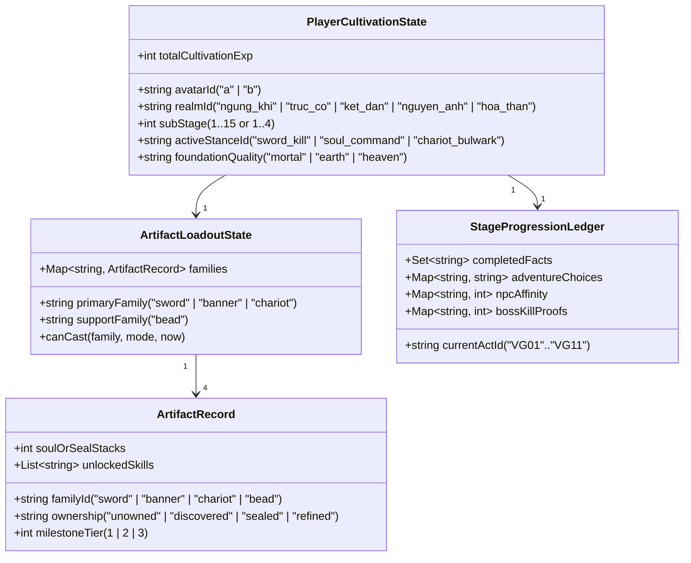

# Đặc Tả Chi Tiết Artwork & Logic Theo Từng Chặng (GDD 0.34 · 14/10/2026)

> **Mục đích tài liệu:** Chuyển hóa lộ trình 5 Đại Cảnh Giới trong [STAGE-PROGRESSION-QUEST-REDESIGN-2026-10-14.md](STAGE-PROGRESSION-QUEST-REDESIGN-2026-10-14.md) thành **bản thiết kế kỹ thuật tách đôi: (1) Danh mục Artwork (Pixel, Animation, VFX, Props, Environment, UI) và (2) Đặc tả Logic Engine (State Machine, Trigger, Combat Geometry, Server Facts, Progression Formula)** cho từng chặng và từng hồi.  
> **Nguyên tắc bảo toàn (`AGENTS.md`):** Tài liệu này chỉ định rõ tài nguyên nào **đã khóa hash (`Approved`)**, tài nguyên nào **đang ở trạng thái ứng viên (`Candidate`)**, và tài nguyên/logic nào **cần sản xuất mới (`To-Build`)** trên nhánh fixture trước khi tích hợp.

---

## Phần I. Quy Chuẩn Kỹ Thuật Chung Giữa Artwork & Logic Engine

Trước khi đi vào từng chặng, đội ngũ Art và Engineering thống nhất **bảng thông số gốc** để mọi asset xuất ra đều khớp trực tiếp vào hệ thống tọa độ của Engine mà không cần co kéo hay sửa tay từng frame:

### 1.1. Bảng Quy Chuẩn Khung Hình, Pivot & Layer (Artwork Standards)

| Nhóm Tài Nguyên | Khung Canvas (px) | Điểm Neo Chân / Pivot `(x, y)` | Chiều Cao Chuẩn (camera `1×`) | Cấu Trúc Layer & Quy Tắc Sản Xuất |
| --- | --- | --- | --- | --- |
| **Nhân vật chính (`Huyễn Tâm a` / `Tịch Bạch b`) — Neutral** | `64 × 96` | `(32, 88)` | `80 px` (Crown-to-boot) | Tách rời `body-only` và `gear`. Lấy master riêng của từng danh tính làm gốc nhận diện; Vương Lâm Pixel02 làm chuẩn tỷ lệ người và nét pixel. |
| **Nhân vật chính — Motion Body (8 hướng × 8 action)** | `112 × 112` | `(56, 104)` | `80 px` (Giữ nguyên 1 scale từ neutral) | Canvas rộng hơn chỉ để chứa vạt áo/tay vung (padding), **không phóng to body**. Không mirror ngang để giả hướng; 8 hướng đều là artwork thật. |
| **Pháp Bảo / Trang Bị Rời (Gear Props — 4 Họ)** | `192 × 192` | Nghỉ: `(80, 160)` Motion: `(96, 160)` | Theo tỷ lệ từng món | Tách 3 lớp vẽ theo thứ tự Z: `rear-gear` (sau lưng) → `body` → `front-gear` (trước ngực/tay) → `own-hand-occlusion` (lấy đúng pixel bàn tay của pose đó đè lên cán vũ khí). |
| **NPC Vân Hải (14 NPC — Chuẩn người Pixel02)** | Neutral: `64 × 96` Motion: `96 × 96` | Neutral: `(32, 88)` Motion: `(48, 88)` | `~78–80 px` | Vương Lâm cùng hướng làm `Image1` chuẩn tỷ lệ. Mỗi NPC có `idle`, `talk` và `gesture nghề` riêng (rèn sắt, giã thuốc, cầm thương, đọc thẻ). Chân tính tại đế giày, không tính mũi đạo cụ. |
| **Quái Thường (8 loài) & Tinh Anh (3 loài)** | Theo morphology từng loài | World-foot tại điểm chạm đất thực | Thường: `48–84 px` Tinh anh: `72–96 px` | 8 hướng × 5 action (`idle`, `move`, `attack`, `hit`, `death`). Loài bay (*Mặc Dực Bức*) tách `ground-shadow` tại mặt đất và `lift-offset` cho thân. |
| **Boss (4 Boss Chặng 1–2)** | • Lang Vương: `320×176` • Hắc Ấn: `160×112` • Tam Ấn / Cổ Mộc: riêng | • Lang Vương: `(160, 144)` • Hắc Ấn: `(80, 104)` | • Lang Vương: `96 px` • Hắc Ấn: `80 px` • Tam Ấn: `128 px` • Cổ Mộc: `160 px` | 8 hướng × (`idle, move, attack, hit, death, appear` + `2–3 skill cast`). Dư ảnh (*Phân Phù*) hoặc rễ phụ tách thành VFX/instance, không biến thành entity có HP/loot giả. |
| **VFX Pháp Bảo & Chiêu Thức Boss** | Theo manifest từng sequence (`gutter 2px`) | Khớp origin hoặc điểm contact | Alpha mềm đa cấp | Mỗi chiêu chia đủ các pha: `warning` (dưới mặt đất) → `charge` (quanh tay/thân) → `release` (rời tay/khởi phát) → `active/resolve` (đường đạn/trận địa) → `contact/collapse` (nổ trúng/tan). |

---

### 1.2. Kiến Trúc Dữ Liệu & State Machine Chung (Logic Engine Standards)

Để chấm dứt tình trạng "nhiệm vụ hành chính" và hỗ trợ vòng lặp **20% Tuyến Chính + 80% Sandbox**, Engine quản lý tiến trình nhân vật qua **4 Hợp Đồng Trạng Thái (Server-Authoritative State Contracts)**:

1. **Quy tắc Tự Động Hóa Bước Nhiệm Vụ (`Auto-Chain Fact Rule`):**
   - Mỗi bước trong Hồi cốt truyện (`ActStep`) được định nghĩa bởi: `triggerCondition` → `objectiveCheck` → `onCompleteGrant` → `nextStepId`.
   - Khi `objectiveCheck` thỏa mãn ngoài thực địa (ví dụ: nhặt `stone_bead_raw`, hạ `cloud_wolf_king`, hoặc phá `ancient_tree_core`), server **ghi nhận `Fact`, trao thưởng và chuyển thẳng sang `nextStepId` ngay tại chỗ** kèm thoại nổi/tiếng vọng Thức Hải, không bắt chạy bộ về gặp NPC chỉ để bấm nút "Hoàn thành".
2. **Quy tắc Đột Phá Cảnh Giới (`Sub-stage Auto vs. Gate Breakthrough`):**
   - **Tầng thường** (`Ngưng Khí 2, 4, 5, 7, 8, 10, 11, 13, 14`): Khi `totalCultivationExp >= threshold[level]`, server tự động nâng `subStage`, tăng chỉ số cơ bản (`maxHp`, `maxMp`, `attackPower`) và phát VFX *Linh Khí Nhập Thể* (`1.2s`) mà không chặn màn hình.
   - **Tầng Cột Mốc (`Ngưng Khí 3, 6, 9, 12, 15`) & Đại Đột Phá (`Trúc Cơ, Kết Đan...`):** Đòi hỏi đủ `totalCultivationExp` **VÀ** hoàn thành `BreakthroughFact` (ví dụ: đã luyện hóa Pháp bảo tương ứng hoặc đánh bại Boss gác cổng).
3. **Quy tắc Hình Học & Công Bằng Chiến Đấu (`Combat Geometry & Fairness`):**
   - Mọi đòn nguy hiểm của Boss/Tinh anh phải tuân theo chu kỳ: `Intent` → `Warning Telegraph (rõ biên hình học)` → `Lock Origin/Aim` → `Release / Active Pulse` → `Recovery Window`.
   - Thời gian `Warning Telegraph` phải đảm bảo nhân vật đi bộ thường (`80 px/s`, bán kính chân `8 px`) có thể lách ra khỏi vùng sát thương hoặc bước vào khe an toàn (như khe `90°` của chiêu *Ấn Hồi*) nếu phản ứng kịp; kỹ năng lướt/hộ thân (`Dẫn Giới Hộ Thân`) là công cụ cứu nguy khi người chơi đứng quá sâu.

---

## Phần II. Thiết Kế Chi Tiết Chặng 1: Ngưng Khí (Tầng 1 → 15) Lên Trúc Cơ

Chặng 1 gồm **6 Hồi Cốt Truyện (`VG01` → `VG06`)** đan xen với **3 Vòng Lặp Sandbox Mở**. Dưới đây là bảng phân rã chi tiết **Artwork cần chuẩn bị** và **Logic cần lập trình** cho từng Hồi:

---

### Hồi I (`VG01`): Phế Sài Nhập Môn & Cơ Duyên Dưới Vực (Ngưng Khí Tầng 1 → 3)

| Hạng mục | Đặc tả Artwork (Visual & Asset Spec) | Đặc tả Logic & Kỹ thuật (Engine & Gameplay Spec) |
| --- | --- | --- |
| **1. Không gian & Props Bản đồ** | • **Khu vực:** Hằng Nhạc Ngoại Môn + **Hẻm Vân Liệt (Cliff Cave Sub-zone)**. • **Props cần có (`To-Build`):**   1. `prop_suction_vent` (`64×64`, 4 frame loop gió hút nhịp nhàng ở vách đá).   2. `prop_skeleton_bird_corpse` (`48×48`, hài cốt cổ & xác chim đá chứa Châu).   3. `prop_stone_bead_pickup` (`32×32`, viên châu đá xám khắc 5 đám mây phát sáng nhẹ).   4. `prop_qi_conduit_nodes` (3 mắt trận dẫn khí trên sân tập, phát sáng xanh/vàng). | • **Map Zoning:** Giữ nguyên map Hằng Nhạc của Owner và 9 blocker gốc; nối lối rẽ phía Đông Nam xuống phân cảnh nhỏ `zone_cliff_cave` (hoặc góc khuất vách núi ngoại môn). • **Suction Hazard Logic:** Lỗ gió hút hoạt động theo chu kỳ `4.0s hút nhẹ (kéo 24 px/s) → 4.0s lặng` (chuyển thể từ nhịp 30/60 phút ở Ch.8 nguyên tác sang nhịp real-time). |
| **2. Nhân vật & Trang bị** | • **Player:** `Huyễn Tâm (a)` hoặc `Tịch Bạch (b)` ở trạng thái **Áo Ngoại Môn / Mốc I**:   - Lúc đầu (`Step 1–2`): Chỉ vẽ `body-only` (chưa đeo kiếm).   - Từ `Step 3`: Bật layer `gear: sword (Mốc I)` + `bead (Mốc I)`. • **NPC tham gia:** **Trần Duy** (`guide`), **Kỷ An** & **Phùng Dã** (đệ tử sinh hoạt), **Diệp Tĩnh** (`cultivation`), **Tạ Kiếm Sơn** (`training`). • **Quái sân tập:** **Khôi Lỗi Rạn Ngọc** (`Pixel01` đã có motion). | • **State Khởi tạo Nhân vật (`VG01_Init`):**   - `realm = "ngung_khi"`, `subStage = 1`, `hp = 100/100`, `mp = 60/60`.   - `ArtifactRecord["bead"].ownership = "unowned"`, `ArtifactRecord["sword"].ownership = "unowned"`. • **Khi nhặt Châu Đá (`onInteract: prop_stone_bead_pickup`):**   - Chuyển `bead.ownership = "discovered"`, `bead.milestoneTier = 1`.   - Cộng ngay `+150 Tu vi` → **Tự động lên Ngưng Khí Tầng 2** (`hp = 115`, `mp = 80`), mở kỹ năng `Dẫn Giới Hộ Thân` (`bead_st`). |
| **3. Kỹ năng, VFX & Thực chiến** | • **VFX Châu Đá Mốc I:**   - `vfx_dew_absorb`: Giọt sương bạc-lục rơi xuống đỉnh đầu và lan tỏa quanh thân (`6 frame`).   - `bead_st` (*Dẫn Giới Hộ Thân*): Vòng khiên ngũ vân bán kính `40px` quanh thân (`Approved/Candidate P2–P5`). • **VFX Kiếm Linh Mốc I:**   - `sword_st` (*Kiếm Ý Nhất Tuyến*): 10 sequence / 60 frame (`Approved trong Pilot V1`). | • **Bài Vận Khí & Thực Chiến Liên Mạch (`VG01_Step2_3`):**   1. Gặp **Diệp Tĩnh**: Kích hoạt `meditate` `3.0s` hồi đầy MP, mở HUD phân biệt rõ thanh **Tu Vi (Vàng)** và **Linh Lực/MP (Lam)**.   2. Gặp **Tạ Kiếm Sơn**: Nhận `sword (Mốc I)`, mở `Kiếm Ý Nhất Tuyến` (`corridor length 320px, width 44px, cooldown 6.0s`).   3. Hạ `3 Khôi Lỗi Rạn Ngọc` (dùng `bead_st` đỡ đòn quét tay của khôi lỗi, dùng `sword_st` đâm xuyên 2 con thẳng hàng).   4. Chạy qua **Trận Dẫn Khí** 1 lượt (`60s` tối đa) → Đạt **Ngưng Khí Tầng 3** (`hp = 135`, `mp = 100`), mở cổng **Tuyến Ngoại Vi**. |

---

### Hồi II (`VG02`): Máu Nhuộm Ngoại Vi & Săn Lùng Lang Vương (Ngưng Khí Tầng 4 → 6)

| Hạng mục | Đặc tả Artwork (Visual & Asset Spec) | Đặc tả Logic & Kỹ thuật (Engine & Gameplay Spec) |
| --- | --- | --- |
| **1. Không gian & Quái Ngoại Vi** | • **Khu vực:** Tuyến Ngoại Vi Hằng Nhạc & Đài Đá Sói Tru. • **NPC hiện diện:** **Tô Nhược** (`preparation`), **Đinh Sóc** (Hộ sơn cầm thương), **Hứa Hành** (Thám báo giữ tuyến), **Bạch Chỉ** (Dược sư), **Tống Thiết** (Luyện khí). • **Quái & Tinh anh (`Pixel01` + `VFX02`):**   - **Vân Nha Lang** (quái thường) + **Lang Tuần Sơn** (tinh anh có cờ hiệu/vệt sẹo).   - **Phù Mộc Tinh** (quái thảo mộc phóng tia).   - **Tán Tu Hắc Phù** (quái tu sĩ ném phù). | • **Vòng lặp Sandbox Ngoại Vi #1 (Tầng 4 → 5):**   - Người chơi ra ngoại vi không bị bó buộc thứ tự: có thể đánh quái, hái dược hoặc cứu người.   - **Logic Cụm Quái (`Cluster Spawner`):** Mỗi cụm gồm `2 Vân Nha Lang + 1 Phù Mộc Tinh` hoặc `1 Lang Tuần Sơn + 2 Vân Nha Lang`. Điều phối nhịp đánh lệch nhau tối thiểu `450ms` theo [CLUSTER-REVIEW.md](design/characters/van-hai-monster-animation-v1/CLUSTER-REVIEW.md) để người chơi đọc được đòn.   - **Drop Table Chặng 1-A:**     • `mat_cloud_fang` (*Vân Nha* — từ Sói, tỷ lệ `65%`).     • `mat_wood_sap` (*Mộc Linh Dịch* — từ Phù Mộc Tinh, `60%`).     • `mat_lesser_beast_soul` (*Yêu Hồn Sơ Cấp* — từ Tinh anh Lang Tuần Sơn, `100%`). |
| **2. Chế Tác Hồn Phiên Mốc I & Kỳ Ngộ** | • **Artwork Hồn Phiên (`banner`):**   - Gear prop `banner` cho `Huyễn Tâm (a)` & `Tịch Bạch (b)` (`192×192`, lớp vải cờ phất theo tay, đuôi khói đen-vàng).   - VFX `banner_st` (*Chủ Hồn Dẫn Lộ*): Đầu lâu/chủ hồn lao theo dải khí khóa mục tiêu (`2 pulse`). • **Props Kỳ ngộ (`To-Build`):**   - `prop_wounded_herbalist` (Dược đồng bị thương cạnh giỏ thuốc đổ).   - `prop_black_talisman_stake` (Cọc gỗ cắm Hắc Phù rỉ khói mực làm đàn sói phát điên). | • **Logic Mở Khóa Hồn Phiên Mốc I (`Craft_Banner_M1`):**   - Khi thu thập đủ `3 Yêu Hồn Sơ Cấp` + `2 Mảnh Hắc Phù`, gặp **Tống Thiết** để luyện thành **Tiểu Hồn Phiên (Hồn phiên Mốc I)**.   - Mở kỹ năng `Chủ Hồn Dẫn Lộ` (`banner_st`: khóa `targetId` + `targetLifeId` trong tầm `260px`, gây 2 nhịp sát thương ở `420ms` và `960ms`). • **Logic Kỳ Ngộ Ngoại Vi (`Adv_Herbalist_Rescue`):**   - Nhánh A: Dùng *Lộ Thủy Thiên Nghịch Châu* cứu dược đồng ngay → **Bạch Chỉ** tặng công thức *Thanh Tâm Đan* (tăng hồi MP) + `+20 Hảo cảm Bạch Chỉ`.   - Nhánh B: Phá hủy trước 3 `prop_black_talisman_stake` → Làm suy yếu `15% tốc độ công` của **Vân Nha Lang Vương** trong trận Boss! |
| **3. Trận Boss 1: Vân Nha Lang Vương** | • **Artwork Boss 1 (`Approved`):**   - [Vân Nha Lang Vương](design/characters/cloud-wolf-king-animation-v1/approval.json): `64 clip / 384 pose` 8 hướng + `5 FX / 30 frame`, thân cao `96px`, canvas `320×176`, chân `(160,144)`. • **Artwork Mở Khóa Sau Boss:**   - Kỹ năng AOE của Kiếm linh (`sword_aoe`: *Kiếm Trận Phá Giới* — 3 hành lang kiếm song song) & Hồn phiên (`banner_aoe`: *Tam Môn Tụ Hồn* — 3 cổng hồn tam giác). | • **Logic AI Boss 1 (`boss_cloud_wolf_king`):**   - **Pha 1 (100% → 50% HP):** Đòn cào cận chiến + **Chiêu 1: Liệt Phong Phác (Đường Chồm Dài)** — Hạ vai báo hiệu `750ms` (hiện hành lang đỏ rộng `56px`, dài `240px`), khóa hướng lao tới; sau khi đáp đất có **cửa thở gấp (Recovery `1.4s`)** để người chơi phản đòn.   - **Pha 2 (50% → 0% HP):** Thêm **Chiêu 2: Vân Nha Hoàn Quét (Vòng Quét Bán Kính `104px`)** — Gầm tụ khí `800ms` rồi quét tròn xung quanh.   - **Victory Fact (`kill_cloud_wolf_king`):** Đột phá **Ngưng Khí Tầng 6**, mở khóa ô kỹ năng **AOE (`R` / Slot 2)** cho Kiếm linh & Hồn phiên, rơi `item_broken_black_seal_1` (*Mảnh Lệnh Bài Đen*). |

---

### Hồi III (`VG03`): Bí Mật Thức Hải & Ba Khuynh Hướng Công Pháp (Ngưng Khí Tầng 7 → 9)

| Hạng mục | Đặc tả Artwork (Visual & Asset Spec) | Đặc tả Logic & Kỹ thuật (Engine & Gameplay Spec) |
| --- | --- | --- |
| **1. Không Gian Mộng Cảnh Châu Đá & Tư Đồ Nam** | • **Environment (`To-Build`):**   - `scene_bead_dreamscape`: Nền không gian mộng cảnh tối giản (mặt đất đá xám nổi giữa sương mù ngũ vân, bầu trời có 5 xoáy mây cổ). • **Artwork Tư Đồ Nam (Dạng Tàn Hồn / Thức Hải):**   - `npc_situ_nan_spirit` (`64×96` / `96×96` lơ lửng, nửa thân dưới hòa vào khói lam-vàng, nét uy nghiêm phóng khoáng) + Portrait đối thoại HD/Pixel. | • **Logic Kích Hoạt Không Gian Châu (`Enter_Bead_Dreamscape`):**   - Khi người chơi sở hữu `item_broken_black_seal_1` và đạt Tầng 6, Thiên Nghịch Châu phát sáng mời vào **Mộng Cảnh Thức Hải** (Instance cá nhân 1 người).   - Tại đây **Tư Đồ Nam** lần đầu lên tiếng, giải thích nguồn gốc **Châu Đá Ngũ Vân** và mở bảng **Chuyển Đổi Công Pháp Vận Hành (`Stance System`)**. |
| **2. Ba Khuynh Hướng Công Pháp & Điều Tra Hắc Phù** | • **UI & Aura Công Pháp (`To-Build`):**   - 3 biểu tượng Công pháp trên HUD + hiệu ứng vòng khí nhỏ dưới chân khi kích hoạt:     1. `stance_sword_kill` (*Kiếm Sát Quyết* — Vệt kiếm khí bạc-lam).     2. `stance_soul_command` (*Ngự Hồn Quyết* — Vòng khói tím-đen).     3. `stance_chariot_bulwark` (*Trấn Nhạc Quyết* — Vòng ấn vàng-đồng). • **NPC Phối hợp:** **Lục Văn** (Thủ thư Tàng Kinh Các), **Mạc Bà** (Trà đình), **A Ly**, **Tiểu Nghiên**. | • **Logic Modifier Của 3 Công Pháp (Đổi tự do ngoài giao chiến):**   1. **Kiếm Sát Quyết:** `+15% sát thương Kiếm linh`, `Kiếm Ý Nhất Tuyến` giảm `1.0s cooldown`, xuyên `20% phòng thủ`.   2. **Ngự Hồn Quyết:** `+20% sát thương Hồn phiên`, mỗi nhịp trúng của `Chủ Hồn Dẫn Lộ` / `Tam Môn Tụ Hồn` hồi cho người chơi `3% Max HP`.   3. **Trấn Nhạc Quyết:** `+18% Max HP`, lá chắn `Dẫn Giới Hộ Thân` dày thêm `+30%`, tăng sát thương phá giáp của Xạ Thần Xa. • **Chuỗi Điều Tra Lục Văn (`VG03_Investigation`):** Đối chiếu mảnh lệnh bài đen với trang sách bị xé tại chỗ **Lục Văn**, mở đường xuống **Khe Đá Rạn & Sân Khảo Nghiệm Nội Môn** (Đạt **Ngưng Khí Tầng 9**). |

---

### Hồi IV (`VG04`): Sát Cơ Trường Khảo Nghiệm — Tam Ấn Khôi Lỗi (Ngưng Khí Tầng 10 → 12)

| Hạng mục | Đặc tả Artwork (Visual & Asset Spec) | Đặc tả Logic & Kỹ thuật (Engine & Gameplay Spec) |
| --- | --- | --- |
| **1. Quái Khe Đá & Sân Khảo Nghiệm** | • **Quái & Tinh anh (`Pixel01` + `VFX02`):**   - **Ngọc Giáp Trùng** + Tinh anh **Thiết Giáp Linh Trùng** (vỏ ngọc dày, có tư thế khép giáp và mở giáp).   - **Mặc Dực Bức** (dơi bay có bóng dưới đất).   - Tinh anh **Phù Sư Hắc Lụa** (tu sĩ dựng 2 cột phù nối tia sét đen). | • **Cơ chế Thực Chiến Tinh Anh (Tầng 10 → 11):**   - **Thiết Giáp Linh Trùng:** Khi ở trạng thái `ArmorClosed` giảm `70% sát thương`; sau cú húc `Charge` sẽ lộ trạng thái `ArmorExposed` (`2.5s`, nhận `150% sát thương`).   - **Phù Sư Hắc Lụa:** Đặt 2 điểm ấn cách nhau `160px`, sau `900ms` phóng tia nối giữa 2 điểm — dạy người chơi không cắt ngang dây phù. |
| **2. Trận Boss 2: Tam Ấn Khôi Lỗi (`128px`)** | • **Artwork Boss 2 (`Boss02 Concept` → `Motion To-Build`):**   - **Tam Ấn Khôi Lỗi** cao `128px` (uy lực áp đảo người `80px`), trên ngực và hai vai khắc **3 Ấn Ký Cổ (Thân Ấn – Khí Ấn – Thuật Ấn)** phát sáng theo pha.   - VFX Boss: Đòn đập sóng chấn động hình quạt (`Fan Slam`), tia cắt đôi sân (`Double-Line Laser`) và vòng nạp ấn. | • **Logic AI Boss 2 (`boss_three_seal_construct`):**   - Boss có **3 Lớp Giáp Ấn Ký** tại `100%`, `66%`, `33% HP`.   - Mỗi khi phá vỡ 1 Ấn (hoặc dùng *Phá Cấm Phù* do **Tống Thiết** chế tạo để削 nhanh thanh Ấn), Boss rơi vào trạng thái `Staggered` (`3.0s`).   - **Pha 3 (<33% HP):** Kích hoạt `Double-Line Sweep` kết hợp vòng tròn trung tâm, buộc người chơi đọc khoảng trống giữa 2 tuyến tia. |
| **3. Mở Khóa Pháp Bảo Thứ 3: Xạ Thần Xa (Mốc I)** | • **Artwork Xạ Thần Xa (`chariot`):**   - Gear prop `chariot` cho `Huyễn Tâm (a)` & `Tịch Bạch (b)` (`192×192`, mảnh giáp/xích niêm phong và hư ảnh chiến xa lôi thú).   - VFX `chariot_st` (*Giải Niêm Dẫn Thú*): Mở 1 mắt niêm phóng chiến thú húc dọc hành lang.   - VFX `chariot_aoe` (*Lôi Thú Liệt Địa*): 2 đường rail xích báo hiệu + 3 điểm dậm nổ (`node 1 → 2 → 3`) tuần tự. | • **Logic Sở Hữu & Thi Triển Xạ Thần Xa (`Unlock_Chariot_M1`):**   - Hạ **Tam Ấn Khôi Lỗi** thu được `item_chariot_sealed_core` (*Lõi Chiến Xa Cổ Tu*).   - Nhờ **Tư Đồ Nam** và **Tống Thiết** giải tầng niêm phong đầu tiên → Mở khóa **Xạ Thần Xa (Mốc I)**:     • `Giải Niêm Dẫn Thú` (`chariot_st`): Hành lang `280×56px`, gây sát thương lớn và **phá 200% thanh giáp/ấn của mục tiêu**.     • `Lôi Thú Liệt Địa` (`chariot_aoe`): 2 rail dài `300px`, 3 node phát nổ ở `600ms`, `950ms`, `1300ms` (tối đa 4 địch/node).   - Đột phá **Ngưng Khí Tầng 12**, mở cơ chế **Đổi Nhanh 2 Pháp Bảo Chủ Chiến (`Phím Tab / Q`)**. |

---

### Hồi V (`VG05`): Rừng Cổ Mộc, Gặp Lý Mộ Uyển & Cổ Mộc Trấn Khí (Ngưng Khí Tầng 13 → 15)

| Hạng mục | Đặc tả Artwork (Visual & Asset Spec) | Đặc tả Logic & Kỹ thuật (Engine & Gameplay Spec) |
| --- | --- | --- |
| **1. Không Gian Rừng Cổ Mộc & Lý Mộ Uyển** | • **Khu vực:** Rừng Cổ Mộc Trấn Khí & Trạm Tiền Tiêu Quyết Minh Cốc. • **Artwork Lý Mộ Uyển (`To-Build theo chuẩn Pixel02`):**   - `npc_li_muwan` (`64×96` neutral / `96×96` motion, thân cao `78–80px`): Phục trang thanh nhã trắng-lục nhạt, đeo túi linh thảo và ngọc bội đan sư, có animation `idle`, `talk`, `alchemy_tend` (chăm lửa lò đan / kết ấn đan hỏa). • **Quái Rừng Sâu (`Pixel01`):** **Thực Linh Khuẩn** (nấm phun vòng bào tử độc) & **U Niệm** (linh thể bóng tối bắn dải mực). | • **Sự kiện Giải Cứu Đoàn Dược Sư (`VG05_Meet_LiMuwan`):**   - Tại bìa rừng giáp Quyết Minh Cốc, người chơi phá vòng vây của đám **Tán Tu Hắc Phù** và **U Niệm** đang tấn công xe thuốc của **Lý Mộ Uyển**.   - Mở khóa hệ thống **Lò Đan Lý Mộ Uyển (`Alchemy_LiMuwan_UI`)**: Cho phép dùng linh thảo ngoại vi + nội đan tinh anh luyện các loại đan dược chiến thuật (*Tị Độc Đan*, *Bạo Khí Đan*) và chuẩn bị đơn thuốc **Trúc Cơ Đan** (cần chủ dược *Thanh Mộc Linh Tâm*). |
| **2. Trận Boss 3: Cổ Mộc Trấn Khí (`160px`)** | • **Artwork Boss 3 (`Boss02 Concept` → `Motion/FX To-Build`):**   - **Cổ Mộc Trấn Khí** (`160px`, dáng thấp rộng bám chặt mạch đất, 3 rễ lớn quấn phù ấn đen, tâm mộc ở giữa thân có cửa vỏ cây đóng/mở).   - VFX Boss: `vfx_root_eruption` (rễ nhọn trồi lên theo ô đất), `vfx_corrupted_beam` (tia linh khí đen-lục quét dọc hành lang), `vfx_core_exposed` (tâm mộc phát sáng lục bảo khi lộ điểm yếu). | • **Logic AI Boss 3 (`boss_spirit_ward_elder_tree` — Rooted Terrain Boss):**   - Boss đứng cố định tại tâm sân, không di chuyển nhưng điều khiển toàn bộ mặt đất:     • **Pha 1:** 3 đợt rễ ngầm mọc đuổi theo vị trí chân người chơi (`delay 650ms` mỗi đợt).     • **Pha 2:** Phóng tia linh khí quét qua các hành lang, đồng thời gọi `2 Thực Linh Khuẩn` ở rìa sân.     • **Pha 3 & Cửa Mở Lõi:** Khi người chơi chặt đứt 3 nhánh rễ bị nhiễm Hắc Ấn (bằng AOE Pháp bảo), lớp vỏ tâm mộc bật mở trong `6.0s` (`CoreExposed`, nhận `200% sát thương`).   - **Thành quả:** Hạ Boss thu được `item_azure_wood_heart` (*Thanh Mộc Linh Tâm*), đạt **Ngưng Khí Tầng 15 Đỉnh Phong** và mở kỹ năng AOE của Thiên Nghịch Châu: **Nội Giới Hộ Đạo (`bead_aoe`)**! |

---

### Hồi VI (`VG06`): Đại Kiếp Nạn Hằng Nhạc — Quyết Chiến Hắc Ấn Chấp Sự & Đột Phá Trúc Cơ

| Hạng mục | Đặc tả Artwork (Visual & Asset Spec) | Đặc tả Logic & Kỹ thuật (Engine & Gameplay Spec) |
| --- | --- | --- |
| **1. Trận Boss 4: Hắc Ấn Chấp Sự (`80px`)** | • **Artwork Boss 4 (`Approved Neutral03 + VFX02` & `Motion01 72 clip`):**   - Body: [Neutral03](design/characters/van-hai-dark-seal-officer-v3/approval.json) & [Motion01](design/characters/dark-seal-officer-animation-v1/README.md) (`72 clip / 432 pose` 8 hướng, canvas `160×112`, chân `(80,104)`, cao `80px`).   - VFX: [Triện Thuật VFX02](design/vfx/dark-seal-officer-vfx-v2/README.md) (`8 sequence / 48 frame` đã được Owner duyệt):     1. `Đạo Ấn` (Tụ ấn sau lưng → phóng ấn đỏ-mực tới điểm khóa).     2. `Phân Phù` (Tách 2 cổng phù dư ảnh mờ, tan lệch nhau `80ms`).     3. `Ấn Hồi` (Vòng trận địa bán kính `112px` trên mặt đất, giữ đúng **khe an toàn 90°** theo hướng khóa). | • **Logic AI Boss 4 (`boss_dark_seal_officer` — Culmination Boss Chặng 1):**   - **Chiêu 1 — Đạo Ấn (`seal_palm_shot`):** Khóa tọa độ mục tiêu lúc hết `charge`, phóng chưởng ấn tốc độ cao; dùng `Dẫn Giới Hộ Thân` hoặc lướt ngang để tránh.   - **Chiêu 2 — Phân Phù (`twin_talisman_mirage`):** Tạo 2 dư ảnh có thủ ấn khác nhau (không phải entity thật, không nhận sát thương/loot) phóng tia chéo ép góc.   - **Chiêu 3 — Ấn Hồi (`annular_seal_convergence`):** Dựng vòng ấn `r = 112px` thu sập về tâm; renderer và server cùng tính góc khóa để mở **cửa thoát 90°** — người chơi chạy bộ (`80 px/s`) qua khe 90° sẽ hoàn toàn miễn thương và áp sát đánh trả lúc Boss hồi thế!   - **Cơ chế Hộ Đạo:** Bật `Nội Giới Hộ Đạo` (`bead_aoe`) tạo 3 điểm `sanctuary` tăng tốc/giảm sát thương cho bản thân và làm chậm Hắc Ấn Chấp Sự khi hắn lao vào. |
| **2. Nghi Thức Đại Đột Phá Trúc Cơ** | • **VFX & UI Đột Phá Trúc Cơ (`To-Build`):**   - `vfx_foundation_breakthrough`: Cột sáng đạo đài dựng lên dưới chân nhân vật (3 màu biến thể: Lam cho Phàm Đạo, Vàng Kim cho Địa Đạo, Tím Ngũ Vân cho Thiên Đạo).   - Giao diện **Ngưng Tụ Đạo Đài (Trúc Cơ UI)**: Hiển thị 3 vật phẩm chứng đạo đã thu thập từ 3 Boss trước (*Nanh Lang Vương, Lõi Tam Ấn, Tâm Cổ Mộc*) hợp cùng *Trúc Cơ Đan* của Lý Mộ Uyển. | • **Logic Phẩm Chất Trúc Cơ (`Execute_Foundation_Breakthrough`):**   - Khi đánh bại Hắc Ấn Chấp Sự và có `item_foundation_pill` do **Lý Mộ Uyển** luyện:     • Đủ `Trúc Cơ Đan` cơ bản → **Phàm Đạo Trúc Cơ** (`+40% All Stats`).     • Đủ `Trúc Cơ Đan` + `2 Ấn Ký Boss Tinh Anh` → **Địa Đạo Trúc Cơ** (`+55% All Stats`, `+1 ô Ngọc Phù`).     • Đủ `Trúc Cơ Đan` + trọn bộ `3 Linh Vật Boss (Lang Vương + Tam Ấn + Cổ Mộc)` + phá `Hắc Ấn Chấp Sự` không chết → **Thiên Đạo Trúc Cơ** (`+70% All Stats`, mở hiệu ứng cộng hưởng **Thiên Nghịch Đạo Cơ** giảm `10% Cooldown` mọi Pháp bảo).   - *Ghi chú công bằng:* Người chơi đạt Phàm/Địa Đạo vẫn có thể săn lại Boss ở chế độ Khảo Nghiệm để **Bù Đắp Đạo Cơ** lên Thiên Đạo bất cứ lúc nào! |

---

## Phần III. Thiết Kế Chi Tiết Chặng 2: Trúc Cơ Lên Kết Đan (Pháp Bảo Mốc II & Quyết Minh Cốc)

Chặng 2 là nơi gói sản xuất **Wang Lin Equipment Production V2 (Mốc II — 512 clip cơ sở)** trở thành tâm điểm. Người chơi rời Hằng Nhạc, lấy **Quyết Minh Cốc** làm cứ điểm mới, khám phá **Hàn Thiết Kiếm Mộ / Vực Ngoại Vân Hải** và tiến tới cửa ngõ **Tu Ma Hải**.

### 3.1. Danh Mục Artwork Trọng Tâm Của Chặng 2 (Mốc II)

| Nhóm Tài Nguyên Chặng 2 | Quy Mô & Thông Số Kỹ Thuật | Tình Trạng Hiện Tại & Việc Cần Làm Tiếp |
| --- | --- | --- |
| **1. Nhân vật & 4 Pháp Bảo Mốc II (`wang-lin-equipment-production-v2`)** | • **2 Identity (`Huyễn Tâm a`, `Tịch Bạch b`) × 4 Họ (`sword`, `banner`, `chariot`, `bead`) × 8 Hướng × 8 Action** (`idle, run, hit, death, meditate, gather, cast_st, cast_aoe`) = **512 body clip cơ sở**. • **Gear tracks:** `64 resting views` + `128 cast tracks`. • **FX Kits:** `40 sequence` (4 họ × ST/AOE × 5 phase). | • **Đang sản xuất trong P4–P5** ([progress.json](design/characters/wang-lin-equipment-production-v2/progress.json)). • Bản sắc thị giác Mốc II:   - **Kiếm linh:** Phi kiếm quấn tàn hồn ma đầu **Hứa Lập Quốc** (ánh tím-chàm hung dữ).   - **Hồn phiên:** Đại kỳ mở **3 cổng không gian** triệu hồi Chủ Hồn.   - **Xạ Thần Xa:** Chiến xa mở ấn phóng **Lôi Thú** giẫm nát trận địa.   - **Thiên Nghịch Châu:** Châu hiện rõ vòng Ngũ Hành và trường **Nội Giới**. |
| **2. Ba Không Gian Bản Đồ Chặng 2 (`To-Build`)** | 1. **Quyết Minh Cốc (Hub Trúc Cơ & Đan Thất Lý Mộ Uyển):** Thung lũng sương mù có lò luyện đan trung tâm, trận bàn tứ tượng và lối vào Nội Giới. 2. **Hàn Thiết Kiếm Mộ (Bí Cảnh 1–3 người):** Mộ kiếm cổ cắm hàng trăm thanh đoạn kiếm rỉ sét, nơi phong ấn Hứa Lập Quốc. 3. **Huyết Đàn Ngoại Vực / Cửa Ngõ Tu Ma Hải:** Nền đá đen khắc huyết trận của Âm Thi Tông / Hắc Ấn chân thân. | • Thiết kế 3 layout bản đồ tách biệt với map Hằng Nhạc của Owner. • Tái sử dụng hệ thống tile/prop đá, cổ mộc và bổ sung `prop_alchemy_cauldron_limuwan` (`96×96`), `prop_ancient_sword_mound` (`128×128`), `prop_corpse_sect_coffin` (`64×96`). |
| **3. Quái, Tinh Anh & Boss Chặng 2** | • **Quái/Tinh anh nâng cấp cơ chế:**   - *Kiếm Nô Khôi Lỗi* (biến thể Khôi Lỗi cầm kiếm gãy trong Kiếm Mộ).   - *Âm Thi Tu Sĩ & Huyết Phù Sư* (biến thể Tán Tu Hắc Phù triệu hồi thi khôi). • **3 Boss Chặng 2:**   1. **Hung Linh Hứa Lập Quốc (Boss Kiếm Mộ — `96px`)**.   2. **Huyết Giáp Chiến Xa / Khôi Lỗi Thống Lĩnh (`128px`)**.   3. **Hắc Ấn Chấp Sự · Chân Thân Huyết Ấn (`80px` + Aura Giả Đan)**. | • Tận dụng khung rigging/animation đã có của `Khôi Lỗi`, `Tán Tu Hắc Phù` và `Hắc Ấn Chấp Sự`, bổ sung **Hung Linh Hứa Lập Quốc** (linh thể kiếm ma biến ảo) và hiệu ứng **Kiếp Lôi Kết Đan**. |

---

### 3.2. Phân Rã Chi Tiết 5 Hồi Chặng 2 (`VG07` → `VG11`): Logic & Cơ Chế Mới

| Hồi & Cảnh Giới | Cốt Truyện & Nhân Vật | Logic Cơ Chế Gameplay Mới (Engine Mechanics) | Thành Quả Mở Khóa (Mốc II) |
| --- | --- | --- | --- |
| **Hồi VII (`VG07`)** *Phong Vân Quyết Minh Cốc* **(Trúc Cơ Sơ Kỳ)** | Thiết lập cứ điểm tại **Quyết Minh Cốc** cùng **Lý Mộ Uyển**, **Bạch Chỉ**, **Tống Thiết**, **Hứa Hành**. **Tư Đồ Nam** thức tỉnh hoàn toàn trong Châu, mở **Thức Hải Truyền Thừa**. | **1. Cơ chế Không Gian Nội Giới (`Bead_Inner_Realm`):** • Người chơi có thể dịch chuyển vào Nội Giới để:   - Thu hoạch *Lộ Thủy Tinh Thuần* theo chu kỳ.   - Dung luyện *Yêu Hồn / Chủ Hồn* vừa săn được vào **Hồn Phiên**.   - Đối thoại với **Tư Đồ Nam** để mở bảng nhiệm vụ giải ấn Pháp Bảo Mốc II. | • Mở **Không Gian Nội Giới Thiên Nghịch Châu**. • Luyện hóa thành công **Hồn Phiên Mốc II** (*Tam Môn Tôn Hồn Phiên* — triệu hồi Chủ Hồn Tinh Anh). |
| **Hồi VIII (`VG08`)** *Hung Linh Nhập Kiếm* **(Trúc Cơ Trung Kỳ)** | Tiến vào **Hàn Thiết Kiếm Mộ** tìm linh kiếm thượng cổ, chạm trán và khuất phục tàn hồn ma đầu **Hứa Lập Quốc** `[Nguyên tác Ch.365]`. | **2. Cơ chế Bí Cảnh Nhóm Nhỏ (1–3 Người) & Thu Phục Khí Linh (`Subdue_Sword_Spirit`):** • Hỗ trợ đi Solo hoặc lập đội 2–3 người. • Khi đánh bại Boss **Hung Linh Hứa Lập Quốc** xuống `10% HP`, kích hoạt pha **Thần Thức Trấn Áp**: dùng `Dẫn Giới Hộ Thân` + `Chủ Hồn Dẫn Lộ` khóa đường trốn của hắn trong `5.0s` để ép nhập vào thân kiếm! | • Tiến hóa **Kiếm Linh Mốc II (Hứa Lập Quốc)**:   - Mở ngoại trang & bộ clip **Kiếm linh Mốc II** (`Huyễn Tâm / Tịch Bạch`).   - Chiêu `Kiếm Ý Nhất Tuyến` & `Kiếm Trận Phá Giới` kèm hiệu ứng *Ma Kiếm Phệ Hồn* (tăng sát thương lên mục tiêu dưới 50% máu). |
| **Hồi IX (`VG09`)** *Hộ Đạo Đan Tâm* **(Trúc Cơ Hậu Kỳ)** | **Lý Mộ Uyển** khai lò luyện **Thiên Ly Đan** (chủ dược Kết Đan). Đám tu sĩ **Âm Thi Tông** đánh hơi thấy đan hương, kéo quân vây đánh Quyết Minh Cốc `[Nguyên tác Ch.104]`. | **3. Cơ chế Sự Kiện Hộ Đạo Đan Thất (`Furnace_Defense_Encounter`):** • Lò đan của Lý Mộ Uyển có thanh `Độ Ổn Định Đan Hỏa (100%)`. • Kẻ địch tấn công theo **3 Đợt (Waves)** từ 3 hướng thung lũng trong `180s`:   - Người chơi đặt cọc trận pháp (do Lý Mộ Uyển cung cấp) làm chậm quái ở cửa ngõ.   - Dùng **Xạ Thần Xa Mốc II** (`Lôi Thú Liệt Địa`) nghiền nát đội hình khiên của Âm Thi Tông trước khi chúng chạm vào lò đan. | • Tiến hóa **Xạ Thần Xa Mốc II (Giải Ấn Lôi Thú)**. • Nhận **Thiên Ly Đan** từ Lý Mộ Uyển & mở mốc **Nhân Duyên Sinh Tử** (Lý Mộ Uyển trao *Ngọc Giản Hộ Mệnh* tự động kích hoạt khi người chơi chịu đòn chí mạng). |
| **Hồi X (`VG10`)** *Đoạt Mệnh Chân Thân* **(Trúc Cơ Viên Mãn)** | Phản công vào Huyết Đàn Ngoại Vực, tiêu diệt **Chân Thân Hắc Ấn Chấp Sự (Giả Đan)** trước khi hắn hoàn tất huyết tế. | **4. Cơ chế Boss Đa Pha Giả Đan & Thu Nạp Chủ Hồn (`Boss_Soul_Extraction`):** • Chân thân Hắc Ấn Chấp Sự kết hợp liên hoàn `Phân Phù` + `Ấn Hồi` kép (2 vòng ấn thu liên tiếp với góc mở lệch nhau `90°`). • Sau khi hạ gục, người chơi dùng **Hồn Phiên Mốc II** rút trực tiếp **Chủ Hồn Giả Đan** của hắn làm tướng hồn thứ ba trong cờ! | • Hoàn thiện **Ngũ Hành Linh Vật** cho **Thiên Nghịch Châu Mốc II**. • Chủ hồn thứ 3 của `Tam Môn Tụ Hồn` mang hình dáng Tu Sĩ Hắc Ấn. |
| **Hồi XI (`VG11`)** *Tiến Vào Tu Ma Hải — Độ Kiếp Kết Đan* **(Đột Phá Kết Đan)** | Đứng trước bờ biển đầy bão tố của **Tu Ma Hải**, người chơi nuốt *Thiên Ly Đan*, vận chuyển *Thiên Nghịch Châu* đón nhận **Tam Trọng Kiếp Lôi** để kết tụ Kim Đan! | **5. Cơ chế Độ Kiếp Kết Đan (`Core_Formation_Tribulation`):** • Khác với Trúc Cơ chỉ cần linh vật, Kết Đan là một **Phiên Độ Kiếp Thực Chiến (`90s`)**:   - **Đạo Lôi 1 (Tử Lôi):** Dùng `Giải Niêm Dẫn Thú` / `Kiếm Ý Nhất Tuyến` chém tan lôi cầu trước khi chạm đất.   - **Đạo Lôi 2 (Tâm Ma Ảnh):** Đánh bại hư ảnh của chính mình trong `25s`.   - **Đạo Lôi 3 (Diệt Thế Lôi Trận):** Bật `Nội Giới Hộ Đạo` (`bead_aoe`) + `Dẫn Giới Hộ Thân` (`bead_st`) hấp thụ lôi lực vào Châu Đá để ngưng tụ **Bổn Mệnh Kim Đan**! | • **Đột Phá Đại Cảnh Giới Kết Đan**. • Hoàn tất toàn bộ **8 Bộ Tạo Hình & Pháp Bảo Mốc II**. • Mở khóa bản đồ Chặng 3: **Tu Ma Hải**. |

---

## Phần IV. Đặc Tả Kiến Trúc Chặng 3, Chặng 4 & Chặng 5 (Kết Đan → Nguyên Anh → Hóa Thần / Mốc III)

Để đội ngũ có tầm nhìn dài hạn và thiết kế dữ liệu không phải đập đi xây lại ở các bản mở rộng sau, dưới đây là kiến trúc **Artwork & Logic** cho 3 chặng cao cấp:

| Chặng & Cảnh Giới | Trọng Tâm Artwork Cần Sản Xuất | Trọng Tâm Logic & Hệ Thống Cần Mở Rộng |
| --- | --- | --- |
| **Chặng 3: Kết Đan → Nguyên Anh** *(Tu Ma Hải & Đấu Trường Vạn Tông)* | • **Biến thể Kim Đan Aura & Combo `F` (192 clip mở rộng):**   - Mở chuỗi đòn thường / combo 3 bước (`F1 → F2 → F3`) đặc trưng cho từng họ Pháp Bảo.   - Hiệu ứng **Đạo Đan Hư Ảnh** lơ lửng sau lưng khi kích hoạt đại chiêu. • **Bản đồ Tu Ma Hải:** Đảo san hô huyết sắc, chợ đen tu ma, di tích Cổ Thần nửa chìm dưới biển. | • **Hệ thống Thuộc Tính Kim Đan (`CoreAttribute`):**   - *Kiếm Đan* (Đòn đánh thường thứ 3 phóng kiếm khí phụ).   - *Hồn Đan* (Hạ gục kẻ địch tự động sinh 1 tiểu hồn phát nổ).   - *Lôi Xa Đan* (Mỗi `12s` tích tụ 1 tầng Lôi Giáp chống khống chế). • **Hệ thống Phe Phái & Săn Boss Đảo Ngoại Hải (3–5 người):** Tranh đoạt nguyên liệu luyện **Phân Thân** và chuẩn bị nhục thân cho **Tư Đồ Nam**. |
| **Chặng 4: Nguyên Anh → Hóa Thần Sơ Khởi** *(Cổ Thần Chi Địa & Kiếp Nạn Thọ Nguyên)* | • **Artwork Nguyên Anh Xuất Khiếu (`Nascent_Soul_Projection`):**   - Sprite tiểu ảnh nguyên anh (`48×64` phát sáng vàng/tím) bay ra từ đỉnh đầu khi thi triển thuật hoặc thuấn di.   - Nhân vật **Tư Đồ Nam (Dạng Nhục Thân Hoàn Chỉnh)** đồng hành chiến đấu trong cốt truyện.   - Cảnh **Lý Mộ Uyển** tóc điểm bạc trong đại kiếp thọ nguyên (tạo đỉnh cao cảm xúc nguyên tác). | • **Cơ chế Nguyên Anh Thuấn Di & Bản Thể Hợp Kích (`Blink & Dual-Cast`):**   - Kỹ năng di chuyển thay thế chạy bộ ngắn bằng **Thuấn Di (`Teleport 140px`)**.   - Khi cast AOE Pháp Bảo, **Nguyên Anh** có thể tách ra giữ trận địa trong khi **Bản Thể** tự do di chuyển đánh mục tiêu khác! • **Chuỗi Nhiệm Vụ Nghịch Thiên Tục Mệnh:** Đấu với Sứ Giả Thiên Đạo để giữ lại tàn hồn Lý Mộ Uyển vào trong Thiên Nghịch Châu. |
| **Chặng 5: Hóa Thần Đỉnh Phong** *(Mốc III: Đạo Của Chính Mình — Ý Cảnh)* | • **Gói Sản Xuất Pháp Bảo Mốc III (`Milestone III Art Pack`):**   - **Kiếm linh Mốc III:** Tử Kim Ma Kiếm Hứa Lập Quốc hóa hình.   - **Hồn phiên Mốc III:** **Thập Ức Tôn Hồn Phiên** hoàng kim-hắc ám, triệu hồi Đế Hồn.   - **Xạ Thần Xa Mốc III:** Mở toàn bộ 3 ấn viễn cổ, chiến xa lôi đình toàn phần.   - **Thiên Nghịch Châu Mốc III:** Ngũ Hành viên mãn, biến đổi màu nền toàn vùng chiến trường (**Đạo Vực Shader/Overlay**). | • **Cơ chế Ý Cảnh Đạo Vực (`Domain_Field_System`):**   - Thay vì chỉ là một kỹ năng AOE mặt đất, người chơi Hóa Thần mở **Đạo Vực (`r = 280px`)** tồn tại suốt `12s` đổi luật toàn bộ thực thể bên trong:     1. **Sinh Tử Ý Cảnh:** Chuyển hóa sát thương nhận vào thành nhịp hồi sinh cơ khi kết thúc Đạo Vực.     2. **Sát Lục Ý Cảnh:** Mọi đòn Pháp Bảo đều bỏ qua khiên và tăng tốc độ xuất chiêu theo số lượng kẻ địch bị hạ.     3. **Chân Giả Ý Cảnh:** Hoán đổi vị trí giữa Bản Thể và Cổng Hồn / Cọc Kiếm bất kỳ trong Đạo Vực. |

---

## Phần V. Bảng Phân Công Thực Thi Ngay (Actionable Backlog Cho Art & Dev)

Để đội ngũ bắt tay vào làm ngay mà không bị chồng chéo:

### 1. Đội ngũ Artwork / Technical Art (Theo chuẩn `AGENTS.md`)
1. **Ưu tiên 1 (Đang chạy — Gói V2):** Tiếp tục hoàn thiện **P4–P5** cho **Huyễn Tâm (`a`) & Tịch Bạch (`b`)** đủ 8 hướng của **Kiếm linh → Hồn phiên → Xạ Thần Xa → Thiên Nghịch Châu (Mốc II)** theo đúng [progress.json](design/characters/wang-lin-equipment-production-v2/progress.json).
2. **Ưu tiên 2 (Chuẩn bị cho Chặng 1 — Hồi I đến VI):**
   - Hoàn tất duyệt các gói **Quái/Tinh Anh Animation (`van-hai-monster-animation-v1`)**, **VFX02 (`van-hai-monster-vfx-v2`)**, và 2 Boss còn lại (**Tam Ấn Khôi Lỗi, Cổ Mộc Trấn Khí**).
   - Bổ sung 4 prop tương tác nhỏ cho Hồi I–II (`prop_suction_vent`, `prop_stone_bead_pickup`, `prop_black_talisman_stake`, `prop_wounded_herbalist`) và bộ sprite **Lý Mộ Uyển (`npc_li_muwan`)** + **Tư Đồ Nam Tàn Hồn (`npc_situ_nan_spirit`)** theo chuẩn `Pixel02`.

### 2. Đội ngũ Logic / Gameplay Engineering (Trên nhánh Fixture độc lập)
1. **Ưu tiên 1 (Schema & State Machine trên Fixture):**
   - Định nghĩa `PlayerCultivationState`, `ArtifactLoadoutState` (4 họ × 3 mốc) và `StageProgressionLedger` trong module fixture mới, kết nối trực tiếp với [core.mjs](design/gameplay/wang-lin-equipment-prototype-v1/core.mjs) của P2.
2. **Ưu tiên 2 (Kịch bản Hồi I → VI — `VG01..VG06`):**
   - Lập trình bảng cấu hình nhiệm vụ `VG01–VG06` theo chuẩn `Auto-Chain Fact` (tự động chuyển bước ngoài thực địa, tự động tăng tầng nhỏ Ngưng Khí 1–15, chỉ mở cổng đột phá ở Tầng 3, 6, 9, 12, 15 và Trúc Cơ).
3. **Ưu tiên 3 (AI 4 Boss Chặng 1 & Stance Modifiers):**
   - Ghép 3 Khuynh hướng Công pháp (*Kiếm Sát / Ngự Hồn / Trấn Nhạc*) và kịch bản 4 Boss (*Vân Nha Lang Vương, Tam Ấn Khôi Lỗi, Cổ Mộc Trấn Khí, Hắc Ấn Chấp Sự*) vào sân thử nghiệm Encounter trước khi mở migration sang runtime chính.
