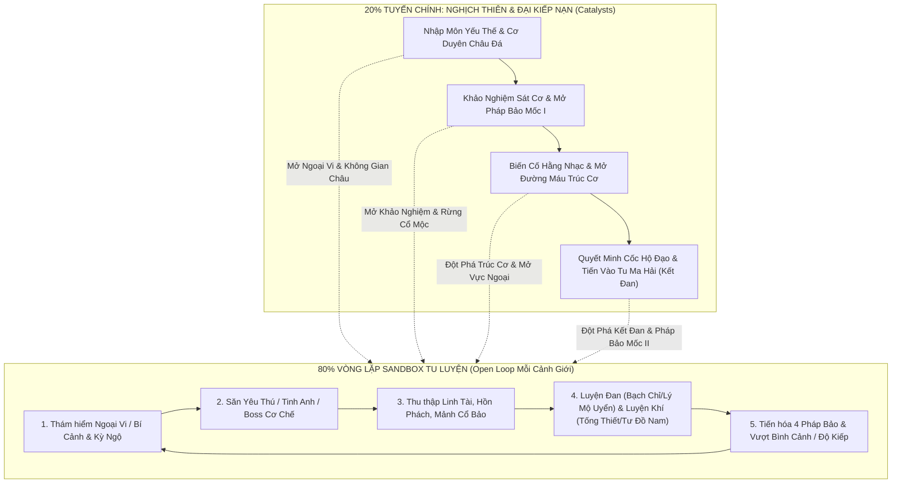

# Thiết Kế Lại Hệ Thống Nhiệm Vụ, Nhân Vật & Lộ Trình Giai Đoạn (14/10/2026)

> **Trạng thái tài liệu:** Phương án thiết kế cốt lõi thuộc **GDD Phiên bản 0.34 (14/10/2026)**, được chốt theo 3 định hướng của Owner. Tài liệu này thống nhất lộ trình sản xuất **Huyễn Tâm / Tịch Bạch + 4 Pháp Bảo** ([WANG-LIN-IMPLEMENTATION-PLAN.md](WANG-LIN-IMPLEMENTATION-PLAN.md)) với **Dàn 14 NPC + 11 Quái/Tinh Anh + 4 Boss** ([VAN-HAI-LIVING-WORLD-PLAN.md](VAN-HAI-LIVING-WORLD-PLAN.md)) và nguồn tư liệu [XIANXIA-MARKET-STORY-REFERENCES-2026-10-14.md](XIANXIA-MARKET-STORY-REFERENCES-2026-10-14.md).  
> **Ranh giới kỹ thuật:** Tuyến nhiệm vụ hành chính cũ đã được thay thế bởi **Mệnh Kiếp Chí (`VG01–VG11`)** trên cả tài liệu, giao diện hiển thị nhiệm vụ và [Gói Prototype G2](design/gameplay/wang-lin-progression-loop-prototype-v1/README.md), đồng thời giữ nguyên tuyệt đối 11 file bảo vệ trong `basis.json`, SQLite DB, map đã chốt và các gói ART/approval đã khóa hash.

---

## 1. Kiến trúc Nhân Vật Tập Trung: "Một Đạo Đồ — Hai Danh Tính — Bốn Pháp Bảo"

### 1.1. Chấm dứt bài toán chia 3 tuyến khởi đầu rời rạc
Trong GDD cũ (0.32–0.33), việc thiết kế Vương Lâm, Tư Đồ Nam và Lý Mộ Uyển cùng làm đệ tử Ngưng Khí tầng 1 tại Hằng Nhạc Phái khiến cốt truyện bị pha loãng và khối lượng sản xuất bị nhân ba. Từ bản 0.34:

| Vai trò trong Game | Nhân vật / Danh tính | Vị trí & Chức năng trong Gameplay / Cốt truyện |
| --- | --- | --- |
| **Nhân vật người chơi (Protagonist duy nhất)** | **Huyễn Tâm** (`ID: a` — Nam) **Tịch Bạch** (`ID: b` — Nữ) | Người chơi chọn 1 trong 2 danh tính tại màn hình khởi tạo. Cả hai đi trên **con đường nghịch thiên của Vương Lâm**: xuất thân đệ tử ngoại môn tư chất bình thường, vô tình đắc được **Châu Đá Ngũ Vân (Thiên Nghịch Châu)** khi gặp nạn dưới vực, từng bước luyện hóa 4 họ Pháp Bảo để sống sót qua họa diệt môn và bước ra biển lớn tu chân. |
| **Đạo sư / Hệ thống Thức Hải (Mentor & Bead System NPC)** | **Tư Đồ Nam** `[Nguyên tác + Chuyển thể]` | Không còn là nhân vật khởi đầu Ngưng Khí tầng 1. Tư Đồ Nam là **tàn hồn đại năng Viễn Cổ ngủ say trong Thiên Nghịch Châu**. Khi người chơi kích hoạt Châu Đá ở cuối Ngưng Khí / đầu Trúc Cơ, Tư Đồ Nam thức tỉnh từng phần để: **(1) Mở Không Gian Nội Giới**, **(2) Giám định và mở phong ấn 4 Pháp Bảo**, **(3) Truyền thụ sát chiêu / cướp đoạt cơ duyên ở các kỳ ngộ sinh tử**. |
| **Nhân duyên Trọng tâm / Hệ thống Đan–Trận (Karmic Ally & Crafting Master)** | **Lý Mộ Uyển** `[Nguyên tác + Chuyển thể]` | Xuất hiện từ cuối Ngưng Khí (nhánh tin tức ngoại vực) và trở thành **NPC Trụ cột từ giai đoạn Trúc Cơ – Kết Đan (Quyết Minh Cốc → Tu Ma Hải)**. Cô nắm giữ hệ thống **Luyện Đan Cao Cấp (Trúc Cơ Đan, Thiên Ly Đan, Kết Đan Linh Dược)**, **Trận Pháp Hộ Đạo (Tam Tài / Tứ Tượng Tị Kiếp Trận)** và chuỗi nhiệm vụ **Nhân Duyên Sinh Tử** (bảo vệ Lý Mộ Uyển trước sự truy bức của Âm Thi Tông / Hắc Ấn dư đảng). |

### 1.2. Bốn Họ Pháp Bảo Biểu Tượng — Trục Xương Sống Của Build Nhân Vật
Thay vì để người chơi dùng mãi các phép cơ bản vô danh, toàn bộ hệ thống chiến đấu của **Huyễn Tâm / Tịch Bạch** xoay quanh **4 Họ Pháp Bảo** ([WANG-LIN-IMPLEMENTATION-PLAN.md](WANG-LIN-IMPLEMENTATION-PLAN.md) & [wang-lin-equipment-prototype-v1](design/gameplay/wang-lin-equipment-prototype-v1/README.md)):

| Họ Pháp Bảo | Vai trò Chiến thuật | Kỹ năng Đơn Mục Tiêu (ST) | Kỹ năng Diện Rộng / Trận Địa (AOE) | Tiến hóa qua 3 Mốc Cảnh Giới |
| --- | --- | --- | --- | --- |
| **1. Kiếm linh** *(Hứa Lập Quốc)* | **Sát thương Xuyên Tuyến & Trận Kiếm** *(Burst / Line Pierce)* | **Kiếm Ý Nhất Tuyến** Phóng phi kiếm khóa mục tiêu, đâm xuyên đường thẳng tốc độ cao (`cooldown 6.0s`, tầm `320px`). | **Kiếm Trận Phá Giới** Dựng trận kiếm bán kính `136px`, chém 3 đợt sóng kiếm liên hoàn (`cooldown 14.0s`). | **Mốc I:** Phi kiếm Thanh Lôi đoạt được sau khảo nghiệm. **Mốc II:** Thu phục tàn hồn **Hứa Lập Quốc** nhập kiếm, kiếm khí mang sát niệm tím sẫm. **Mốc III:** Tử Kim Kiếm Linh hóa trận đồ trảm thiên. |
| **2. Hồn phiên** *(Thập Ức Tôn Hồn Phiên)* | **Triệu Hồi Hồn Phách & Rút Sinh Lực** *(Summon / DoT Zone)* | **Chủ Hồn Dẫn Lộ** Phất cờ phóng chủ hồn khóa và đeo bám mục tiêu, gây sát thương theo nhịp (`cooldown 7.5s`). | **Tam Môn Tụ Hồn** Mở 3 cổng không gian triệu hồi bầy hồn cắn xé vùng `168px` trong 4 nhịp (`cooldown 16.0s`). | **Mốc I:** Tiểu Hồn Phiên thu nạp yêu hồn ngoại vi. **Mốc II:** Luyện hóa Chủ Hồn tinh anh/boss thành **Tôn Hồn Phiên** tam môn. **Mốc III:** **Thập Ức Tôn Hồn Phiên** che khuất bầu trời. |
| **3. Xạ Thần Xa** *(Chiến Xa Cổ Tu)* | **Phá Giáp Hạng Nặng & Khống Chế Tuyến** *(Heavy Breacher / Stagger)* | **Giải Niêm Dẫn Thú** Mở ấn phóng chiến thú lao thẳng húc văng và phá giáp mục tiêu (`cooldown 8.5s`). | **Lôi Thú Liệt Địa** Triệu hồi chiến xa / lôi thú giẫm nát vùng `184px`, làm choáng và sụp đổ đội hình (`cooldown 18.0s`). | **Mốc I:** Mảnh Chiến Xa Khôi Lỗi giải tầng niêm phong thứ nhất. **Mốc II:** Mở ấn thứ hai triệu hồi **Lôi Thú Chiến Hồn**. **Mốc III:** Mở toàn bộ cấm chế **Xạ Thần Xa** viễn cổ. |
| **4. Thiên Nghịch Châu** *(Ngũ Hành Quy Nguyên)* | **Hộ Đạo, Phản Chấn & Không Gian Nội Giới** *(Support / Control / Domain)* | **Dẫn Giới Hộ Thân** Tạo khiên hộ thể, thanh tẩy bất lợi và đẩy lùi kẻ áp sát (`cooldown 10.0s`). | **Nội Giới Hộ Đạo** Mở trường không gian bán kính `160px` giảm sát thương nhận vào, hồi linh lực và áp chế kẻ địch (`cooldown 20.0s`). | **Mốc I:** Châu Đá Ngũ Vân (Lộ thủy hồi nguyên + Hộ thân ngắn). **Mốc II:** Ngũ Hành Tề Tụ (Mở Nội Giới + Tư Đồ Nam trợ chiến). **Mốc III:** Thiên Nghịch Đạo Vực (Đảo ngược sinh tử / định thân không gian). |

> **Cơ chế Trang bị Linh hoạt (Loadout):** Ở giai đoạn đầu (Ngưng Khí), **Thiên Nghịch Châu** là dị bảo hộ mệnh cố định và người chơi mở khóa dần Pháp Bảo chiến đấu đầu tiên (**Kiếm linh** hoặc **Hồn phiên**). Từ **Trúc Cơ – Kết Đan**, người chơi mở khóa đủ **4 Họ Pháp Bảo** và có thể **chuyển đổi Pháp Bảo Chủ Chiến (Active Primary) + Pháp Bảo Hộ Đạo (Secondary/Bead)** tùy theo cơ chế Boss hoặc lối chơi ưa thích.

---

## 2. Vòng Lặp Gameplay Lai: 20% Cốt Truyện Biến Cố + 80% Sandbox Tu Luyện

Lấy cảm hứng từ **Quỷ Cốc Bát Hoang**, **Mịch Trường Sinh** và **Đại Hiệp Lập Chí Truyện**, hệ thống nhiệm vụ không còn ép người chơi chạy việc vặt liên tục mà chia thành **2 tầng rõ rệt**:

### 2.1. Ba Loại Nhiệm Vụ Trong Game (Thay thế cấu trúc chạy việc vặt cũ)

1. **Mệnh Kiếp Chí (Tuyến Chính — 20% thời lượng, 100% kịch tính):**
   - Mỗi đại cảnh giới chỉ gồm **5–6 chương ngắn gọn**, mỗi chương là một **tình huống sinh tử hoặc bước ngoặt vận mệnh** (nhặt Châu Đá dưới vực, bị nội môn chèn ép trong khảo nghiệm, phát hiện âm mưu phản tông của Hắc Ấn Chấp Sự, bảo vệ đan lô của Lý Mộ Uyển).
   - **Quy tắc vàng UX:** Không có bước *"Quay về báo cáo người giao rồi mới được nhận bước tiếp theo"* nếu tình huống đang ngoài thực địa. Khám phá và chiến đấu nối tiếp tự động; chỉ về gặp NPC khi có **biến cố đối thoại, lựa chọn nhánh nhân duyên, hoặc trao đổi bảo vật lớn**.
2. **Vân Hải Kỳ Ngộ & Nhân Duyên (Sự kiện đa nhánh — Học từ *Hero's Adventure* & *Tale of Immortal*):**
   - Kích hoạt tự nhiên khi người chơi khám phá bản đồ, đạt mốc cảnh giới hoặc mang theo vật phẩm đặc biệt.
   - **Luôn có từ 2–3 cách giải quyết** dẫn đến phần thưởng và hệ quả quan hệ khác nhau:
     - *Ví dụ Kỳ ngộ "Thi Thể Tu Sĩ Dưới Rễ Cổ Mộc":* (A) Thu nạp tàn hồn vào **Hồn Phiên** để tăng uy lực chiêu `Chủ Hồn Dẫn Lộ` (tăng Sát Niệm); (B) Lấy di vật mang về cho **Hứa Hành / Lục Văn** để đổi lấy bản đồ mật đạo tránh ổ tinh anh; (C) Dùng lộ thủy **Thiên Nghịch Châu** kích hoạt cấm chế ẩn trên túi trữ vật để đoạt **Mảnh Xạ Thần Xa**.
3. **Lịch Luyện Sandbox & Huyết Lệnh (Vòng lặp 80% — Học từ *Wandering Sword* & *Overmortal*):**
   - Bảng hoạt động tự do không cần nhận trả rườm rà:
     - **Săn Tinh Anh Ngoại Vi** (*Lang Tuần Sơn, Thiết Giáp Linh Trùng, Phù Sư Hắc Lụa*) để lấy **Linh Đan Nguyên Liệu & Chủ Hồn**.
     - **Phá Giải Khảo Nghiệm / Bí Cảnh** (*Tam Ấn Khôi Lỗi, Cổ Mộc Trấn Khí*) để lấy **Trúc Cơ Linh Vật & Ấn Ký Cổ Bảo**.
     - **Truy Nã Phản Đồ / Đoạt Cơ Duyên** (*Hắc Ấn Chấp Sự*) để lấy **Bản Đồ Ngoại Vực & Pháp Bảo Tiến Hóa Mốc II**.

---

## 3. Khung Tổng Thể 5 Đại Cảnh Giới × 3 Mốc Pháp Bảo

Bảng dưới đây định hình toàn bộ bức tranh phát triển của game từ lúc tạo nhân vật đến Hóa Thần, giúp đội ngũ thiết kế không bao giờ bị mất phương hướng khi mở rộng nội dung:

| Đại Cảnh Giới | Chia Nhỏ Tiến Trình | Mốc Tiến Hóa Pháp Bảo (Huyễn Tâm / Tịch Bạch) | Vai trò Tư Đồ Nam & Lý Mộ Uyển | Nội dung PvE / Sandbox / MMO Trọng tâm | Đại Kiếp Nạn Kết Cảnh Giới (Boss / Đột Phá) |
| --- | --- | --- | --- | --- | --- |
| **1. Ngưng Khí** *(Tầng 1 → 15)* | **Sơ kỳ (1–3)** **Trung kỳ (4–9)** **Hậu kỳ (10–14)** **Đỉnh phong (15)** *(Tầng nhỏ tự ổn định; 3 mốc đột phá chủ động tại tầng 3, 6, 12)* | **Mốc I (Khởi nguyên):** • Kích hoạt **Thiên Nghịch Châu** sơ khai (Lộ thủy + `Dẫn Giới Hộ Thân`). • Sở hữu **Kiếm linh (Mốc I)** & mở nhánh chế tạo **Hồn phiên (Mốc I)** từ yêu hồn. | • **Tư Đồ Nam:** Giọng nói mơ hồ vọng ra từ mộng cảnh Châu Đá ở tầng 6 & 12. • **Lý Mộ Uyển:** Xuất hiện qua tín vật/đan phương lưu lạc tại Quyết Minh Cốc ở cuối chương. | • Sinh tồn ở Hằng Nhạc Phái & Ngoại vi. • Săn 8 loài quái thường + 3 Tinh Anh. • Vượt **Vân Nha Lang Vương** & **Tam Ấn Khôi Lỗi**. • Học nền tảng Luyện Đan (Bạch Chỉ) & Luyện Khí (Tống Thiết). | **Hằng Nhạc Biến Cố:** Phá vây âm mưu của **Hắc Ấn Chấp Sự (Pha 1)** & trấn áp **Cổ Mộc Trấn Khí** để đoạt **Linh Mộc Tâm** luyện **Trúc Cơ Đan**. |
| **2. Trúc Cơ** *(Sơ → Trung → Hậu → Viên Mãn)* | Chọn 1 trong 3 phẩm chất nền đạo: • **Phàm Đạo Trúc Cơ** • **Địa Đạo Trúc Cơ** • **Thiên Đạo Trúc Cơ** *(Có thể bù lên Thiên Đạo bằng linh vật Boss)* | **Mốc I Hoàn Chỉnh → Giao Thời Mốc II:** • Mở đủ **4 Họ Pháp Bảo** (thêm **Xạ Thần Xa Mốc I** từ lõi khôi lỗi/cổ tu). • Mở cơ chế **Song Pháp Bảo** (1 Chủ Chiến + 1 Hộ Đạo). | • **Tư Đồ Nam:** Thức tỉnh tàn hồn trong Châu, mở **Thức Hải Truyền Thừa** & dạy cách luyện Chủ Hồn / Giải Niêm. • **Lý Mộ Uyển:** Gặp gỡ trực tiếp tại **Quyết Minh Cốc**, mở **Lò Đan Hộ Đạo** & nhiệm vụ bảo vệ đan thất. | • Bản đồ **Vực Ngoại Vân Hải & Quyết Minh Cốc**. • Bí cảnh tổ đội 2–3 người (Cổ Mộ / Di Tích Chiến Xa). • Săn Boss trọn vẹn **Hắc Ấn Chấp Sự (Triện Thuật 3 pha)**. • Tỷ thí luận đạo tự nguyện & Giao dịch linh tài. | **Huyết Chiến Quyết Minh Cốc:** Bảo vệ Lý Mộ Uyển & tiêu diệt chân thân **Hắc Ấn Chấp Sự / Sứ giả Âm Thi**, thu thập **Hàn Đan Linh Lộ** chuẩn bị Kết Đan. |
| **3. Kết Đan** *(Sơ → Trung → Hậu → Giả Đan / Kim Đan)* | **Ngưng Tụ Đạo Đan:** Lựa chọn thuộc tính Kim Đan (Kiếm Đan / Hồn Đan / Lôi Xa Đan / Nghịch Pháp Đan) cộng hưởng trực tiếp với Pháp Bảo. | **Mốc II (Bản Sắc — Production V2 trọng tâm):** • **Kiếm linh:** Thu phục tàn hồn **Hứa Lập Quốc**. • **Hồn phiên:** Mở **Tam Môn Tụ Hồn**. • **Xạ Thần Xa:** Triệu hồi **Lôi Thú Liệt Địa**. • **Thiên Nghịch Châu:** Mở **Nội Giới Hộ Đạo**. | • **Tư Đồ Nam:** Trực tiếp chỉ điểm chiến thuật trong Nội Giới, mở tính năng **Dung Luyện Khí Linh**. • **Lý Mộ Uyển:** Đồng hành tại **Tu Ma Hải**, luyện **Thiên Ly Đan** giúp đột phá Kim Đan thượng phẩm. | • Mở vùng biển lớn **Tu Ma Hải**. • Tranh đoạt nguyên liệu Boss Thế Giới / Bí Cảnh Tu Ma (3–5 người). • Hệ thống **Tông Môn / Động Phủ Cá Nhân**. • Săn lùng Chủ Hồn bậc Kết Đan cho Hồn Phiên. | **Thiên Kiếp Kết Đan & Đoạt Đan Chiến:** Vượt lôi kiếp Kết Đan trong sự rình rập của cường địch Tu Ma Hải; khẳng định danh hiệu cường giả một phương. |
| **4. Nguyên Anh** *(Sơ → Trung → Hậu → Đại Viên Mãn)* | **Phá Đan Thành Anh:** Nguyên Anh có thể xuất khiếu, mang lại cơ chế **Thuấn Di Ngắn & Nguyên Anh Chiếu Ảnh** khi chiến đấu. | **Mốc II Đỉnh Phong → Cận Mốc III:** • Pháp bảo có **Khí Linh Tự Chủ** (phối hợp combo liên hoàn `F` khi người chơi tung kỹ năng). • Thiên Nghịch Châu hoàn thiện 4/5 nguyên tố Ngũ Hành. | • **Tư Đồ Nam:** Chuẩn bị nghi thức **Tái Tạo Nhục Thân** (chuỗi nhiệm vụ lớn giải phóng Tư Đồ Nam khỏi Châu). • **Lý Mộ Uyển:** Bước vào giai đoạn **Thọ Nguyên Đại Hạn**, thúc đẩy người chơi tìm kiếm sinh cơ nghịch thiên. | • Bản đồ **Cổ Thần Chi Địa / Vực Sâu Tinh Không**. • Chiến trường phe phái (Chính – Ma – Tán Tu). • Bí cảnh nhiều tầng cơ chế (Raid 5 người). • Luyện chế Phân Thân / Bản Thể hợp kích. | **Kiếp Nạn Sinh Tử & Thọ Nguyên:** Đối đầu đại năng Nguyên Anh hậu kỳ để giành lấy sinh cơ cho người thương và hoàn tất Ngũ Hành Thiên Nghịch Châu. |
| **5. Hóa Thần** *(Lĩnh Ngộ Ý Cảnh)* | **Ngộ Đạo Hóa Thần:** Hình thành **Ý Cảnh Riêng**: • *Sinh Tử Ý Cảnh* • *Sát Lục Ý Cảnh* • *Chân Giả / Luân Hồi Ý Cảnh* | **Mốc III (Đạo Của Chính Mình):** • **Thập Ức Tôn Hồn Phiên** đế hồn xuất thế. • **Xạ Thần Xa** giải toàn bộ niêm phong. • **Kiếm linh Hứa Lập Quốc** hóa ma kiếm. • **Thiên Nghịch Châu** mở **Đạo Vực**. | • **Tư Đồ Nam:** Trở thành chiến hữu ngang hàng trước khi rời đi khám phá tinh không. • **Lý Mộ Uyển:** Kết tinh nhân duyên trong Thiên Nghịch Châu, mở khóa kỹ năng cộng hưởng **Nghịch Thiên Viễn Cổ**. | • Đấu trường Đỉnh Cao (Đạo Vực Tranh Phong). • Thử thách Tuyệt Cảnh (Boss Hóa Thần / Cổ Thần Thức Tỉnh). • Truyền thừa lại công pháp cho thế hệ đệ tử trong server. | **Vấn Đạo Đỉnh Phong:** Kháng cự Thiên Đạo sứ giả, chứng minh tôn chỉ *"Thuận vi phàm, nghịch tắc tiên"*. |

---

## 4. Thiết Kế Chi Tiết Chặng 1: Ngưng Khí → Trúc Cơ (Triển Khai Ngay)

Đây là phần thiết kế chi tiết từng bước để **thay thế hoàn toàn mạch nhiệm vụ hành chính cũ**, tận dụng 100% tài nguyên **14 NPC, 8 Quái thường, 3 Tinh Anh, 4 Boss** và **Bộ Pháp Bảo Huyễn Tâm / Tịch Bạch** đã có.

### 4.1. Bản đồ & Phân bổ Sinh Cảnh Chặng 1 (Khớp với Roster 14 NPC & 15 Encounter)

| Khu vực (Zone) | Vai trò Gameplay | NPC Hiện diện (Trong dàn 14 NPC) | Quái / Tinh Anh / Boss (Trong dàn 15 Encounter) |
| --- | --- | --- | --- |
| **1. Hằng Nhạc Ngoại Môn & Vách Vân Liệt** | Khu khởi đầu, sinh hoạt tông môn, chuẩn bị đan/khí và hang bí mật nơi nhặt Châu Đá. | • **Trần Duy** (Chấp sự dẫn đường) • **Diệp Tĩnh** (Giảng đạo vận khí) • **Tạ Kiếm Sơn** (Truyền kiếm thức) • **Tô Nhược** (Phát hành trang) • **Bạch Chỉ** (Đan dược) • **Tống Thiết** (Luyện khí) • **Kỷ An, Phùng Dã, A Ly, Tiểu Nghiên** (Đệ tử/Tạp dịch có nhân duyên) | • **Vân Nha Lang** (Quái thường) • **Phù Mộc Tinh** (Quái thường) • **Khôi Lỗi Rạn Ngọc** (Quái sân tập/khảo nghiệm) • **Tinh anh: Lang Tuần Sơn** |
| **2. Tuyến Ngoại Vi & Khe Đá Rạn** | Vùng săn bắn mở (Open Farm), thu thập linh thảo/khoáng thạch, kỳ ngộ đa nhánh và dấu vết phản tông. | • **Hứa Hành** (Thám báo giữ tuyến ngoại vi) • **Đinh Sóc** (Hộ sơn tuần vệ) • **Mạc Bà** (Người giữ mộ/thông tin cổ) | • **Ngọc Giáp Trùng** + **Tinh anh: Thiết Giáp Linh Trùng** • **Mặc Dực Bức** • **Tán Tu Hắc Phù** + **Tinh anh: Phù Sư Hắc Lụa** • **Boss 1: Vân Nha Lang Vương** |
| **3. Sân Khảo Nghiệm Nội Môn & Rừng Cổ Mộc** | Khu vực thử thách cơ chế (Instance / Deep Zone), săn nguyên liệu đột phá Trúc Cơ và đối đầu thế lực Hắc Ấn. | • **Lục Văn** (Thủ thư nắm giữ cổ tịch) • **Tư Đồ Nam** (Thức tỉnh qua tiếng vọng Thiên Nghịch Châu) • **Lý Mộ Uyển** (Liên kết tại điểm giao Quyết Minh Cốc ở cuối chặng) | • **Thực Linh Khuẩn** • **U Niệm** • **Boss 2: Tam Ấn Khôi Lỗi** • **Boss 3: Cổ Mộc Trấn Khí** • **Boss 4: Hắc Ấn Chấp Sự** |

---

### 4.2. Tuyến Nhiệm Vụ Chính Chặng 1: "Hằng Nhạc Biến Cố & Châu Đá Nghịch Thiên" (6 Hồi)

Thay vì 12 nhiệm vụ chạy đi chạy lại kiểm tra mẫu vật, Chặng 1 được cô đọng thành **6 Hồi Cốt Truyện (Story Acts)** xen kẽ với các khoảng mở **Sandbox Lịch Luyện**:

#### Hồi I: Phế Sài Nhập Môn & Cơ Duyên Dưới Vực (Ngưng Khí Tầng 1 → Tầng 3 · ~15 phút đầu)
- **Bối cảnh `[Nguyên tác Ch.8, 17 + Chuyển thể]`:** Người chơi (**Huyễn Tâm** hoặc **Tịch Bạch**) vừa được nhận vào Hằng Nhạc Phái với tư chất bình thường, bị phân về khu ngoại môn khắc nghiệt.
- **Trình tự trải nghiệm liền mạch (Không bấm xác nhận từng tầng):**
  1. **Bước 1 — Áp lực nhập môn:** Gặp **Trần Duy** và tạp dịch **Kỷ An / Phùng Dã**. Trong lúc đi lấy linh tuyền ở **Vách Vân Liệt**, người chơi bị đám đệ tử cậy thế chèn ép đẩy xuống khe núi có luồng gió hút kỳ dị, tình cờ nhặt được **Châu Đá Ngũ Vân (Thiên Nghịch Châu sơ khai)** bên cạnh hài cốt cổ.
  2. **Bước 2 — Giọt sương đầu tiên & Thổ nạp:** Uống lộ thủy ngưng tụ từ Châu Đá, kinh mạch bừng tỉnh (lên thẳng **Ngưng Khí Tầng 2**). Gặp **Diệp Tĩnh** học cách phân biệt **Tu vi (tích lũy bền)** và **Linh lực/MP (năng lượng chiến đấu)** qua 1 lượt vận khí liền mạch.
  3. **Bước 3 — Thực chiến khai kiếm:** Cùng **Tạ Kiếm Sơn** kích hoạt **Kiếm linh (Mốc I sơ khởi)** đánh tan các **Khôi Lỗi Rạn Ngọc** đang mất kiểm soát tại sân tập; vượt qua **Trận Dẫn Khí** trong 1 lượt di chuyển (dùng bước bộ hoặc thân pháp) để đột phá **Ngưng Khí Tầng 3**.
- **Mở khóa sau Hồi I:** Kỹ năng `Kiếm Ý Nhất Tuyến` (ST), kỹ năng hộ mệnh `Dẫn Giới Hộ Thân` (Thiên Nghịch Châu), và mở cổng ra **Tuyến Ngoại Vi**.

#### Hồi II: Máu Nhuộm Ngoại Vi & Săn Lùng Lang Vương (Ngưng Khí Tầng 4 → Tầng 6)
- **Bối cảnh `[Chuyển thể + Sáng tạo mới]`:** Đội tuần tra của **Đinh Sóc** và **Hứa Hành** phát hiện đàn yêu thú ngoại vi bị kích động bởi một loại **Hắc Phù** lạ làm đứt đoạn nguồn linh thảo của ngoại môn.
- **Nhiệm vụ Cốt truyện (20%):**
  - Nhận hành trang từ **Tô Nhược**, ra ngoại vi hội hợp cùng **Hứa Hành**.
  - Phát hiện đám **Tán Tu Hắc Phù** đang dùng huyết thực dụ đàn **Vân Nha Lang** tấn công đệ tử Hằng Nhạc.
- **Vòng lặp Sandbox Mở #1 (80% — Người chơi tự do chọn cách tăng lực trước khi đánh Boss):**
  - **Săn Quái & Tinh Anh:** Quét dọn **Vân Nha Lang**, **Phù Mộc Tinh** và săn tinh anh **Lang Tuần Sơn** để lấy *Nanh Sói Linh Khí* & *Yêu Hồn Sơ Cấp*.
  - **Kỳ ngộ ngoại vi:** Cứu dược đồng của **Bạch Chỉ** bị vây ở khe đá (nhận *Hồi Khí Đan Phương*) hoặc giao dịch linh khoáng với **Tống Thiết** để cường hóa vỏ kiếm / dệt lá cờ **Hồn Phiên (Mốc I)**.
- **Đỉnh cao Hồi II — Đấu Boss 1: Vân Nha Lang Vương (`96px`):**
  - Trận solo thực chiến đầu tiên: đọc nhịp vồ táp 2 chiêu của **Vân Nha Lang Vương** ([đã duyệt Motion01](design/characters/cloud-wolf-king-animation-v1/approval.json)), dùng `Dẫn Giới Hộ Thân` hóa giải cú扑 (vồ) và phản kích bằng `Kiếm Ý Nhất Tuyến` / `Chủ Hồn Dẫn Lộ`.
  - **Thành quả:** Đột phá **Ngưng Khí Tầng 6**, mở khóa kỹ năng diện rộng `Kiếm Trận Phá Giới` / `Tam Môn Tụ Hồn (Sơ khởi)`, thu được mảnh lệnh bài đen đầu tiên.

#### Hồi III: Bí Mật Thức Hải & Lựa Chọn Công Pháp (Ngưng Khí Tầng 7 → Tầng 9)
- **Bối cảnh `[Nguyên tác Ch.23–27 + Chuyển thể]`:** Đêm xuống, mảnh lệnh bài đen bị **Thiên Nghịch Châu** hấp thụ, kéo người chơi vào **Không Gian Mộng Cảnh** lần đầu tiên.
- **Diễn biến & Gameplay:**
  - Trong mộng cảnh, âm thanh cổ xưa của **Tư Đồ Nam** vang lên: *"Tư chất phàm tục thì đã sao? Tu tiên là nghịch thiên đoạt mệnh! Kẻ chỉ biết làm theo quy củ tông môn sớm muộn cũng thành tro bụi!"*
  - Tư Đồ Nam chỉ điểm cho người chơi **3 Khuynh Hướng Vận Hành Công Pháp (Build Stance)** có thể chuyển đổi tại điểm nghỉ:
    1. **Kiếm Sát Quyết (Sát phạt):** Tăng sát thương xuyên giáp của **Kiếm linh**, giảm nhẹ thời gian hồi chiêu ST.
    2. **Ngự Hồn Quyết (Khống trường & Bền bỉ):** Tăng khả năng hút sinh lực và phạm vi triệu hồi của **Hồn phiên**.
    3. **Trấn岳 / Cổ Xa Quyết (Phá trận & Hộ thể):** Tăng sức chịu đựng, cường hóa lá chắn **Thiên Nghịch Châu** và sát thương phá giáp của **Xạ Thần Xa**.
  - Trở về thực tại, cùng **Lục Văn (Thủ thư)** và **Mạc Bà** tra cứu nguồn gốc mảnh lệnh bài đen, phát hiện có kẻ trong hàng ngũ chấp sự đang lén rút linh mạch hộ sơn.

#### Hồi IV: Sát Cơ Trường Khảo Nghiệm — Tam Ấn Khôi Lỗi (Ngưng Khí Tầng 10 → Tầng 12)
- **Bối cảnh:** Để bước vào khu vực Rừng Cổ Mộc (nơi đặt mắt trận linh mạch), người chơi buộc phải vượt qua **Sân Khảo Nghiệm Nội Môn**. Kẻ đứng sau màn đã âm thầm gắn **Hắc Ấn** vào cỗ máy khảo nghiệm để giết người diệt khẩu.
- **Vòng lặp Sandbox Mở #2 (Chuẩn bị trước Khảo Nghiệm):**
  - Khai thác **Ngọc Giáp Trùng**, **Mặc Dực Bức** và săn tinh anh **Thiết Giáp Linh Trùng** & **Phù Sư Hắc Lụa**.
  - Chế tạo **Phá Cấm Phù** cùng **Tống Thiết** (giúp làm lộ lõi khôi lỗi nhanh hơn) hoặc luyện **Ngưng Thần Đan** cùng **Bạch Chỉ**.
- **Đỉnh cao Hồi IV — Đấu Boss 2: Tam Ấn Khôi Lỗi (`128px`):**
  - Khôi lỗi khổng lồ mang 3 tầng ấn ký phòng ngự. Khi máu giảm xuống các mốc, nó kích hoạt xung chấn diện rộng.
  - Người chơi vận dụng công pháp đã chọn + Pháp bảo để phá vỡ 3 ấn ký, đoạt lấy **Lõi Chiến Xa Cổ Tu** — chính thức mở khóa họ pháp bảo thứ ba: **Xạ Thần Xa (Mốc I: `Giải Niêm Dẫn Thú` & `Lôi Thú Liệt Địa`)**!
  - **Thành quả:** Đột phá **Ngưng Khí Tầng 12**, mở đường tiến sâu vào **Rừng Cổ Mộc**.

#### Hồi V: Rừng Cổ Mộc & Linh Vật Trúc Cơ (Ngưng Khí Tầng 13 → Tầng 15 Đỉnh Phong)
- **Bối cảnh:** Bước vào vùng rừng sâu âm u đầy **Thực Linh Khuẩn** và **U Niệm**. Tại rìa rừng giáp ranh **Quyết Minh Cốc**, người chơi giải cứu một đoàn dược sư đang bị tàn sát và lần đầu gặp **Lý Mộ Uyển**!
- **Vai trò của Lý Mộ Uyển:**
  - Lý Mộ Uyển phát hiện người chơi sắp chạm bình cảnh Ngưng Khí tầng 15 nhưng thiếu chủ dược để luyện **Trúc Cơ Đan**. Cô cho biết: *"Cổ Mộc Trấn Khí ở tâm rừng đã bị Hắc Ấn làm ô uế. Nếu đạo hữu lấy được **Thanh Mộc Linh Tâm** trước khi nó bạo tẩu, Uyển nhi có thể khai lò luyện Trúc Cơ Đan ngay tại Quyết Minh Cốc."*
- **Đỉnh cao Hồi V — Đấu Boss 3: Cổ Mộc Trấn Khí (`160px`):**
  - Boss cố định (Rooted Boss) kiểm soát địa hình bằng rễ ngầm, vùng độc bào tử và triệu hồi **Phù Mộc Tinh / Thực Linh Khuẩn**.
  - Người chơi phải liên tục di chuyển khỏi vùng rễ trồi, dùng AOE (`Kiếm Trận Phá Giới` / `Tam Môn Tụ Hồn` / `Lôi Thú Liệt Địa`) dọn nhánh phụ và dồn sát thương vào tâm mộc khi lộ diện.
  - **Thành quả:** Đạt **Ngưng Khí Tầng 15 Viên Mãn**, thu thập **Thanh Mộc Linh Tâm**.

#### Hồi VI: Đại Kiếp Nạn Hằng Nhạc & Đột Phá Trúc Cơ (Boss 4: Hắc Ấn Chấp Sự)
- **Bối cảnh `[Nguyên tác Ch.47–49, 104 + Chuyển thể]`:** Ngay khi người chơi mang Thanh Mộc Linh Tâm trở về, **Hắc Ấn Chấp Sự** chính thức lộ mặt phản bội, dẫn sát thủ ngoại vực phong tỏa sơn môn nhằm cướp đoạt linh mạch và giết sạch các đệ tử tiềm năng.
- **Đỉnh cao Chặng 1 — Đấu Boss 4: Hắc Ấn Chấp Sự (`80px` — [72 clip Motion01 + Triện Thuật VFX02 đã duyệt](design/vfx/dark-seal-officer-vfx-v2/README.md)):**
  - Một trận chiến đỉnh cao với đối thủ hình người có bộ kỹ năng 3 tuyệt kỹ:
    1. **Đạo Ấn (Chưởng Ấn Tụ Phát):** Khóa mục tiêu phóng ấn, buộc người chơi căn nhịp lướt né hoặc bật `Dẫn Giới Hộ Thân`.
    2. **Phân Phù (Song Ảnh Lệch Nhịp):** Tạo 2 dư ảnh cổng phù mờ đánh lạc hướng (`tan lệch 80ms`), không thể dùng lối đánh đứng yên chịu đòn.
    3. **Ấn Hồi (Trận Địa Hoàn Ấn Bán Kính `112px`):** Vòng ấn khổng lồ bao phủ mặt đất nhưng luôn chừa **khe an toàn 90° theo hướng khóa** — người chơi phải đọc đúng góc mở của vòng ấn để lách vào phản công!
- **Kết cục Hồi VI & Nghi thức Đại Đột Phá Trúc Cơ:**
  - Đánh bại phân thân / tiên phong của Hắc Ấn Chấp Sự, mở đường máu cho các NPC đồng môn (**Tạ Kiếm Sơn, Bạch Chỉ, Tống Thiết, Hứa Hành**) rút về cứ điểm ngoại vực.
  - Tại **Quyết Minh Cốc**, nhờ **Lý Mộ Uyển** hộ pháp luyện đan và **Tư Đồ Nam** dẫn dắt linh khí trong **Thiên Nghịch Châu**, người chơi chính thức thực hiện **Đại Đột Phá Trúc Cơ**!

---

### 4.3. Bảng Ngân Sách Tiến Trình & Mở Khóa Chặng 1 (Ngưng Khí 1 → Trúc Cơ)

| Mốc Cảnh Giới | Cách Đạt Được | Thay Đổi Chỉ Số & Sức Mạnh Thực Tế | Pháp Bảo & Hệ Thống Mở Khóa |
| --- | --- | --- | --- |
| **Ngưng Khí 1 → 3** | Hồi I (Tự động lên tầng 2 khi uống lộ thủy Châu Đá; lên tầng 3 sau trận sân tập & dẫn khí). | Mở thanh Linh Lực (MP), tăng tốc độ di chuyển cơ bản và sát thương đòn đánh thường. | • **Thiên Nghịch Châu (Mốc I):** `Dẫn Giới Hộ Thân` (ST). • **Kiếm linh (Mốc I):** `Kiếm Ý Nhất Tuyến` (ST). |
| **Ngưng Khí 4 → 6** | Sandbox Ngoại vi + Hạ **Vân Nha Lang Vương** (Hồi II). | Tăng giới hạn HP/MP đợt 1; mở ô trang bị **Hộ Phù & Linh Dược**. | • Mở chế tạo **Hồn phiên (Mốc I)**: `Chủ Hồn Dẫn Lộ` (ST). • Mở kỹ năng AOE đầu tiên (`Kiếm Trận Phá Giới` / `Tam Môn Tụ Hồn`). |
| **Ngưng Khí 7 → 9** | Mộng cảnh Tư Đồ Nam + Điều tra Hắc Phù (Hồi III). | Mở **3 Khuynh Hướng Công Pháp** (Kiếm Sát / Ngự Hồn / Trấn Nhạc) thay đổi trực tiếp hiệu ứng phụ của Pháp Bảo. | • Mở **Không Gian Nội Giới Sơ Khai** (Nơi ngưng tụ lộ thủy & đổi cấu hình Pháp Bảo). |
| **Ngưng Khí 10 → 12** | Sandbox Khe Đá + Phá **Tam Ấn Khôi Lỗi** (Hồi IV). | Tăng giới hạn HP/MP đợt 2; mở khả năng **Chuyển đổi nhanh 2 Pháp Bảo trong trận**. | • Mở khóa **Xạ Thần Xa (Mốc I)**: `Giải Niêm Dẫn Thú` (ST) & `Lôi Thú Liệt Địa` (AOE). |
| **Ngưng Khí 13 → 15** | Thám hiểm Rừng Cổ Mộc + Gặp **Lý Mộ Uyển** + Hạ **Cổ Mộc Trấn Khí** (Hồi V). | Đạt đỉnh phong Ngưng Khí; mở khóa kỹ năng diện rộng của **Thiên Nghịch Châu**: `Nội Giới Hộ Đạo` (AOE). | • Mở **Lò Đan Lý Mộ Uyển** (Luyện Trúc Cơ Đan & Đan dược kháng độc/tăng bạo kích). |
| **Đột Phá Trúc Cơ** | Đánh bại **Hắc Ấn Chấp Sự** (Hồi VI) + Phục dụng **Trúc Cơ Đan**. | **Đại nhảy vọt:** Thay đổi căn cơ linh lực (Chân nguyên), tăng mạnh toàn bộ chỉ số, mở phẩm chất **Thiên Đạo Trúc Cơ** nếu thu thập đủ 3 Ấn Ký Boss. | • **Tư Đồ Nam thức tỉnh hoàn toàn** trong Châu. • Mở bản đồ **Quyết Minh Cốc & Vực Ngoại Vân Hải**. • Mở lộ trình tiến hóa **Pháp Bảo Mốc II**. |

---

## 5. Thiết Kế Chi Tiết Chặng 2: Trúc Cơ → Kết Đan (Mở Rộng Thế Giới & Pháp Bảo Mốc II)

Sau khi đột phá Trúc Cơ, người chơi thoát khỏi phạm vi một đệ tử ngoại môn bị động để bước vào **vòng xoáy tranh đoạt của giới tu chân (Quyết Minh Cốc → Tu Ma Hải)**. Đây là nơi gói sản xuất **Wang Lin Equipment Production V2 (Mốc II — 512 clip cơ sở)** phát huy toàn bộ giá trị!

### 5.1. Thay đổi Cốt lõi của Vòng Lặp Gameplay ở Chặng 2 (Trúc Cơ → Kết Đan)
1. **Từ "Làm quen Pháp Bảo" sang "Nuôi Dưỡng Khí Linh & Luyện Hóa Mốc II":**
   - Ở Mốc I (Ngưng Khí), 4 Pháp Bảo mới chỉ là pháp khí/cổ vật sơ khởi.
   - Bước sang Trúc Cơ – Kết Đan, người chơi phải thu thập **4 Nguồn Nguyên Liệu Đặc Thù** thông qua hoạt động Sandbox/Bí cảnh để tiến hóa chúng lên **Mốc II (Luyện hóa thành bản sắc)**:
     - **Kiếm linh Mốc II (Thu phục Hứa Lập Quốc):** Bắt giữ và trấn áp *Tàn Hồn Hung Linh* trong Bí Cảnh Kiếm Mộ; dùng thần thức ép nó nhận chủ để mở hình thái phi kiếm quấn sát khí đen-tím.
     - **Hồn phiên Mốc II (Tam Môn Tôn Hồn Phiên):** Thu thập đủ *3 Chủ Hồn Tinh Anh/Boss* (Hồn Sói Đầu Đàn, Hồn Phù Sư, Hồn Chấp Sự) và *Huyết Văn Lụa* để dệt thành cờ lớn mở 3 cổng không gian.
     - **Xạ Thần Xa Mốc II (Giải Ấn Tầng Hai):** Dùng *Thiên Lôi Thiết* và chỉ điểm của **Tư Đồ Nam** để phá giải tầng niêm phong thứ hai, triệu hồi chiến xa cùng Lôi Thú có hình thể rõ rệt.
     - **Thiên Nghịch Châu Mốc II (Ngũ Hành Tụ Hội):** Hấp thụ đủ linh vật **Mộc** (*Cổ Mộc Trấn Khí*), **Hỏa** (*Đan Hỏa Quyết Minh Cốc*), **Thổ** (*Lõi Tam Ấn Khôi Lỗi*), **Kim** (*Kiếm Mộ*), **Thủy** (*Hàn Đan Linh Lộ*) để mở rộng Không Gian Nội Giới.
2. **Mở rộng Hoạt động MMO Nhóm Nhỏ & Cạnh Tranh Có Kiểm Soát:**
   - **Bí cảnh Tổ đội 2–3 người (Quyết Minh Mật Cảnh / Cổ Tu Động Phủ):** Người chơi phối hợp các bộ Pháp Bảo khác nhau (ví dụ: 1 người dùng *Xạ Thần Xa + Thiên Nghịch Châu* phá giáp/hộ đạo, 1 người dùng *Kiếm linh + Hồn phiên* dồn sát thương xuyên tuyến).
   - **Hộ Đạo Đan Thất (Defense Event cùng Lý Mộ Uyển):** Khi Lý Mộ Uyển khai lò luyện đan bậc cao, mùi hương đan dược thu hút yêu thú và tu sĩ Âm Thi Tông tới cướp. Người chơi (solo hoặc nhóm 2 người) bày trận pháp giữ vững đan thất trong 3 đợt tấn công.
   - **Tỷ Thí Luận Đạo & Đoạt Bảo Vùng Tranh Chấp:** Tại rìa Tu Ma Hải xuất hiện các điểm **Linh Mạch Dâng Trào** theo giờ; người chơi có thể tỷ thí công bằng để giành quyền khai thác linh thạch thượng phẩm.

### 5.2. Tuyến Nhiệm Vụ Chính Chặng 2: "Quyết Minh Phong Vũ & Tu Ma Kết Đan" (5 Hồi)

| Hồi | Giai đoạn Cảnh giới | Mục tiêu Cốt truyện & Nhân vật | Hoạt động Sandbox / Boss / Pháp Bảo gắn kèm |
| --- | --- | --- | --- |
| **Hồi VII: Phong Vân Quyết Minh Cốc** | **Trúc Cơ Sơ Kỳ** | Thiết lập cứ điểm mới tại **Quyết Minh Cốc** cùng **Lý Mộ Uyển** và nhóm đồng môn Hằng Nhạc sống sót (**Tống Thiết, Bạch Chỉ, Hứa Hành**). **Tư Đồ Nam** thức tỉnh, truyền授 *Đoạt Hồn Quyết* và phương pháp luyện hóa Pháp Bảo Mốc II. | • Mở hệ thống **Động Phủ / Nội Giới Thiên Nghịch Châu**. • Săn lùng dư đảng Hắc Phù và yêu thú thung lũng để thu thập nguyên liệu mở **Hồn Phiên Mốc II**. |
| **Hồi VIII: Hung Linh Nhập Kiếm** | **Trúc Cơ Trung Kỳ** | Khám phá **Hàn Thiết Kiếm Mộ** dưới đáy cốc, nơi giam giữ một tàn hồn ma đầu cực kỳ hung hãn nhưng xảo quyệt (**Hứa Lập Quốc** `[Nguyên tác Ch.365]`). | • Vượt Bí Cảnh Kiếm Mộ (Solo hoặc 2 người). • Trấn áp tàn hồn Hứa Lập Quốc và dung hợp vào phi kiếm → **Chính thức tiến hóa Kiếm linh Mốc II**! |
| **Hồi IX: Hộ Đạo Đan Tâm** | **Trúc Cơ Hậu Kỳ** | Thế lực **Âm Thi Tông** và chân thân của **Hắc Ấn Chấp Sự** phát hiện tài năng luyện đan của **Lý Mộ Uyển**, kéo quân vây hãm Quyết Minh Cốc `[Nguyên tác Ch.104 + Chuyển thể]`. | • Sự kiện **Hộ Đạo Đan Thất** cùng Lý Mộ Uyển. • Mở khóa **Xạ Thần Xa Mốc II** dùng chiến xa nghiền nát đội hình vây công. • Tăng cấp Nhân Duyên Lý Mộ Uyển (nhận *Thiên Ly Hộ Đan*). |
| **Hồi X: Đoạt Mệnh Chân Thân** | **Trúc Cơ Viên Mãn** | Truy kích vào sào huyệt của **Hắc Ấn Chấp Sự (Chân Thân Trúc Cơ Đỉnh Phong / Giả Đan)** trước khi hắn hoàn tất huyết tế triệu hồi cường giả Kết Đan. | • Trận quyết chiến **Hắc Ấn Chấp Sự (Chế độ Tinh Anh / Khó)**: vận dụng trọn bộ 4 Pháp Bảo Mốc II để phá giải *Đạo Ấn – Phân Phù – Ấn Hồi* liên hoàn. • Thu nạp chủ hồn của hắn vào Hồn Phiên! |
| **Hồi XI: Tiến Vào Tu Ma Hải — Ngưng Tụ Kim Đan** | **Đột Phá Kết Đan** | Do gây đại thù với thế lực thượng tông đứng sau Hắc Ấn, người chơi từ biệt (hoặc đưa **Lý Mộ Uyển** vào điểm ẩn cư an toàn), theo sự chỉ dẫn của **Tư Đồ Nam** vượt biên giới tiến vào **Tu Ma Hải** và dẫn thiên lôi **Đột Phá Kết Đan**! | • **Nghi thức Độ Kiếp Kết Đan:** Chống đỡ 3 đạo Kiếp Lôi bằng **Thiên Nghịch Châu Mốc II** và công pháp bản mệnh. • Kết tinh **Kim Đan** và mở khóa chương 3: **Tu Ma Hải Tranh Hùng**. |

---

## 6. Lộ Trình Thực Thi Kỹ Thuật & Bảo Toàn Dữ Liệu (G0 → G4)

Để đưa bản thiết kế GDD 0.34 này vào dự án một cách trơn tru mà **không phá vỡ bất kỳ quy tắc bảo toàn nào trong `AGENTS.md`**:

1. **Giai đoạn G0 — Đồng bộ Tài liệu & Chuẩn hóa GDD (Hoàn tất 14/10/2026):**
   - Dọn bỏ các file GDD phiên bản cũ (`0.24`, `0.26`, `0.32`, `0.33`) để tránh nhầm lẫn.
   - Ban hành [GDD.md](GDD.md) (Phiên bản 0.34 duy nhất), [STAGE-ART-AND-LOGIC-SPEC-2026-10-14.md](STAGE-ART-AND-LOGIC-SPEC-2026-10-14.md), [XIANXIA-MARKET-STORY-REFERENCES-2026-10-14.md](XIANXIA-MARKET-STORY-REFERENCES-2026-10-14.md) và bản thiết kế chi tiết này.
2. **Giai đoạn G1 — Hoàn thiện Sản xuất ART/Motion/VFX 4 Pháp Bảo & Quái/Boss (Đang chạy theo Plan 14/10):**
   - Tiếp tục lộ trình **P4–P5** trong [WANG-LIN-IMPLEMENTATION-PLAN.md](WANG-LIN-IMPLEMENTATION-PLAN.md): hoàn thành 8 hướng **Kiếm linh → Hồn phiên → Xạ Thần Xa → Thiên Nghịch Châu** cho **Huyễn Tâm (`a`)** và **Tịch Bạch (`b`)** ở Mốc II, sau đó mở rộng sang Mốc I / Mốc III.
   - Giữ nguyên tuyệt đối các gói V1/pilot/concept đã pin hash (`approval.json`, `body-basis.json`).
3. **Giai đoạn G2 — Prototype Gameplay Chặng 1–2 (`VG01 → VG11`) & Đồng bộ Mệnh Kiếp Chí (Hoàn tất 14/10/2026):**
   - Đã hiện thực hóa cấu trúc dữ liệu nhiệm vụ mới (`VG01–VG11` tương ứng 11 Hồi Chặng 1–2 + bảng Sandbox Lịch Luyện) trong [wang-lin-progression-loop-prototype-v1](design/gameplay/wang-lin-progression-loop-prototype-v1/README.md) và cập nhật sổ nhiệm vụ/giao diện sang `VG01–VG11`, giữ nguyên 11 file bảo vệ trong `basis.json`.
   - Kết nối hợp đồng kỹ năng 4 Pháp Bảo ([wang-lin-equipment-prototype-v1](design/gameplay/wang-lin-equipment-prototype-v1/README.md)) với hệ thống tiến trình Ngưng Khí 1–15 tự động ổn định tầng nhỏ.
4. **Giai đoạn G3 — Tích hợp Sinh Cảnh 14 NPC + 11 Quái/Tinh Anh + 4 Boss vào Chặng 1:**
   - Đưa 4 Boss (**Vân Nha Lang Vương, Tam Ấn Khôi Lỗi, Cổ Mộc Trấn Khí, Hắc Ấn Chấp Sự**) vào đúng 4 cột mốc đột phá của Chặng 1 (Tầng 6, Tầng 12, Tầng 15, Đột phá Trúc Cơ) sau khi từng gói ART/Motion/VFX được Owner duyệt.
5. **Giai đoạn G4 — Mở Chặng 2 (Quyết Minh Cốc → Tu Ma Hải / Kết Đan):**
   - Triển khai hệ thống **Luyện Hóa Pháp Bảo Mốc II**, **Thức Hải Tư Đồ Nam**, **Đan Thất Lý Mộ Uyển** và Bí Cảnh Tổ Đội 2–3 người.
