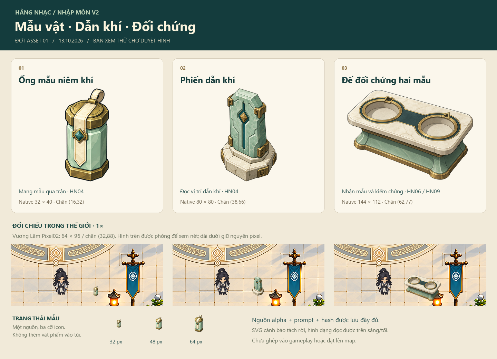

# Hằng Nhạc — asset nhập môn v1

**13/10/2026 · Đợt đầu theo GDD 0.33 · Owner đã chấp nhận hình ba đạo cụ, chưa đặt lên map.**

[Duyệt theo hash](approval.json) lưu phản hồi “tôi thấy ổn rồi”. Phạm vi là ba đạo cụ raster và các PNG native/icon đã hiển thị; năm SVG riêng còn candidate. [Kế hoạch NPC/sinh hoạt](../../../HANG-NHAC-NPC-LIFE-PLAN.md) bổ sung nơi dùng đế và vai trò các NPC; đây là thiết kế, chưa phải placement runtime.

Phục vụ HN04 “Qua trận dẫn khí” và dùng lại cho đối chứng HN06/giữ điểm HN09. Không phải toàn bộ asset cho các cảnh giới sau.

[Mở trang đối chiếu](http://127.0.0.1:5184/hang-nhac-onboarding-assets-v1/) · [Bảng tổng quan](review/overview.png) · [Dấu báo](telegraphs/preview.html) · [Manifest](assets.json)



## Phạm vi

| Asset | Nguồn | Dùng cho |
| --- | --- | --- |
| Ống mẫu niêm khí | Raster mới, một nguồn; xuất world và icon hiển thị trạng thái | HN04/HN06/HN09; là state activity, không thêm item hoặc tiền tệ vào túi |
| Phiến dẫn khí thấp | Raster mới, chưa bake VFX | Đạo cụ đặt cạnh đoạn thử trong sân riêng |
| Đế đối chứng hai mẫu | Raster mới, hai ổ trống | Điểm nhận HN04, đối chứng HN06, điểm giữ HN09; nhỏ hơn bàn chuẩn bị cũ |
| Vòng báo/luồng báo/lối an toàn/trạng thái mẫu | SVG viết bằng code | Đọc nguy hiểm và trạng thái; geometry/timing thật lấy từ gameplay khi tích hợp |
| 11 icon nguyên liệu/ngọc/công cụ và bàn chuẩn bị | Tái dùng [bộ Vân Ngọc](../van-ngoc-gameplay-assets-v1/README.md) | HN08 và EX; không vẽ lại đồ đã có |

## Chuẩn và nguồn

- Style: [Vân Ngọc V2](../../world/hang-nhac-van-ngoc-detail-v2/README.md), celadon/đá ngà/bóng petrol/đồng tiết chế, nét rõ. Đã xem ảnh và mô tả bằng chữ; tool asset không truyền pixel reference.
- Nhân vật đối chiếu: Vương Lâm Pixel02, frame 64×96/chân (32,88), không dùng body cũ làm chuẩn mới.
- [production.json](production.json) giữ brief/kích thước request ban đầu; `deliveredNativeTargets` ghi cỡ xuất cuối. `specs/` lưu plan được lập trước từng request.
- Tạo bằng MCP `game_assets`, router `gpt-image-2`, ba request đơn tuần tự, không tự retry hoặc đổi model.
- Gói nguồn nguyên vẹn/request/prompt/metadata/hash nằm trong `output/imagegen/game-assets/vn-hn-*-v1-*`; [assets.json](assets.json) trỏ tới từng gói và pin hash source/alpha/sáu PNG native.

## Bàn giao native

| Đạo cụ | Canvas / thân thực | Chân đo |
| --- | --- | --- |
| Ống mẫu niêm khí | 32×40 / 13×28; icon riêng 32/48/64 px | (16,32): đáy viền đồng |
| Phiến dẫn khí | 80×80 / 34×56 | (38,66): đỉnh trước của đế |
| Đế đối chứng | 144×112 / 106×76 | (62,77): trung điểm hai tiếp điểm trước (28,64)/(96,90) |

Trang đối chiếu có 1×/2×, nền sáng/tối/checker, Vương Lâm đứng trước/sau/trái/phải và dấu chân đo. Khung ảnh là canvas; crop map chỉ để so tỷ lệ 1×, chưa phải placement. Mẫu và phiến được thu nhỏ so với brief để giữ tỷ lệ với người, luôn giữ tỷ lệ ảnh.

[pivot-measurements.json](pivot-measurements.json) pin phép đo theo hash PNG. Đã xem grid 6×/nearest và đánh dấu ở `review/*-pivot.png`; không lấy tâm ảnh làm chân. Các ổ nhận mẫu/tay cầm cần đo riêng khi ghép hành động, pivot nền không thay cho socket.

## Nguồn và kích thước router

| Nguồn | Request → thực tế | Manifest nguồn |
| --- | --- | --- |
| Mẫu niêm khí | 1024×1024 → 1312×1199 | [Manifest](../../../../output/imagegen/game-assets/vn-hn-quest-sample-v1-2026-10-13T00-31-00-952Z-7432ec778b44771d/manifest.json) |
| Phiến dẫn khí | 1024×1024 → 1312×1199 | [Manifest](../../../../output/imagegen/game-assets/vn-hn-qi-guide-stone-v1-2026-10-13T00-31-40-325Z-c6c25e477d607e12/manifest.json) |
| Đế đối chứng | 1024×1024 → 1536×1024 | [Manifest](../../../../output/imagegen/game-assets/vn-hn-sample-comparator-v1-2026-10-13T00-33-25-451Z-e0db9a621ce203a9/manifest.json) |

Router trả kích thước khác request; giữ nguyên ảnh nhận, không phát sinh request bù. Nguồn phiến/bệ đã có alpha; nguồn mẫu dùng magenta. Prepare giữ canvas nguồn. Các gói `output/` là nguồn cần giữ cùng workspace khi chuyển máy, dù không mặc nhiên được Git theo dõi.

[generation-results.json](generation-results.json) là biên bản lúc sinh ảnh; trường native/pivot cũ trong đó phản ánh thời điểm chưa xuất. `assets.json` và `pivot-measurements.json` là hợp đồng native sau xuất.

## Kiểm và tái xuất

Đã kiểm alpha trên nền sáng/tối, tỷ lệ cùng Pixel02 ở 1×, điểm chân trên grid phóng. Sáu PNG có **0 pixel magenta lộ theo ngưỡng kiểm** và **0 pixel alpha chạm biên canvas**. Xem [dấu báo](telegraphs/README.md) để kiểm SVG trên ba nền, thang xám và badge 24/32/48/64 px. Kiểm kỹ thuật không thay thế duyệt hình.

[Kiểm trang review](review/verification.json): desktop 1440 px/mobile 390 px, ảnh và link tải được, controls nền/tỷ lệ/vị trí hoạt động, không lỗi console/HTTP hoặc tràn trang. [Ảnh desktop](review/browser-desktop.png) / [mobile](review/browser-mobile.png) lưu kết quả; font tiêu đề đã kiểm riêng dấu tiếng Việt.

Tái xuất cục bộ, không gọi API hoặc builder map:
```powershell
python docs/design/gameplay/hang-nhac-onboarding-assets-v1/export.py
python docs/design/gameplay/hang-nhac-onboarding-assets-v1/build-review.py
```

Mỗi cỡ native lấy trực tiếp từ alpha nguồn bằng Lanczos, không resize nối tiếp. Review phóng bằng nearest. Export kiểm hash source/alpha; nếu native đổi hash, ghép pivot sẽ dừng để đo lại. Không chạy request tạo ảnh để tái xuất.

## Phạm vi tiếp nối

- Ghép HN04 cần adapter lấy hình học/timing từ server, kiểm đường đi bộ/Phong và dấu chồng nhau tại camera 1×; SVG hiện tại không đặt radius hay thời gian gameplay.
- Bệ có hai ổ trống để ghép mẫu sau. HN02 ưu tiên HUD/hiệu ứng sẵn có; HN08/EX tái dùng nguyên liệu/công cụ cũ.
- Chưa sản xuất NPC/quái/chân dung/map mới hoặc asset cảnh giới cao trước khi chốt tình huống dùng.

`ownerApproved/artApproved` của ba đạo cụ trong `assets.json` nay là true theo phản hồi owner; `runtimeConsumable` vẫn false. Plan/request, ảnh QA và biên bản kiểm trước đó giữ trạng thái lịch sử lúc sản xuất; `approval.json` là mốc duyệt mới. Chưa có placement/collider, chưa import runtime/Editor, không sửa hub, owner map, DB hoặc draft. Các vòng báo không được dùng bitmap để suy collision hoặc thời gian resolve.
